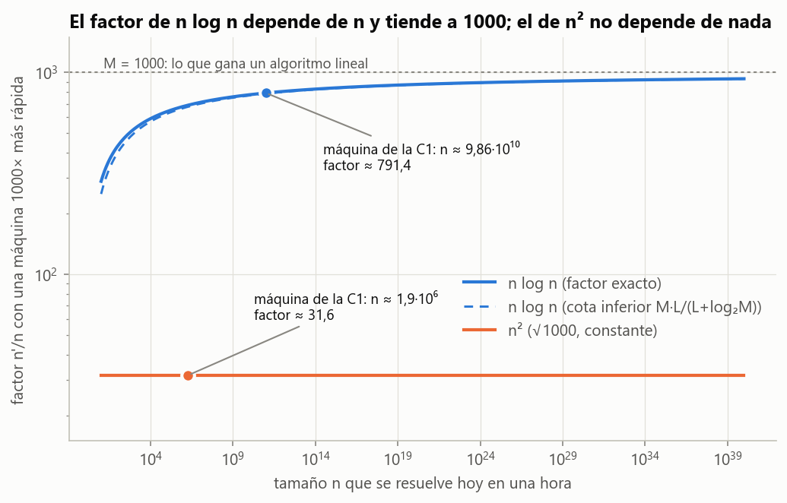
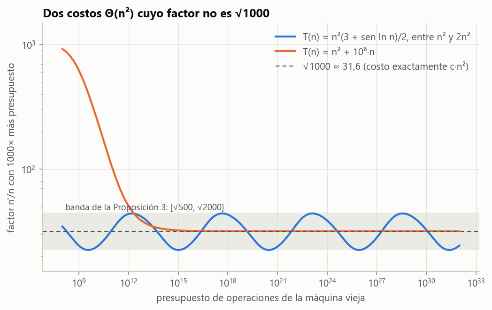
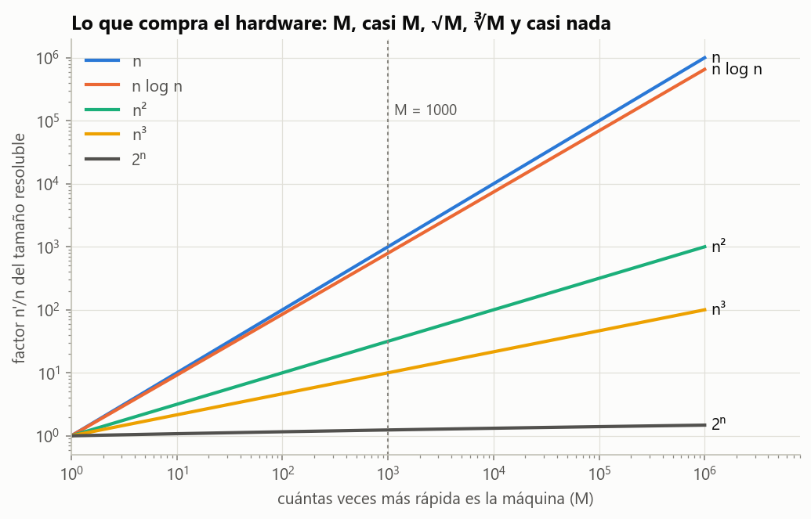

# Ejercicio 1 · Una computadora mil veces más rápida

> ★ Una computadora mil veces más rápida. ¿Cuánto crece el tamaño de entrada que se resuelve en una hora con un algoritmo $\Theta(n^2)$? ¿Y con uno $\Theta(n \log n)$? Estima los dos factores. (C1)

## Respuesta

| costo | factor $n'/n$ | máquina de la C1, §7 ($10^9$ op/s) |
|---|---|---|
| $\Theta(n^2)$ | $\sqrt{1000} \approx 31{,}6$, siempre | $1\ 897\ 366 \ \to\  60\ 000\ 000$ |
| $\Theta(n \log n)$ | entre $1000\cdot\frac{L}{L+\log_2 1000}$ y $1000$, con $L=\log_2 n$; tiende a 1000 pero nunca llega | $98\ 574\ 774\ 544 \ \to\  78\ 008\ 697\ 597\ 778$, factor $\approx 791$ |

Con mil veces más máquina, el algoritmo cuadrático resuelve entradas unas **32 veces** más grandes y el $n \log n$ unas **790 veces** más grandes. Las dos respuestas tienen naturaleza distinta: la primera es una constante que no depende de la máquina, ni de la hora, ni de la constante oculta en $\Theta$; la segunda depende del tamaño que ya se resolvía, y se acerca a 1000 muy despacio (con $n = 10^{100}$ todavía es 971).

Las dos estimaciones suponen que el costo es $c \cdot g(n)$ salvo términos que se vuelven despreciables. La sección 4 demuestra que esa hipótesis hace falta: hay costos $\Theta(n^2)$ cuyo factor oscila para siempre entre 22 y 44.

---

## 1. Planteamiento y modelo

**Modelo.** Word RAM: cada operación sobre palabras cuesta 1, y el costo de un algoritmo es su número de operaciones en el peor caso (C1, §4, §5 y §9). La máquina hace un número fijo $R$ de operaciones por segundo.

**Presupuesto.** En una hora la máquina hace $B = 3600\ R$ operaciones; con $R = 10^9$, como en la C1, §7, $B = 3{,}6\cdot 10^{12}$. Una máquina $M = 1000$ veces más rápida hace $MB$ operaciones en la misma hora. Para el algoritmo da lo mismo que dejar la máquina vieja corriendo 1000 horas (casi 42 días): solo importa el cociente de presupuestos.

**Qué se pregunta.** Si $T(n)$ es el costo del algoritmo, el mayor tamaño que cabe en el presupuesto es

```math
N(B) = \max\lbrace n : T(n) \le B \rbrace,
```

y el factor que pide el ejercicio es

```math
k = \frac{N(MB)}{N(B)} = \frac{n'}{n}.
```

**Simplificación.** En las secciones 2 y 3 tomamos $T(n) = c\cdot g(n)$ exactamente y tratamos $n$ como un número real, de modo que $n$ y $n'$ son las soluciones de $T(n) = B$ y $T(n') = MB$. Redondear a enteros mueve el factor en $O(1/n)$, que con $n \approx 10^6$ ya es invisible; la sección 7 lo mide con la búsqueda exacta de la conferencia. La sección 4 quita la hipótesis de que el costo es exactamente $c\cdot g(n)$.

## 2. Costo $\Theta(n^2)$: el factor es $\sqrt{1000}$ y no depende de nada

Si $T(n) = c\ n^2$, de $c\ n^2 = B$ y $c\ n'^2 = MB$ sale

```math
\frac{n'^2}{n^2} = M \quad\Longrightarrow\quad k = \sqrt{M} = \sqrt{1000} \approx 31{,}62.
```

En la cuenta se cancelaron la constante $c$, la velocidad $R$ y la duración de una hora. El factor es una propiedad de la forma $n^2$ y de nada más. Con la misma cuenta, un costo $c\ n^a$ da $k = M^{1/a}$: 1000 para el lineal, 31,6 para el cuadrático, 10 para el cúbico.

Con la máquina de la conferencia: $n = \sqrt{3{,}6\cdot 10^{12}} \approx 1{,}9\cdot 10^6$ pasa a $n' = \sqrt{3{,}6\cdot 10^{15}} = 6\cdot 10^{7}$.

## 3. Costo $\Theta(n \log n)$: el factor depende de $n$, es menor que 1000 y tiende a 1000

### 3.1 La ecuación del factor

Sea $T(n) = c\ n\log_2 n$ y sea $n \ge 2$ el tamaño que se resuelve hoy. Escribimos $n' = k\ n$ y $L = \log_2 n \ge 1$. La condición $T(n') = M\ T(n)$ es $c\ kn\log_2(kn) = M\ c\ n\log_2 n$, y dividiendo entre $c\ n$:

```math
k\,(L + \log_2 k) = M\,L. \tag{★}
```

Tres observaciones sobre (★):

- **La constante se cancela.** $c$ no aparece, igual que en el caso cuadrático.
- **La base del logaritmo se cancela.** Con $\log_b$ en lugar de $\log_2$, se multiplica la ecuación por $\ln b / \ln 2$ y se llega a la misma (★). Es la misma razón por la que la base no importa dentro de $O$ (C1, §5).
- **Pero aparece $n$.** A diferencia del caso cuadrático, el factor depende de $L = \log_2 n$, o sea de cuánto se resolvía ya. Una máquina más lenta, o media hora en lugar de una, da otro factor.

### 3.2 Cotas para el factor

**Proposición 1.** Para $n \ge 2$ y $M > 1$, la ecuación (★) tiene una única solución $k$, y

```math
M\cdot\frac{L}{L + \log_2 M} \;<\; k \;<\; M.
```

*Demostración.* La función $h(k) = k\ (L + \log_2 k)$ es estrictamente creciente en $k \ge 1$, porque es el producto de dos funciones positivas y crecientes. Además $h(1) = L < ML$ y $h(M) = M(L + \log_2 M) > ML$. Por continuidad y monotonía hay exactamente una solución, y está en $(1, M)$. Eso da la cota superior.

Para la inferior, se despeja (★) como $k = \dfrac{ML}{L + \log_2 k}$. Como $k < M$, $\log_2 k < \log_2 M$, y el denominador crece al cambiar $k$ por $M$:

```math
k = \frac{ML}{L + \log_2 k} > \frac{ML}{L + \log_2 M}. \qquad\blacksquare
```

**Consecuencia.** El déficit relativo cumple $1 - \dfrac{k}{M} < \dfrac{\log_2 M}{L + \log_2 M}$, que tiende a 0 cuando $n \to \infty$. El factor tiende a $M$, pero el déficit $M - k$ se comporta como $M\log_2 M / \log_2 n$: baja con el logaritmo de $n$. Hace falta $n = 10^{100}$ para que el factor llegue a 971.

### 3.3 Cálculo para la máquina de la conferencia: una iteración que se encierra sola

Para $B = 3{,}6\cdot10^{12}$, la búsqueda exacta de la C1 da $n = 98\ 574\ 774\ 544$, así que $L = 36{,}5205$. Para resolver (★) iteramos

```math
k_0 = M, \qquad k_{t+1} = g(k_t), \qquad g(k) = \frac{ML}{L + \log_2 k}.
```

**Lema 2.** Los iterados alternan alrededor del factor $k^\ast$: los de índice impar son cotas inferiores y los de índice par, superiores. Además $|k_{t+1} - k^\ast| \le q\ |k_t - k^\ast|$ con

```math
q = \frac{L + \log_2 M}{(L + \log_2 \ell)^2 \ln 2}, \qquad \ell = \frac{ML}{L+\log_2 M}.
```

*Demostración.* $g$ es decreciente y $g(k^\ast) = k^\ast$. Si $x > k^\ast$ entonces $g(x) < g(k^\ast) = k^\ast$, y si $x < k^\ast$ entonces $g(x) > k^\ast$: cada paso cambia de lado. Como $k_0 = M > k^\ast$, los impares quedan debajo y los pares encima. Todos los iterados y $k^\ast$ están en $[\ell, M]$, porque $k_1 = g(M) = \ell$ y $g$ manda $[\ell, M]$ dentro de $[g(M), g(\ell)] \subseteq [\ell, M]$ (la última inclusión es $g(\ell) \le M$, que vale porque $\ell \ge 1$, o sea $L(M-1) \ge \log_2 M$, cierto para $L \ge 1$ y $M = 1000$). Por el teorema del valor medio, $|g(x) - k^\ast| = |g'(\xi)|\ |x - k^\ast|$ con $\xi \in [\ell, M]$, y

```math
|g'(\xi)| = \frac{ML}{\xi\,(L + \log_2 \xi)^2 \ln 2} \le \frac{ML}{\ell\,(L + \log_2 \ell)^2 \ln 2} = q,
```

usando que $ML/\ell = L + \log_2 M$. $\blacksquare$

Para la máquina de la conferencia, $q \approx 0{,}0315$: cada iteración gana un dígito y medio, y cada par de iterados encierra al factor.

| $t$ | $k_t$ | lado | $k_t - k^\ast$ |
|---|---|---|---|
| 0 | 1000 | encima | $+2{,}1\cdot10^{2}$ |
| 1 | 785,6188 | debajo | $-5{,}8$ |
| 2 | 791,5461 | encima | $+1{,}8\cdot10^{-1}$ |
| 3 | 791,3601 | debajo | $-5{,}6\cdot10^{-3}$ |
| 4 | 791,36590 | encima | $+1{,}8\cdot10^{-4}$ |
| 5 | 791,365716 | debajo | $-5{,}5\cdot10^{-6}$ |

El factor es $k^\ast = 791{,}3657\ldots$ La búsqueda exacta de la conferencia da $78\ 008\ 697\ 597\ 778 / 98\ 574\ 774\ 544 = 791{,}3657$, el mismo número.

**A mano, sin computadora.** $\log_2(3{,}6\cdot10^{12}) \approx 41{,}7$, y como $n = B/\log_2 n$, dos pasos de $L \leftarrow \log_2(B/L)$ dan $L \approx 41{,}7 \to 36{,}3 \to 36{,}5$. Con $\log_2 1000 \approx 10$, el primer paso da $k \approx 1000\cdot 36{,}5/46{,}5 \approx 785$, y el segundo, con $\log_2 785 \approx 9{,}6$, da $k \approx 1000\cdot 36{,}5/46{,}1 \approx 792$. Dos líneas de aritmética dan tres cifras correctas, y el Lema 2 garantiza que el valor está entre las dos.

### 3.4 Forma cerrada con la W de Lambert

La ecuación $n\ln n = x$ se escribe $\ln n\cdot e^{\ln n} = x$, así que $\ln n = W(x)$ y $n = x/W(x)$, donde $W$ es la función de Lambert (la inversa de $w \mapsto w e^w$). Con $T(n) = c\ n\log_2 n = B$ el tamaño es $n = X/W(X)$ con $X = B\ln 2/c$, y el de la máquina nueva es $MX/W(MX)$. Dividiendo:

```math
k = M\cdot\frac{W(X)}{W(MX)}.
```

Como $W(y) = \ln y - \ln\ln y + o(1)$, el cociente $W(X)/W(MX)$ tiende a 1 y se confirma que $k \to M$. Numéricamente da $791{,}36572169$, igual que la iteración y que la búsqueda.

### 3.5 Cómo cambia el factor con el tamaño de partida

| $n$ de hoy | $L$ | cota inferior | factor $k$ | $1000 - k$ |
|---|---|---|---|---|
| $10^{3}$ | 9,97 | 500,00 | 524,50 | 475,50 |
| $10^{6}$ | 19,93 | 666,67 | 679,34 | 320,66 |
| $10^{9}$ | 29,90 | 750,00 | 757,61 | 242,39 |
| $10^{12}$ | 39,86 | 800,00 | 805,05 | 194,95 |
| $10^{18}$ | 59,79 | 857,14 | 859,83 | 140,17 |
| $10^{30}$ | 99,66 | 909,09 | 910,22 | 89,78 |
| $10^{100}$ | 332,19 | 970,87 | 970,99 | 29,01 |

La cota inferior de la Proposición 1 se equivoca en menos del 5 % en toda la tabla, en un 1 % con $n = 10^{9}$ y en menos a partir de ahí. Es la estimación de una línea que conviene recordar. Con $n = 10^3$ la cota da exactamente 500, porque entonces $L = \log_2 M$.



**Figura 1.** El factor de $n\log n$ (azul) sube hacia 1000 a medida que crece el tamaño que ya se resolvía; la cota inferior (azul discontinuo) casi se confunde con él. El de $n^2$ (naranja) es la constante $\sqrt{1000}$. Los puntos marcan la máquina de la conferencia.

## 4. Qué garantiza $\Theta$ y qué no: por qué el enunciado dice "estima"

$\Theta(n^2)$ esconde una constante y términos de orden menor. Lo único que garantiza es $c_1 n^2 \le T(n) \le c_2 n^2$ a partir de algún $n_0$. ¿Alcanza eso para que el factor sea 31,6?

**Proposición 3.** Sea $T$ no decreciente con $c_1 n^2 \le T(n) \le c_2 n^2$ para todo $n \ge n_0$. Si $n = N(B) \ge n_0$ y $n' = N(MB)$, entonces

```math
\sqrt{M\,\frac{c_1}{c_2}} - \frac{1}{n} \;<\; \frac{n'}{n} \;<\; \sqrt{M\,\frac{c_2}{c_1}}\left(1 + \frac{1}{n}\right).
```

*Demostración.* Por la definición de $N$, $T(n) \le B < T(n+1)$ y $T(n') \le MB < T(n'+1)$, y $n' \ge n \ge n_0$. Para la cota superior:

```math
c_1 n'^2 \le T(n') \le MB < M\,T(n+1) \le M c_2 (n+1)^2.
```

Para la inferior:

```math
c_2 (n'+1)^2 \ge T(n'+1) > MB \ge M\,T(n) \ge M c_1 n^2.
```

Se sacan raíces y se divide entre $n$. $\blacksquare$

**Corolario.** Si $T(n)/n^2 \to c > 0$, entonces $n'/n \to \sqrt{M}$ cuando $B \to \infty$.

*Demostración.* Dado $\varepsilon \in (0,1)$, a partir de algún $n_0$ vale $c(1-\varepsilon)n^2 \le T(n) \le c(1+\varepsilon)n^2$. La Proposición 3 con $c_1 = c(1-\varepsilon)$ y $c_2 = c(1+\varepsilon)$ deja el factor, para $B$ grande, entre $\sqrt{M(1-\varepsilon)/(1+\varepsilon)}$ y $\sqrt{M(1+\varepsilon)/(1-\varepsilon)}$, salvo $O(1/n)$. Como $\varepsilon$ es arbitrario, el límite es $\sqrt M$. $\blacksquare$

Esa es la hipótesis que hay detrás de "31,6": que el costo sea **asintóticamente** $c\ n^2$, no solo $\Theta(n^2)$. Los dos ejemplos siguientes muestran que sin ella la respuesta cambia (tabla 5 de `codigo/ejercicio_01.py`).

**Ejemplo A: términos de orden menor.** $T(n) = n^2 + 10^6 n$ es $\Theta(n^2)$ y $T(n)/n^2 \to 1$, así que el corolario se aplica: el factor tiende a $\sqrt{1000}$. Pero mientras $n < 10^6$ manda el término lineal, y el algoritmo se porta como uno lineal:

| presupuesto | $10^{8}$ | $10^{10}$ | $10^{12}$ | $10^{14}$ | $10^{16}$ | $10^{20}$ | $10^{30}$ |
|---|---|---|---|---|---|---|---|
| factor | 925,32 | 272,86 | 50,36 | 33,19 | 31,78 | 31,624 | 31,6228 |

La notación asintótica describe el régimen en que el término dominante domina, y no dice nada de dónde empieza ese régimen.

**Ejemplo B: un costo $\Theta(n^2)$ sin límite.** Sea

```math
T(n) = \frac{n^2\,(3 + \mathrm{sen}\,\ln n)}{2}.
```

Cumple $n^2 \le T(n) \le 2n^2$, así que es $\Theta(n^2)$ con $c_1 = 1$ y $c_2 = 2$. Es creciente, porque

```math
T'(n) = n\left(3 + \mathrm{sen}\,\ln n + \tfrac12\cos\ln n\right) \ge n\left(3 - \sqrt{1 + \tfrac14}\right) > 0.
```

Pero $T(n)/n^2$ oscila sin límite, y entre $n$ y $31n$ el logaritmo avanza $\ln 31 \approx 3{,}4$, algo más de media vuelta del seno, así que $T(n)/n^2$ y $T(n')/n'^2$ pueden estar en extremos opuestos. El resultado es que el factor oscila para siempre: con presupuestos entre $10^{8}$ y $10^{30}$ toma valores desde **22,364** hasta **43,964**. La Proposición 3 lo encierra en $[\sqrt{500}, \sqrt{2000}] = [22{,}361;\ 44{,}721]$, y el ejemplo recorre casi toda esa banda, así que **con solo la información de $\Theta$ las cotas de la Proposición 3 son esencialmente las mejores posibles**.



**Figura 2.** El costo con término lineal (naranja) empieza con factor cercano a 1000 y converge a $\sqrt{1000}$. El costo oscilante (azul) nunca converge y recorre la banda de la Proposición 3 (gris).

La lectura para el ejercicio: "estima" es la palabra correcta. El factor $\sqrt{1000}$ es exacto para un costo $c\ n^2$ y es el límite para cualquier costo asintótico a $c\ n^2$, que es lo que tienen los algoritmos que vemos en el curso. Con solo $\Theta(n^2)$ lo único garantizado es la banda.

## 5. Con algoritmos de verdad: inserción y mezcla

Para comprobar que nada de esto depende de costos idealizados, usamos dos algoritmos con su costo **exacto** de peor caso, contando comparaciones:

- **Inserción**, $\Theta(n^2)$: $T(n) = n(n-1)/2$, con el arreglo invertido.
- **Mezcla** (merge sort de arriba hacia abajo), $\Theta(n\log n)$: $T(n) = n\lceil\log_2 n\rceil - 2^{\lceil\log_2 n\rceil} + 1$.

Las dos fórmulas no se suponen, se comprueban: el código implementa los dos algoritmos con un contador de comparaciones, recorre las $n!$ permutaciones para $n \le 8$ y verifica que el máximo coincide con la fórmula. La de mezcla se verifica además contra la recurrencia $W(n) = W(\lceil n/2\rceil) + W(\lfloor n/2\rfloor) + n - 1$ hasta $n = 5000$.

| algoritmo | $n$ hoy | $n$ con 1000× | factor |
|---|---|---|---|
| inserción | 2 683 282 | 84 852 814 | 31,6228 |
| mezcla | 101 011 863 607 | 79 590 159 326 709 | 787,9288 |

Inserción da $\sqrt{1000}$ con cuatro decimales. Mezcla da un poco menos que el $n\log_2 n$ ideal (791,37), y la diferencia se explica. Si se escribe $\lceil\log_2 n\rceil = \log_2 n + \theta$ con $\theta \in [0,1)$, el costo es $n(\log_2 n - \alpha) + 1$ con $\alpha = 2^\theta - \theta \in [0{,}914;\ 1]$. Es como si $L$ fuera un poco más chico, y por la Proposición 1 un $L$ más chico da un factor más chico. Con los valores de $\alpha$ en $n$ y en $n'$ (0,916 y 0,946), la ecuación (★) corregida da 787,94.

## 6. Interpretación

**La escalera.** Con $M = 1000$: el lineal gana ×1000, el $n\log n$ ×791, el cuadrático ×31,6, el cúbico ×10 y el exponencial pasa de 41 a 51, apenas ×1,24 (C1, §7). La Figura 3 muestra la escalera para todo $M$: en escala logarítmica las potencias son rectas de pendiente $1/a$, el $n\log n$ es casi la recta del lineal y el exponencial queda prácticamente plano.



**Figura 3.** Factor del tamaño resoluble según cuántas veces más rápida es la máquina, para el presupuesto de una hora de la conferencia.

**La otra cara: los datos crecen.** Si los datos crecen 1000 veces junto con la máquina, el algoritmo $n\log n$ hace $T(1000n)/T(n) = 1000\cdot\frac{L + \log_2 1000}{L} \approx 1273$ veces más operaciones, que en la máquina 1000 veces más rápida son $1{,}27$ horas, unos 76 minutos. El cuadrático pasa de una hora a **1000 horas**, casi 42 días. Es el argumento de la C1, §7, con números: el $n\log n$ casi sigue el paso del hardware y el cuadrático se queda atrás.

**Dos comprobaciones de modelo.**

- *Memoria.* El análisis de tiempo dice que la máquina nueva ordena casi $8\cdot 10^{13}$ elementos con mezcla en una hora, pero esos elementos, a 8 bytes cada uno, ocupan más de 600 TB. Como dice la C1, §6, la memoria suele acabarse antes que el tiempo. El factor de tiempo es una cota superior de lo que la máquina nueva puede hacer, no una promesa.
- *Palabra.* El word RAM pide $w \ge \log_2 n$ para que una palabra guarde un índice (C1, §9). Con $n' \approx 7{,}8\cdot10^{13}$, $\log_2 n' \approx 46$ bits, que caben en una palabra de 64. El modelo sigue valiendo en la máquina nueva.

## 7. Verificación: código y pruebas

- [`codigo/ejercicio_01.py`](codigo/ejercicio_01.py) calcula todas las tablas de este informe y genera las figuras. Usa la búsqueda exacta de la C1, §7 (`mayor_n`) como referencia independiente de las fórmulas.
- [`codigo/test_ejercicio_01.py`](codigo/test_ejercicio_01.py) tiene 14 pruebas. Cada afirmación del informe tiene la suya:

| prueba | qué comprueba |
|---|---|
| `test_mayor_n_cumple_su_definicion` | $T(n) \le B < T(n+1)$ en 1500 presupuestos al azar |
| `test_reproduce_la_tabla_de_la_conferencia_1` | los diez valores de la tabla de la C1, §7 |
| `test_cuadratico_no_depende_de_la_constante_ni_del_presupuesto` | sección 2, con cuatro constantes y cuatro presupuestos |
| `test_potencias` | $k = M^{1/a}$ |
| `test_nlogn_entre_las_cotas_de_la_proposicion_1` | Proposición 1, desde $n = 2$ hasta $n = 10^{100}$ |
| `test_iterados_alternan_y_convergen` | Lema 2: alternancia y contracción por $q$ |
| `test_nlogn_busqueda_formula_y_lambert_coinciden` | búsqueda, punto fijo y $W$ de Lambert dan el mismo número |
| `test_la_base_del_logaritmo_y_la_constante_no_importan_dado_n` | sección 3.1, con bases $2, e, 10$ y tres constantes |
| `test_los_algoritmos_ordenan` | inserción y mezcla ordenan 300 arreglos al azar |
| `test_formulas_de_peor_caso_por_fuerza_bruta` | peor caso sobre todas las permutaciones, $n \le 8$ |
| `test_formula_de_mezcla_cumple_la_recurrencia` | la fórmula de mezcla hasta $n = 5000$ |
| `test_algoritmos_reales` | tabla de la sección 5 |
| `test_costo_patologico_es_theta_n2_y_creciente` | hipótesis del Ejemplo B, hasta $n = 2\cdot10^5$ |
| `test_theta_no_basta` | el Ejemplo B recorre la banda sin salirse; el Ejemplo A empieza "lineal" |

Una de las pruebas sirvió de algo antes de que el informe estuviera terminado. La primera versión del Lema 2 decía que cada iteración reduce la distancia a menos del 4 %. La prueba falló con $n = 10^6$, donde la reducción es del 5 %: el 4 % solo valía para la máquina de la conferencia. De ahí salió la cota $q$ con su dependencia de $n$, que es la que se demuestra arriba.

Para reproducir todo (Python 3, con `matplotlib` para las figuras y `scipy` para la $W$ de Lambert):

```bash
cd codigo
python ejercicio_01.py --figuras
python -m pytest test_ejercicio_01.py
```

## 8. Resumen

- Mil veces más máquina compra $\sqrt{1000} \approx 31{,}6$ veces más tamaño a un algoritmo cuadrático, sin importar la constante, la máquina ni el tiempo disponible.
- A un algoritmo $n\log n$ le compra un factor $k$ que resuelve $k(L + \log_2 k) = 1000\ L$, con $L = \log_2 n$. Está entre $1000\ L/(L+\log_2 1000)$ y 1000, y vale $\approx 791$ para la máquina de la conferencia.
- La constante y la base del logaritmo nunca importan. El tamaño de partida importa solo para $n\log n$.
- $\Theta$ sola no fija el factor: hace falta que el costo sea asintóticamente $c\cdot g(n)$. Sin eso, un costo $\Theta(n^2)$ puede tener cualquier factor dentro de una banda, y la banda de la Proposición 3 es ajustada.
