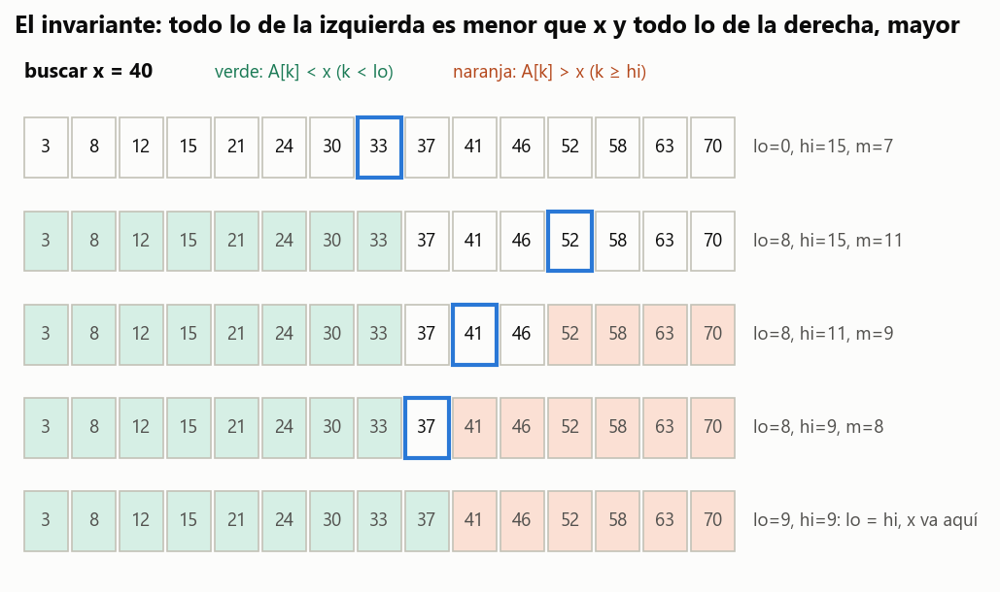
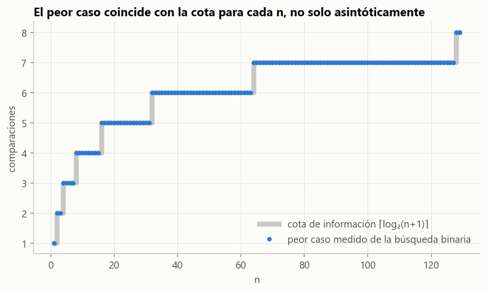
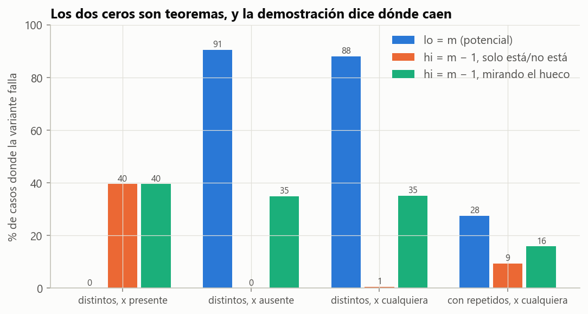

# Ejercicio 2 · Invariante, potencial y cota de la búsqueda binaria

> ★ Da el invariante y el potencial de la búsqueda binaria, y la cota de información que la hace óptima. (C3, C5)

## Respuesta

- **Invariante:** $0 \le lo \le hi \le n$, todo $A[k]$ con $k < lo$ es menor que $x$, y todo $A[k]$ con $k \ge hi$ es mayor que $x$. Es la versión reforzada de "si $x$ está, está en $A[lo..hi)$" (C3, §1). Además de decir si $x$ está, da el hueco donde va.
- **Potencial:** $\Phi = hi - lo$, un entero no negativo que baja en cada vuelta, así que el ciclo termina. Como baja al menos a la mitad, $\Psi$, la cantidad de bits de $hi - lo$, baja al menos 1 por vuelta. Eso da a lo sumo $\lceil\log_2(n+1)\rceil$ comparaciones.
- **Cota de información:** los $n+1$ huecos de un arreglo de $n$ elementos necesitan $n+1$ hojas distintas en un árbol binario (C5, §3), así que todo algoritmo de comparaciones necesita $\lceil\log_2(n+1)\rceil$ en el peor caso.
- **Óptima exactamente:** el peor caso de la búsqueda binaria es $\lceil\log_2(n+1)\rceil$ para **cada** $n$, no solo asintóticamente. Lo comprobamos para $n = 1, \dots, 1024$.

---

## 1. Especificación y algoritmo

**Precondición.** $A[0..n)$ está ordenado de forma no decreciente. Puede tener repetidos.

**Postcondición.** Se devuelve una de dos cosas:

- ("está", $m$) con $A[m] = x$;
- ("hueco", $lo$) con $x \notin A$ y $A[lo-1] < x < A[lo]$. Si $lo = 0$ o $lo = n$, se omite la desigualdad con el elemento que no existe.

Modelo: comparaciones de tres salidas ($<$, $=$, $>$) entre $x$ y un elemento, como en la C5, §3.

```python
def busqueda_binaria(A, x):
    lo, hi = 0, len(A)
    while lo < hi:
        m = (lo + hi) // 2
        if x == A[m]:
            return ("está", m)
        if x < A[m]:
            hi = m
        else:
            lo = m + 1
    return ("hueco", lo)
```

## 2. El invariante

**(I)** Al empezar cada vuelta: $0 \le lo \le hi \le n$, $\ A[k] < x$ para todo $k < lo$, y $\ A[k] > x$ para todo $k \ge hi$.

La Figura 1 lo muestra en acción: la zona verde ($k < lo$) solo tiene valores menores que $x$, la naranja ($k \ge hi$) solo mayores, y la blanca es lo que falta mirar.



**Figura 1.** Búsqueda de $x = 40$, que no está, en un arreglo de 15 elementos. Cada fila es una vuelta y el recuadro azul es $m$. Al terminar, $lo = hi = 9$: $x$ va entre el 37 y el 41.

**Teorema 1 (correctitud parcial).** Si la búsqueda termina, cumple la postcondición.

*Demostración.*

- **Inicialización.** Con $lo = 0$ y $hi = n$, las dos condiciones sobre $A$ hablan de conjuntos vacíos de índices, así que valen.
- **Mantenimiento.** Supongamos (I) y $lo < hi$. Entonces $m = \lfloor(lo+hi)/2\rfloor$ cumple $lo \le m < hi$. Hay tres casos:
  - **$x = A[m]$.** Se devuelve ("está", $m$), que es correcto.
  - **$x < A[m]$.** Como $A$ está ordenado, $A[k] \ge A[m] > x$ para todo $k \ge m$, así que $hi \leftarrow m$ mantiene la mitad derecha. La izquierda no cambia, y $lo \le m$.
  - **$x > A[m]$.** Por la misma razón, $A[k] \le A[m] < x$ para todo $k \le m$, así que $lo \leftarrow m+1$ mantiene la mitad izquierda, y $m + 1 \le hi$.
- **Conclusión.** Si el ciclo termina sin encontrar a $x$, es porque $lo = hi$. Por (I), todo elemento es menor que $x$ (si $k < lo$) o mayor (si $k \ge lo$), así que $x \notin A$, y $A[lo-1] < x < A[lo]$. $\blacksquare$

**Por qué la versión reforzada.** El invariante de la C3, "si $x$ está, está en $A[lo..hi)$", alcanza para decir si $x$ está, y también es inductivo. Pero no dice dónde iría $x$, y la cota de la sección 4 habla precisamente de huecos. El reforzado da las dos cosas.

Con repetidos todo funciona igual, porque la demostración solo usó $A[k] \le A[m]$ para $k \le m$. Se devuelve alguna aparición de $x$, no necesariamente la primera.

## 3. El potencial

**Teorema 2 (terminación y costo).** Con $\Phi = hi - lo$:

1. $\Phi$ es un entero $\ge 0$ y baja en cada vuelta, así que la búsqueda termina.
2. Más fuerte: cada vuelta lo deja en a lo sumo $\lfloor\Phi/2\rfloor$. Así, $\Psi = \mathrm{bits}(\Phi) = \lfloor\log_2\Phi\rfloor + 1$ (con $\mathrm{bits}(0) = 0$) baja al menos 1 por vuelta.
3. Por lo tanto la búsqueda hace a lo sumo $\mathrm{bits}(n) = \lceil\log_2(n+1)\rceil$ comparaciones.

*Demostración.* Sea $\Phi = hi - lo \ge 1$ al empezar una vuelta. Como $m = lo + \lfloor\Phi/2\rfloor$:

- si va a la izquierda, queda $m - lo = \lfloor\Phi/2\rfloor$;
- si va a la derecha, queda $hi - m - 1 = \Phi - \lfloor\Phi/2\rfloor - 1 = \lceil\Phi/2\rceil - 1 \le \lfloor\Phi/2\rfloor$.

En los dos casos $\Phi' \le \lfloor\Phi/2\rfloor < \Phi$. Dividir por 2 entero es quitar el último bit, así que $\mathrm{bits}(\lfloor\Phi/2\rfloor) = \mathrm{bits}(\Phi) - 1$, y $\Psi$ baja al menos 1. $\Psi$ empieza en $\mathrm{bits}(n)$ y el ciclo sigue solo mientras $\Psi \ge 1$, así que hay a lo sumo $\mathrm{bits}(n)$ vueltas, con una comparación cada una. Finalmente, $n$ tiene $b$ bits si y solo si $2^{b-1} \le n < 2^b$, o sea $2^{b-1} < n+1 \le 2^b$, que es $b = \lceil\log_2(n+1)\rceil$. $\blacksquare$

Los dos potenciales hacen trabajos distintos. $\Phi$ es el que pide el enunciado y demuestra la terminación. $\Psi$ es el que cuenta. Una traza real, la de la Figura 1:

| vuelta | $lo$ | $hi$ | $\Phi$ | $\Psi$ | $A[m]$ | comparación |
|---|---|---|---|---|---|---|
| 0 | 0 | 15 | 15 | 4 | 33 | $x > A[m]$ |
| 1 | 8 | 15 | 7 | 3 | 52 | $x < A[m]$ |
| 2 | 8 | 11 | 3 | 2 | 41 | $x < A[m]$ |
| 3 | 8 | 9 | 1 | 1 | 37 | $x > A[m]$ |
| fin | 9 | 9 | 0 | 0 | | hueco 9 |

**Memoria:** $O(1)$, porque solo se guardan $lo$, $hi$ y $m$.

## 4. La cota de información

**Teorema 3 (C5, §3).** Todo algoritmo que busca $x$ en un arreglo ordenado de $n$ elementos comparando $x$ con elementos hace, en el peor caso, al menos $\lceil\log_2(n+1)\rceil$ comparaciones.

*Demostración.* El algoritmo es un árbol de decisión ternario. Contar todas las salidas no alcanza: hay $n$ posiciones y $n+1$ huecos, y $2n+1$ salidas en un árbol de tres ramas solo dan $\log_3(2n+1)$, que es menos. El truco de la C5 es mirar únicamente las entradas donde $x$ **no está**. Ahí ninguna comparación puede dar la respuesta $=$, así que esas ejecuciones viven en un subárbol **binario**.

Además, dos valores $x_1 < x_2$ en huecos distintos tienen que llegar a hojas distintas. Entre los dos huecos hay algún $A[i]$ con $x_1 < A[i] < x_2$. Si el algoritmo nunca comparó con él, el valor $x = A[i]$ recibe las mismas respuestas que $x_1$ y $x_2$ en cada comparación y llega a la misma hoja, que dice "no está". Pero $A[i]$ sí está (C5, Lema 4).

Son $n+1$ hojas en un árbol binario, así que la altura es al menos $\lceil\log_2(n+1)\rceil$ (C5, Lema 1). $\blacksquare$

**Corolario (optimalidad exacta).** El peor caso de la búsqueda binaria es exactamente $\lceil\log_2(n+1)\rceil$ para todo $n \ge 1$.

*Demostración.* El Teorema 2 da $\le$ y el Teorema 3 da $\ge$. $\blacksquare$

El código lo confirma de dos maneras:

- Corre la búsqueda con todos los $x$ posibles (cada elemento y un valor en cada hueco) para $n = 1, \dots, 1024$. El peor caso medido coincide con la cota **en los 1024 casos**. La Figura 2 muestra los primeros 129.
- Para cada $n$ hasta 200 registra el camino de un valor en cada hueco. Los $n+1$ caminos son distintos y ninguno tiene una respuesta $=$, que es lo que dice el lema.



**Figura 2.** El peor caso medido (puntos) y la cota $\lceil\log_2(n+1)\rceil$ (escalera gris) coinciden en cada $n$. Los saltos están en $n = 2^k$.

## 5. Lo que el invariante y el potencial dicen que hay que probar

Siguiendo la C3, §5, plantamos dos errores de una sola línea. Cada uno rompe una pieza distinta de la demostración, y esa pieza dice con qué entradas aparece.

**Error 1: `lo = m` en lugar de `lo = m + 1`** (el ejercicio 7 de la C3). El invariante sigue valiendo, porque $A[k] < x$ para $k < m$ también es cierto. Lo que se rompe es el potencial: con $\Phi = 1$ es $m = lo$, y si $x > A[lo]$ el intervalo no cambia. El ejemplo mínimo es $A = [1]$, $x = 2$. Si $x$ **está**, en cambio, siempre termina:

- por el invariante, la posición $p$ de $x$ está siempre en $[lo, hi)$;
- con $\Phi \ge 2$ es $m > lo$, así que $\Phi$ baja;
- con $\Phi = 1$ el intervalo es $[p, p+1)$, y ahí lo encuentra.

Así que las pruebas con $x$ presente **no pueden** atraparlo.

**Error 2: `hi = m - 1` en lugar de `hi = m`.** La terminación sigue valiendo, porque $\Phi$ baja todavía más rápido. Lo que se rompe es la mitad derecha del invariante: afirma $A[m-1] > x$ sin haberlo mirado. Si $x$ está justamente en $m-1$, se pierde. El ejemplo mínimo es $A = [1, 2]$, $x = 1$. Si $x$ **no está**, la respuesta "no está" sigue siendo correcta, porque solo se dice "está" después de ver $A[m] = x$. Lo único que puede salir mal es el hueco.

Medido con 4000 casos por generador:

| generador | `lo = m` | `hi = m - 1`, solo está / no está | `hi = m - 1`, mirando el hueco |
|---|---|---|---|
| distintos, $x$ presente | **0,0 %** | 39,6 % | 39,6 % |
| distintos, $x$ ausente | 90,7 % | **0,0 %** | 35,0 % |
| distintos, $x$ cualquiera | 88,2 % | 0,6 % | 35,1 % |
| con repetidos, $x$ cualquiera | 27,5 % | 9,4 % | 15,9 % |



**Figura 3.** Los dos ceros son teoremas: `lo = m` no puede fallar con $x$ presente, y `hi = m - 1` no puede equivocarse en "está / no está" con $x$ ausente. Si además se mira el hueco, el segundo error aparece también con $x$ ausente (barra verde, 35 %).

Los dos ceros no son mala suerte. Son teoremas, y las pruebas `test_lo_igual_m_termina_si_x_esta` y `test_hi_igual_m_menos_1_no_se_equivoca_en_esta_si_x_falta` los comprueban. El generador más natural, el de $x$ cualquiera, casi siempre produce un $x$ ausente. Atrapa el error 1, pero ve el error 2 en apenas el 0,6 % de los casos. La lista de casos que hay que probar sale de las piezas de la demostración:

- $x$ presente, para el invariante;
- $x$ ausente, para el potencial;
- el hueco, para la postcondición completa.

## 6. Verificación: código y pruebas

- [`codigo/ejercicio_02.py`](codigo/ejercicio_02.py) implementa la búsqueda con registro del camino, invariante vigilado y las dos variantes con error. Calcula las tablas y genera las figuras.
- [`codigo/test_ejercicio_02.py`](codigo/test_ejercicio_02.py) tiene 9 pruebas:

| prueba | qué comprueba |
|---|---|
| `test_postcondicion` | 5000 casos, con y sin repetidos |
| `test_invariante_vigilado` | (I) al empezar cada vuelta, en 2000 búsquedas |
| `test_potencial_baja_y_se_parte_a_la_mitad` | $\Phi' \le \lfloor\Phi/2\rfloor$, $\Psi$ baja al menos 1, y vueltas $\le \mathrm{bits}(n)$ |
| `test_peor_caso_igual_a_la_cota` | el corolario, para $n < 600$ |
| `test_huecos_a_hojas_distintas` | el lema de la C5 sobre el árbol real, $n < 200$ |
| `test_lo_igual_m_no_termina` | el ejemplo mínimo del error 1 |
| `test_lo_igual_m_termina_si_x_esta` | por qué $x$ presente no lo atrapa |
| `test_hi_igual_m_menos_1_pierde_a_x` | el ejemplo mínimo del error 2 |
| `test_hi_igual_m_menos_1_no_se_equivoca_en_esta_si_x_falta` | por qué $x$ ausente no lo atrapa |

```bash
cd codigo
python ejercicio_02.py --figuras
python -m pytest test_ejercicio_02.py
```

## 7. Resumen

- **Invariante:** $A[0..lo) < x < A[hi..n)$, que se demuestra en tres pasos usando que $A$ está ordenado. Da la respuesta y también el hueco.
- **Potencial:** $\Phi = hi - lo$ para terminar. Su cantidad de bits, $\Psi$, cuenta: a lo sumo $\lceil\log_2(n+1)\rceil$ comparaciones.
- **Cota:** $n+1$ huecos y un subárbol binario dan $\lceil\log_2(n+1)\rceil$. Coincide con el algoritmo para cada $n$.
- **Errores:** un error en el potencial solo aparece con $x$ ausente. Uno en el invariante, en la respuesta "está / no está", solo aparece con $x$ presente; con $x$ ausente se ve únicamente si se mira el hueco. La demostración dice qué generar.
