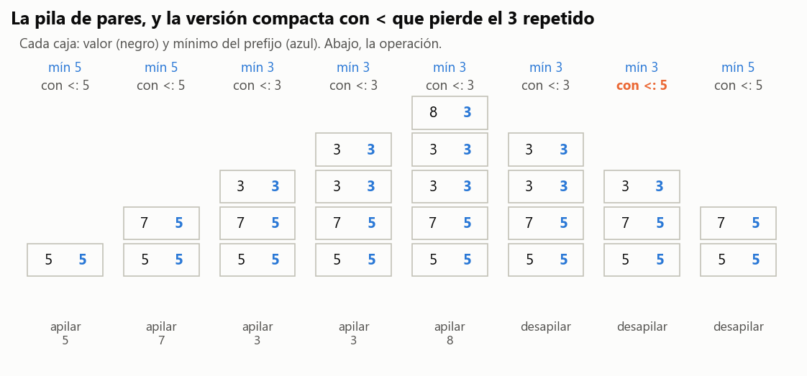
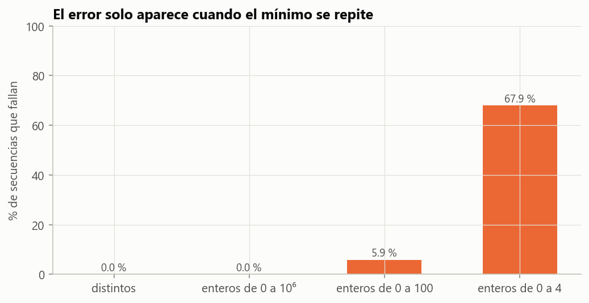

# Ejercicio 3 · Una pila con mínimo en $O(1)$

> ★ Una pila con una operación `minimo` que cuesta $O(1)$ en el peor caso. Diseña la estructura, enuncia el invariante que la hace correcta y da el costo de cada operación. (C3)

## Respuesta

- **Estructura.** Cada entrada de la pila guarda un par $(x, m)$, donde $m$ es el mínimo de los elementos desde el fondo hasta $x$ inclusive. `minimo` devuelve el $m$ del tope.
- **Invariante.** Para toda posición $k$ de la pila, $m_k = \min(x_1, \dots, x_k)$.
- **Costo.** `apilar`, `desapilar`, `tope` y `minimo` cuestan $O(1)$ en el peor caso, no amortizado. `apilar` hace a lo sumo una comparación y las demás ninguna. La memoria es $2n$ palabras.
- **Versión compacta.** Una segunda pila guarda solo los récords del mínimo. Gasta $n + H_n$ palabras en promedio sobre entradas al azar, pero tiene una trampa: hay que usar $\le$ y no $<$. Con $<$ la estructura falla, y solo cuando el mínimo está **repetido**. Las pruebas con valores distintos no lo ven nunca.
- **Límite.** Ninguna estructura de comparaciones puede tener además `extraer_minimo` en $O(1)$, porque ordenaría en $O(n)$ comparaciones (C5). La nuestra se salva porque `desapilar` saca el tope, no el mínimo.

---

## 1. Especificación

Los elementos vienen de un orden total y se comparan con $\le$ (modelo de comparaciones, C5, §1). Las operaciones son:

| operación | precondición | efecto y resultado |
|---|---|---|
| `apilar(x)` | | pone $x$ en el tope |
| `desapilar()` | pila no vacía | saca el tope y lo devuelve |
| `tope()` | pila no vacía | devuelve el tope sin sacarlo |
| `minimo()` | pila no vacía | devuelve el menor elemento de la pila |

"$O(1)$ en el peor caso" quiere decir que **cada** llamada, por separado, cuesta una constante. No es un promedio ni un costo amortizado sobre una secuencia, que es lo que veremos en la C4.

## 2. La estructura

```python
class PilaMin:
    def __init__(self):
        self.datos = []                         # pares (x, m)

    def apilar(self, x):
        if not self.datos or x <= self.datos[-1][1]:
            self.datos.append((x, x))
        else:
            self.datos.append((x, self.datos[-1][1]))

    def desapilar(self):
        return self.datos.pop()[0]

    def tope(self):
        return self.datos[-1][0]

    def minimo(self):
        return self.datos[-1][1]
```



*Figura 1. La pila después de cada operación. En negro, cada valor; en azul, el mínimo de su prefijo. Arriba, el mínimo correcto y el que da la versión compacta con $<$ de la sección 5, que se equivoca al desapilar el segundo 3.*

## 3. El invariante y la correctitud

Esta vez el invariante no es de un ciclo sino de una **estructura de datos**. Tiene que valer antes y después de cada operación, y cada operación es un "paso" de la inducción.

**(I)** Si la pila tiene, desde el fondo, los pares $(x_1, m_1), \dots, (x_n, m_n)$, entonces $m_k = \min(x_1, \dots, x_k)$ para todo $k$.

**Teorema 1.** (I) vale después de cualquier secuencia de operaciones, y entonces `minimo()` devuelve el menor elemento de la pila.

*Demostración.* Por inducción sobre la cantidad de operaciones.

- **Inicialización.** La pila vacía cumple (I) sin nada que verificar.
- **`apilar(x)`.** Las entradas viejas no cambian. La nueva es $(x, m_{n+1})$, y hay que ver que $m_{n+1} = \min(x_1, \dots, x_{n+1})$.
  - Si la pila estaba vacía, $m_1 = x = \min(x_1)$.
  - Si no, por hipótesis $m_n = \min(x_1, \dots, x_n)$. El código pone $m_{n+1} = x$ si $x \le m_n$ y $m_{n+1} = m_n$ si no, o sea $m_{n+1} = \min(x, m_n) = \min(x_1, \dots, x_{n+1})$.
- **`desapilar()`.** Saca la última entrada. Para cada $k$ que queda, $m_k$ es el mínimo de un prefijo que no cambió.
- **`tope()`, `minimo()`.** No modifican la pila.
- **Conclusión.** Con (I) para $k = n$, $m_n = \min(x_1, \dots, x_n)$, el mínimo de toda la pila, y eso es lo que devuelve `minimo()`. `tope()` y `desapilar()` devuelven $x_n$, que es lo que pide una pila. $\blacksquare$

La clave es que el mínimo es una función del **prefijo**, y una pila solo modifica su prefijo por la punta. Al desapilar, el mínimo de lo que queda ya está calculado y guardado en la entrada de abajo. Por eso no hace falta recalcular nada.

Una traza real (tabla 1 del código), con un mínimo repetido a propósito:

| operación | resultado | pila (fondo → tope) |
|---|---|---|
| apilar 5, 7, 3, 3, 8 | | (5,5) (7,5) (3,3) (3,3) (8,3) |
| minimo | 3 | igual |
| desapilar | 8 | (5,5) (7,5) (3,3) (3,3) |
| desapilar | 3 | (5,5) (7,5) (3,3) |
| minimo | 3 | igual |
| desapilar | 3 | (5,5) (7,5) |
| minimo | 5 | igual |

## 4. Costo

**Teorema 2.** Cada operación cuesta $O(1)$ en el peor caso. `apilar` hace a lo sumo una comparación entre elementos, y las demás ninguna. La memoria es de $2n$ palabras con $n$ elementos.

*Demostración.* Ninguna operación tiene ciclos. Cada una hace una cantidad fija de accesos al final de un arreglo dinámico y, como mucho, la comparación $x \le m_n$. El arreglo de pares guarda dos palabras por elemento. $\blacksquare$

Un detalle del modelo: el `append` de un arreglo dinámico cuesta $O(1)$ amortizado, porque de vez en cuando duplica el arreglo. Para $O(1)$ estricto en el peor caso se usa una lista enlazada, o un arreglo con capacidad reservada. La comparación entre elementos, que es lo que el ejercicio mide, es una sola en cualquier caso. El código lo comprueba en $2\cdot10^4$ operaciones al azar: ninguna hizo más de una comparación.

## 5. La versión compacta y su trampa

Guardar $m$ en cada entrada gasta una palabra por elemento. La mayoría de esas copias son repetidas: el mínimo solo cambia cuando llega un **récord**. La versión compacta usa dos pilas, `datos` y `minimos`, y apila en `minimos` solo cuando $x \le$ `minimos[-1]`. Al desapilar, si el valor que sale es igual a `minimos[-1]`, saca también de `minimos`.

**Invariante (I').** `minimos` es la lista, en orden, de los **récords débiles** de `datos`: los $x_k$ con $x_k \le \min(x_1, \dots, x_{k-1})$.

**Lema 3.** Bajo (I'), el tope $x_n$ está en `minimos` si y solo si es igual a `minimos[-1]`.

*Demostración.*

- Si $x_n$ es un récord débil, es el último récord, así que es `minimos[-1]`.
- Si no lo es, $x_n > \min(x_1, \dots, x_{n-1})$. Ese mínimo es el último récord, o sea `minimos[-1]`, así que $x_n \ne$ `minimos[-1]`. $\blacksquare$

Con el lema, `desapilar` mantiene (I'), y `minimo` devuelve el último récord, que es el mínimo. La demostración de mantenimiento para `apilar` es la del Teorema 1.

La versión compacta sigue siendo $O(1)$ en el peor caso, pero cambia dónde se compara: `apilar` hace a lo sumo una comparación, y `desapilar` hace exactamente una, la igualdad con `minimos[-1]` que pide el lema. El código cuenta las dos.

**El error: `<` en lugar de `≤`.** Con récords **estrictos**, el segundo caso del lema se rompe. Si el tope es una copia del mínimo actual que no es récord estricto, es igual a `minimos[-1]` sin ser él. Al desapilarlo se borra un récord que todavía está en la pila. La búsqueda exhaustiva del código encuentra el contraejemplo más corto:

```text
apilar 1, apilar 1, desapilar, desapilar      → la segunda desapilada revienta: minimos ya está vacío
```

La Figura 1 muestra lo mismo con 5, 7, 3, 3, 8: tras desapilar el 8 y un 3, la versión con $<$ responde 5 en lugar de 3.

**Qué pruebas lo ven.** La hipótesis del lema dice exactamente cuándo importa: cuando se repite el mínimo. Con valores distintos, $<$ y $\le$ son lo mismo. Medido con 3000 secuencias de 40 operaciones por generador:

| valores apilados | versión con `<` | versión con `≤` |
|---|---|---|
| distintos (reales al azar) | **0,0 %** | 0,0 % |
| enteros de 0 a $10^6$ | **0,0 %** | 0,0 % |
| enteros de 0 a 100 | 5,9 % | 0,0 % |
| enteros de 0 a 4 | 67,9 % | 0,0 % |



*Figura 2. El generador que casi todo el mundo escribe, valores al azar en un rango grande, no ve el error nunca. Hacen falta repeticiones, y el lema dice que son repeticiones del mínimo.*

**Cuánta memoria ahorra.** Con $n$ valores distintos en orden aleatorio, la posición $k$ es un récord con probabilidad $1/k$: el menor de los primeros $k$ está con la misma probabilidad en cualquiera de ellos. Por linealidad, la cantidad esperada de récords es $H_n = 1 + \frac12 + \dots + \frac1n \approx \ln n$, y la memoria esperada es $n + H_n$. Es el mismo $H_n$ del ejercicio 10.

| $n$ | récords medidos (media de 200) | $H_n$ | memoria $/\,n$ |
|---|---|---|---|
| 10 | 2,91 | 2,93 | 1,291 |
| 100 | 5,38 | 5,19 | 1,054 |
| 1000 | 7,29 | 7,49 | 1,007 |
| 10 000 | 9,79 | 9,79 | 1,001 |

En el peor caso, apilando en orden decreciente, todos son récords y la memoria vuelve a ser $2n$. El ahorro es en promedio, no una garantía.

**Con memoria extra $O(1)$, saliéndose del modelo.** Para enteros hay un truco: guardar solo el mínimo actual y, cuando llega un récord $x < \min$, apilar $2x - \min$ en su lugar. Ese valor es menor que $x$, y eso lo marca como récord. Al desapilar un valor $y < \min$, el mínimo anterior es $2\min - y$. Funciona (está en el código y en las pruebas), pero usa **aritmética** sobre los valores, no solo comparaciones. Además $2x - \min$ puede necesitar un bit más que $x$. Es el mismo tipo de salida del modelo que el ordenamiento por conteo de la C5, §9.

## 6. ¿Se puede hacer mejor?

Ninguna operación puede costar menos de una constante, así que la estructura es óptima. Lo interesante es lo que **no** puede hacer.

**Teorema 4.** Si una estructura de comparaciones permite `insertar` con $I(n)$ comparaciones y `extraer_minimo` con $E(n)$ comparaciones en el peor caso, entonces

$$I(n) + E(n) \ge \log_2 n - 1{,}443.$$

En particular, no pueden ser las dos $O(1)$.

*Demostración.* Insertar $n$ elementos y extraer el mínimo $n$ veces los ordena con $n\,(I(n) + E(n))$ comparaciones. Por la cota de la C5, §3, ordenar requiere $\log_2 n! \ge n\log_2 n - 1{,}443\,n$. Se divide entre $n$. $\blacksquare$

Nuestra pila no lo contradice: `minimo` **consulta** el mínimo pero no lo saca, y `desapilar` saca el tope, que en general no es el mínimo. Un heap tiene `extraer_minimo` en $O(\log n)$, y el teorema dice que no se puede hacer mucho mejor.

**Una cola con mínimo, en $O(1)$ amortizado.** Con dos de estas pilas se arma una cola con `minimo`:

- `encolar` apila en la pila de entrada;
- `desencolar` saca de la pila de salida y, si está vacía, primero muda toda la entrada a la salida;
- el mínimo es el menor de los mínimos de las dos pilas.

Un `desencolar` suelto puede costar $\Theta(n)$, por la mudanza. Pero cada elemento se muda a lo sumo una vez, así que $m$ operaciones cuestan $O(m)$ en total. Es la cola del análisis amortizado de la C4, y la prueba `test_cola_mudanzas_amortizadas` comprueba que las mudanzas nunca superan a los encolados. Para la pila el enunciado pide peor caso, y lo cumple sin necesitar amortización.

## 7. Verificación: código y pruebas

- [`codigo/ejercicio_03.py`](codigo/ejercicio_03.py) implementa la pila de pares, la compacta (con y sin el error), la codificada y la cola con mínimo, más un oráculo, generadores de secuencias y la búsqueda exhaustiva del contraejemplo.
- [`codigo/test_ejercicio_03.py`](codigo/test_ejercicio_03.py) tiene 9 pruebas:

| prueba | qué comprueba |
|---|---|
| `test_coinciden_con_el_oraculo` | las tres pilas correctas contra una lista con `min()`, en 2000 secuencias |
| `test_invariantes_vigilados` | (I) y (I') después de cada operación |
| `test_una_comparacion_por_operacion` | Teorema 2: `PilaMin` hace a lo sumo una comparación, y solo al apilar; la compacta, a lo sumo una al apilar y exactamente una al desapilar |
| `test_pila_vacia` | las precondiciones: las operaciones sobre una pila vacía fallan |
| `test_error_estricto_solo_con_repetidos` | con valores distintos la versión con `<` nunca falla |
| `test_contraejemplo_minimo` | el contraejemplo de 4 operaciones con dos copias del mínimo |
| `test_peor_caso_de_memoria` | orden decreciente: la compacta gasta $2n$ |
| `test_cola_con_minimo` | la cola con mínimo contra una lista |
| `test_cola_mudanzas_amortizadas` | mudanzas $\le$ encolados en $5\cdot10^4$ operaciones |

```bash
cd codigo
python ejercicio_03.py --figuras
python -m pytest test_ejercicio_03.py
```

## 8. Resumen

- Se guarda con cada elemento el mínimo de su prefijo. Una pila solo cambia por la punta, así que el mínimo de lo que queda ya está calculado.
- **Invariante:** $m_k = \min(x_1, \dots, x_k)$, que se mantiene en cada operación. Todas las operaciones son $O(1)$ en el peor caso, con a lo sumo una comparación.
- **Versión compacta:** $n + H_n$ palabras en promedio, si los récords son **débiles** ($\le$). Con $<$ falla solo cuando el mínimo se repite, y las pruebas con valores distintos no lo ven nunca.
- **Límite:** `insertar` y `extraer_minimo` no pueden ser ambas $O(1)$ en el modelo de comparaciones, porque ordenarían en tiempo lineal.
