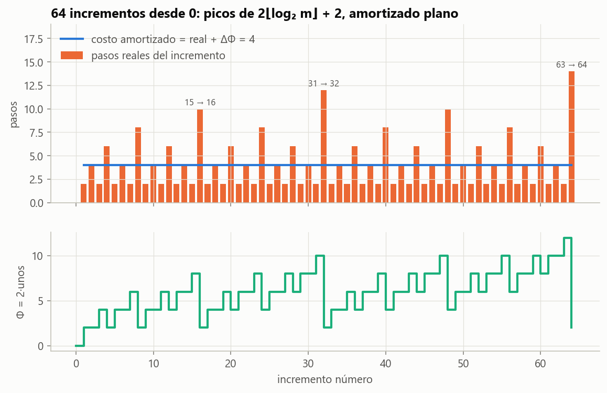
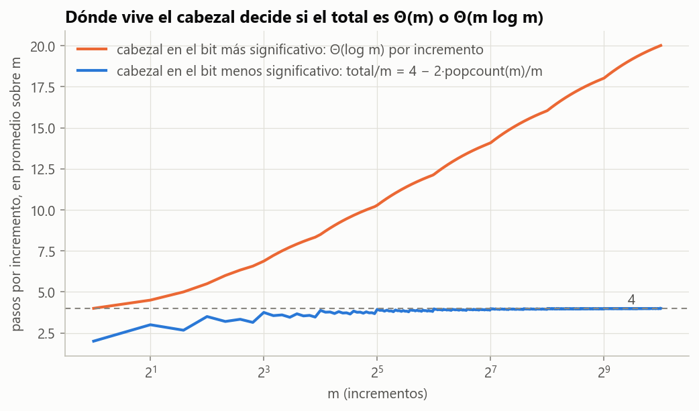

# Ejercicio 4 · El contador binario en una máquina de Turing

> ★★ El contador binario en una máquina de Turing, del ejercicio 7 de la conferencia 1. Demuestra con un potencial que $m$ incrementos desde 0 cuestan $O(m)$ pasos en total, aunque uno solo pueda costar $\Theta(\log m)$. Es la pregunta que la conferencia 1 dejó abierta. (C1, C4)

## Respuesta

- **La máquina.** Una cinta con el número en binario, el bit menos significativo en la celda 0 y los demás a su izquierda. El cabezal empieza y termina en la celda 0. Tiene 2 estados de trabajo y 5 transiciones.
- **Un incremento de $k$ cuesta exactamente $2\ t(k) + 2$ pasos**, donde $t(k)$ es la cantidad de unos en que termina $k$. Va hacia la izquierda convirtiendo esos unos en ceros, escribe un 1 y vuelve. El peor de los $m$ primeros cuesta $2\lfloor\log_2 m\rfloor + 2 = \Theta(\log m)$.
- **Potencial.** $\Phi = 2\cdot(\text{unos en la cinta})$. Cada incremento tiene costo amortizado **exactamente 4**: paga $2t + 2$ y el potencial baja $2(t - 1)$. Como $\Phi_0 = 0$ y $\Phi \ge 0$, $m$ incrementos cuestan a lo sumo $4m$.
- **Exacto.** El total es $4m - 2\cdot\mathrm{popcount}(m)$, donde $\mathrm{popcount}(m)$ es la cantidad de unos de $m$ en binario. Comprobado simulando la máquina para cada $m \le 20\ 000$, y en valores sueltos hasta $m = 10^5$.
- **El modelo importa.** Si el cabezal viviera en el bit **más** significativo, cada incremento costaría $\Theta(\log m)$ solo en ir y volver, y el total sería $\Theta(m\log m)$. El $O(m)$ depende de que el trabajo de cada incremento esté **pegado al cabezal**.

---

## 1. La máquina

**Especificación** (ejercicio 7 de la C1). La cinta tiene un número en binario, con el bit menos significativo en la celda 0 y los más significativos en las celdas $-1, -2, \dots$; fuera del número hay blancos (`_`). El cabezal empieza en la celda 0 en el estado `sumar`. Al terminar, la cinta tiene el número más 1 y el cabezal está otra vez en la celda 0, en el estado `fin`. El 0 se escribe como un solo `0` en la celda 0.

| estado | lee | escribe | se mueve | pasa a | para qué |
|---|---|---|---|---|---|
| `sumar` | 1 | 0 | izquierda | `sumar` | acarreo: el 1 se vuelve 0 y el acarreo sigue |
| `sumar` | 0 | 1 | derecha | `volver` | el acarreo se absorbe |
| `sumar` | \_ | 1 | derecha | `volver` | el número crece un bit |
| `volver` | 0 | 0 | derecha | `volver` | volver sobre los ceros que dejó el acarreo |
| `volver` | \_ | \_ | izquierda | `fin` | se pasó del bit menos significativo: un paso atrás |

Un paso es una transición. Traza de $7 \to 8$, o sea de `0111` a `1000`, generada por el código:

| paso | estado | celda | lee | escribe | mueve |
|---|---|---|---|---|---|
| 1 | sumar | 0 | 1 | 0 | ← |
| 2 | sumar | −1 | 1 | 0 | ← |
| 3 | sumar | −2 | 1 | 0 | ← |
| 4 | sumar | −3 | \_ | 1 | → |
| 5 | volver | −2 | 0 | 0 | → |
| 6 | volver | −1 | 0 | 0 | → |
| 7 | volver | 0 | 0 | 0 | → |
| 8 | volver | 1 | \_ | \_ | ← (fin, en la celda 0) |

Son 8 pasos $= 2\cdot t(7) + 2$, con $t(7) = 3$.

**Correctitud.** Sumar 1 en binario consiste en convertir en 0 los unos finales y en 1 el primer 0 a su izquierda (o el blanco, si eran todos unos). Eso es exactamente lo que hace `sumar`. Después, `volver` recorre hacia la derecha los $t$ ceros recién escritos. No puede encontrar un 1, porque a la derecha del 1 escrito solo quedan esos ceros. Al llegar al blanco de la celda 1, retrocede a la celda 0. La prueba `test_la_maquina_suma_uno_y_vuelve_a_casa` lo comprueba para los primeros 5000 incrementos, con el valor, la posición del cabezal y el largo del número.

## 2. El costo de un incremento

**Lema 1.** Incrementar $k$ cuesta exactamente $2\ t(k) + 2$ pasos.

*Demostración.* Se cuentan las transiciones:

- $t(k)$ transiciones `sumar`/1, una por cada uno final;
- 1 transición `sumar`/0 o `sumar`/\_, que escribe el 1;
- $t(k)$ transiciones `volver`/0, una por cada cero recién escrito;
- 1 transición `volver`/\_, para volver a casa.

En total, $2t(k) + 2$. $\blacksquare$

**El peor incremento.** Entre $k = 0, \dots, m-1$, el máximo de $t(k)$ se alcanza en $k = 2^j - 1$ con $j = \lfloor\log_2 m\rfloor$. Así que el incremento más caro de los $m$ primeros cuesta $2\lfloor\log_2 m\rfloor + 2 = \Theta(\log m)$. Con el análisis "operación por operación" de la C4, §1, el total quedaría en $O(m\log m)$. Es verdadero, pero no es lo que pasa.

## 3. El potencial

**Teorema 2.** Sea $\Phi = 2\cdot(\text{cantidad de unos en la cinta})$. El costo amortizado de cada incremento, $\hat c = c + \Phi_{\text{después}} - \Phi_{\text{antes}}$, es **exactamente 4**.

*Demostración.* Un incremento de $k$ convierte $t = t(k)$ unos en ceros y un 0 (o un blanco) en 1. La cantidad de unos cambia en $1 - t$, así que $\Delta\Phi = 2(1 - t)$. Por el Lema 1,

```math
\hat c = (2t + 2) + 2(1 - t) = 4. \qquad\blacksquare
```

**Corolario.** $m$ incrementos desde 0 cuestan exactamente $4m - 2\cdot\mathrm{popcount}(m) \le 4m$ pasos. Como cada incremento cuesta al menos 2, el total es $\Theta(m)$.

*Demostración.* Sumando, el potencial se telescopia (C4, §2):

```math
\sum_{i=1}^m c_i = \sum_{i=1}^m \hat c_i - (\Phi_m - \Phi_0) = 4m - \Phi_m + \Phi_0.
```

Al principio la cinta tiene un 0, así que $\Phi_0 = 0$. Al final tiene el número $m$, así que $\Phi_m = 2\cdot\mathrm{popcount}(m) \ge 0$. $\blacksquare$

Es la condición que la C4 pide cuidar: $\Phi_m \ge \Phi_0$. Acá se cumple con holgura, y la holgura es exactamente el término $-2\cdot\mathrm{popcount}(m)$.

**Qué deuda mide el potencial.** Cada 1 en la cinta es trabajo pendiente. Algún incremento futuro va a tener que caminar sobre él dos veces: una para convertirlo en 0 y otra para volver sobre él. Por eso vale 2.

**Los otros dos métodos de la C4 dan lo mismo.**

- **Contabilidad.** Se cobran 4 por incremento. Con 2 se pagan los dos pasos propios: escribir el 1 y retroceder desde el blanco. Los otros 2 quedan pegados al 1 recién escrito. Cuando un incremento futuro lo convierte en 0, esas dos monedas pagan el paso de ida y el de vuelta sobre esa celda. El crédito nunca es negativo porque cada 1 tiene sus dos monedas, y la suma de los créditos es $\Phi$.
- **Agregado.** Cada incremento cambia la cantidad de unos en $1 - t(k)$. Sumando de $k = 0$ a $m-1$, el total de cambios es $\mathrm{popcount}(m) - 0$, así que $\sum_k t(k) = m - \mathrm{popcount}(m)$. Entonces el total es $\sum_k (2t(k) + 2) = 4m - 2\ \mathrm{popcount}(m)$, el mismo número.



**Figura 1.** Arriba, los pasos de cada uno de los 64 primeros incrementos, con picos en $2^j - 1 \to 2^j$, y el costo amortizado, plano en 4. Abajo, el potencial: sube 2 en cada incremento barato y se desploma en cada pico, justo lo que el pico costó de más. Es la Figura 1 de la C4, para el contador.

**Medido** con el simulador:

| $m$ | total medido | $4m - 2\ \mathrm{popcount}(m)$ | $4m$ | total $/\ m$ | peor incremento | $2\lfloor\log_2 m\rfloor + 2$ |
|---|---|---|---|---|---|---|
| 1 | 2 | 2 | 4 | 2,000 | 2 | 2 |
| 16 | 62 | 62 | 64 | 3,875 | 10 | 10 |
| 100 | 394 | 394 | 400 | 3,940 | 14 | 14 |
| 1000 | 3 988 | 3 988 | 4 000 | 3,988 | 20 | 20 |
| 10 000 | 39 990 | 39 990 | 40 000 | 3,999 | 28 | 28 |
| 100 000 | 399 988 | 399 988 | 400 000 | 3,9999 | 34 | 34 |

## 4. La respuesta a la conferencia 1

El ejercicio 7 de la C1 preguntaba cuántos pasos da la máquina en el peor caso y cuántos en total con $m$ incrementos desde 0. Respuestas:

- **El peor caso** de un incremento es $2b + 2$ con un número de $b$ bits todos en 1. Entre los $m$ primeros, $2\lfloor\log_2 m\rfloor + 2$.
- **El total** es $4m - 2\ \mathrm{popcount}(m)$, o sea $\Theta(m)$, aunque una operación suelta cueste $\Theta(\log m)$.

La pregunta tenía trampa en el modelo. En la máquina de Turing, acceder a una celda cuesta tanto como la distancia (C1, §3). Por eso los palíndromos cuestan $\Omega(n^2)$ en una cinta. Acá la máquina no se ve penalizada, porque cada celda que el cabezal visita es una celda que el incremento **tiene** que modificar, o su vecina. El camino es proporcional al trabajo, y el trabajo es $O(1)$ amortizado igual que en la RAM.

## 5. Dónde vive el cabezal

Si la especificación pusiera el cabezal en el bit **más** significativo, cada incremento tendría que caminar todo el número hasta el bit menos significativo y volver. Son unos $2b + 2$ pasos con $b$ bits, aunque el acarreo sea corto. El total sería $\sum_{k<m} \Theta(\mathrm{bits}(k)) = \Theta(m\log m)$. El código implementa esa variante (`TRANSICIONES_MSB`). La Tabla 2 del script da, con $m = 10^4$, 267 249 pasos: 26,7 por incremento contra 4,0. La prueba `test_cabezal_en_el_bit_mas_significativo_cuesta_m_log_m` comprueba con $m = 16$, $256$ y $2048$ que el total queda entre $2\sum_k \mathrm{bits}(k)$ y eso más $4m$.



**Figura 2.** Pasos por incremento, en promedio sobre $m$. Con el cabezal en el bit menos significativo el promedio tiende a 4. En el más significativo crece como $2\log_2 m$.

En términos de potencial, la variante no tiene arreglo. El viaje de ida y vuelta cuesta $\Theta(b)$ en **cada** incremento, aunque no haya ningún trabajo pendiente que lo justifique. Ninguna función del estado puede pagar un costo que se repite siempre igual. El potencial solo puede mover costo entre operaciones, no hacerlo desaparecer.

Lo mismo pasa si además de incrementar se permite **decrementar** (ejercicio 2 de la C4). Alternar entre $2^j - 1$ y $2^j$ cuesta $\Theta(j)$ cada vez. El potencial ya no sirve, porque un decremento de $2^j$ **crea** $j$ unos, y sube $\Phi$ justo cuando el costo real también es alto. Así, el $O(m)$ depende de dos hipótesis: el cabezal en el bit menos significativo y solo incrementos.

## 6. Verificación: código y pruebas

- [`codigo/ejercicio_04.py`](codigo/ejercicio_04.py) es un simulador de máquinas de Turing de una cinta con la tabla de transiciones de la sección 1. Incluye la variante con el cabezal en el bit más significativo, el potencial, la traza y las figuras.
- [`codigo/test_ejercicio_04.py`](codigo/test_ejercicio_04.py) tiene 6 pruebas:

| prueba | qué comprueba |
|---|---|
| `test_la_maquina_suma_uno_y_vuelve_a_casa` | valor, cabezal en la celda 0 y largo del número, para $k < 5000$ |
| `test_costo_de_cada_incremento` | Lema 1: $2t(k) + 2$ pasos, para $k < 5000$ |
| `test_costo_amortizado_exactamente_4` | Teorema 2, con $\Phi_0 = 0$ y $\Phi \ge 0$ |
| `test_total_exacto` | el corolario para cada $m \le 20\ 000$ |
| `test_peor_incremento` | $2\lfloor\log_2 m\rfloor + 2$ |
| `test_cabezal_en_el_bit_mas_significativo_cuesta_m_log_m` | la variante cuesta $\approx 2\sum_k \mathrm{bits}(k)$ |

```bash
cd codigo
python ejercicio_04.py --figuras
python -m pytest test_ejercicio_04.py
```

## 7. Resumen

- Incrementar $k$ cuesta $2t(k) + 2$ pasos de máquina de Turing: ir sobre los unos finales, escribir el 1 y volver.
- Con $\Phi = 2\cdot(\text{unos})$, el costo amortizado es **exactamente 4**. Como $\Phi_0 = 0 \le \Phi_m$, $m$ incrementos cuestan $4m - 2\ \mathrm{popcount}(m) \le 4m$, aunque uno solo cueste $2\lfloor\log_2 m\rfloor + 2$.
- Cada 1 es una deuda de dos pasos. La contabilidad pega dos monedas a cada 1, y el método agregado da el mismo total exacto.
- El resultado depende del modelo: con el cabezal en el bit más significativo, o permitiendo decrementos, el peor caso del total pasa a ser $\Theta(m\log m)$.
