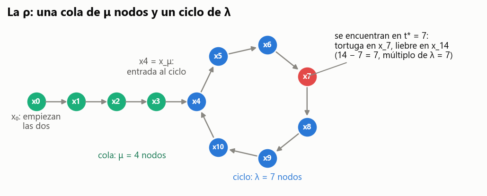
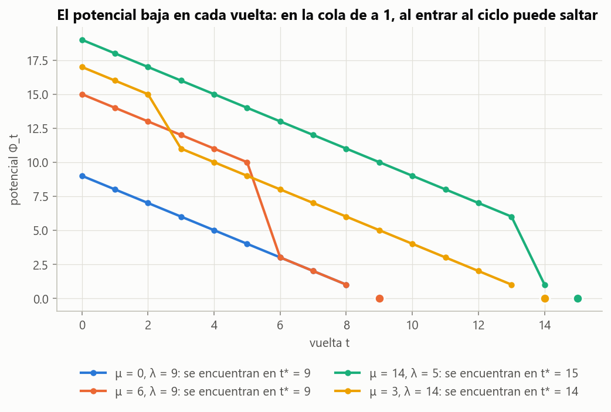

# Ejercicio 5 · Detección de ciclos de Floyd

> ★★ Detección de ciclos en una lista enlazada con dos punteros que avanzan a velocidades 1 y 2 (algoritmo de Floyd). Demuestra que se encuentran si y solo si hay un ciclo, con un invariante, y que termina, con un potencial. Da el costo. (C3)

## Respuesta

Sea $x_0$ el primer nodo y $x_{i+1} = \mathrm{sig}(x_i)$. Si hay ciclo, la sucesión tiene forma de $\rho$: una cola de $\mu$ nodos y un ciclo de $\lambda$ nodos.

- **Invariante.** Después de $t$ vueltas, la tortuga está en $x_t$ y la liebre en $x_{2t}$.
- **Si y solo si.** $x_t = x_{2t}$ para algún $t \ge 1$ si y solo si hay ciclo, y entonces el primer encuentro es exactamente en $t^\ast = \lambda\cdot\max(1, \lceil\mu/\lambda\rceil)$, el primer múltiplo de $\lambda$ que es al menos $\mu$ y al menos 1.
- **Potencial.**
  - Sin ciclo, $\Phi = n - 2t$ (los nodos que le faltan a la liebre).
  - Con ciclo, en la cola $\Phi = (\mu - t) + \lambda$, y en el ciclo $\Phi$ es la distancia que la liebre tiene que recorrer para alcanzar a la tortuga, que baja exactamente 1 por vuelta.

  En los dos casos es un entero positivo que baja en cada vuelta, y da a lo sumo $\mu + \lambda$ vueltas.
- **Costo.** A lo sumo $\mu + \lambda$ vueltas y $3(\mu+\lambda)$ punteros seguidos con ciclo, y $\lfloor n/2\rfloor$ vueltas sin ciclo. Memoria $O(1)$. Todo algoritmo que solo sigue punteros y compara nodos necesita $\mu + \lambda$ (o $n$) evaluaciones, así que Floyd es óptimo salvo el factor 3 con memoria constante.
- **Verificación exhaustiva.** El teorema se comprueba sobre **todas** las listas de hasta 6 nodos, con todo nodo inicial: 747 486 casos.

---

## 1. El modelo y la forma de las listas

Una lista es una función $\mathrm{sig}$ sobre un conjunto finito de nodos, que puede valer `None`. El algoritmo solo puede **seguir punteros** y **comparar nodos por identidad**. No puede marcar nodos ni guardar más que una cantidad constante de ellos.

```python
def floyd(sig, inicio):
    tortuga = liebre = inicio
    t = 0
    while liebre is not None and sig[liebre] is not None:
        tortuga = sig[tortuga]
        liebre = sig[sig[liebre]]
        t += 1
        if tortuga == liebre:
            return True, t           # hay ciclo
    return False, t                  # la liebre llegó a None
```

**Lema 0 (la $\rho$).** Hay exactamente dos posibilidades.

- **(a) Sin ciclo.** Algún $x_n$ es `None`, y entonces $x_0, \dots, x_{n-1}$ son nodos distintos.
- **(b) Con ciclo.** Ningún $x_i$ es `None`. Existen $\mu \ge 0$ y $\lambda \ge 1$ tales que $x_0, \dots, x_{\mu+\lambda-1}$ son distintos y, para $i < j$:

```math
x_i = x_j \iff i \ge \mu \ \text{ y }\ \lambda \mid (j - i).
```

*Demostración.* Si algún nodo se repite, $x_i = x_j$ con $i < j$, entonces $x_{i+1} = x_{j+1}$, y así sucesivamente: la sucesión nunca llega a `None`. Así que en el caso (a) no hay repetidos.

Si nunca llega a `None`, como hay finitos nodos, alguno se repite. Sea $j$ el primer índice tal que $x_j = x_i$ para algún $i < j$, y pongamos $\mu = i$, $\lambda = j - i$. Por minimalidad, $x_0, \dots, x_{\mu+\lambda-1}$ son distintos, y como $\mathrm{sig}$ es una función, $x_{k+\lambda} = x_k$ para todo $k \ge \mu$. Entonces para $k \ge \mu$ el nodo $x_k$ es uno de los $\lambda$ nodos distintos del ciclo, en la posición $(k - \mu) \bmod \lambda$.

- Si $i < \mu$, el nodo $x_i$ de la cola no está en el ciclo, y por lo tanto no vuelve a aparecer.
- Si $i \ge \mu$, $x_i = x_j$ si y solo si $(i-\mu) \equiv (j-\mu) \pmod\lambda$, o sea $\lambda \mid (j-i)$. $\blacksquare$



**Figura 1.** Una lista con cola $\mu = 4$ y ciclo $\lambda = 7$. La tortuga y la liebre se encuentran en $t^\ast = 7$, el primer múltiplo de 7 que es al menos 4. La tortuga está en $x_7$ y la liebre en $x_{14}$, que es el mismo nodo porque $14 - 7 = 7$.

## 2. El invariante y el "si y solo si"

**La lista vacía.** Si `inicio` es `None`, la condición del `while` falla de entrada, el algoritmo responde "no hay ciclo" tras 0 vueltas, y es correcto: no hay ningún nodo. La prueba `test_lista_vacia` lo comprueba. En lo que sigue la lista tiene al menos un nodo, así que $x_0$ no es `None`.

**(I)** Después de $t$ vueltas: tortuga $= x_t$, liebre $= x_{2t}$, los $x_0, \dots, x_{2t}$ son nodos (ninguno es `None`), y $x_s \ne x_{2s}$ para todo $1 \le s < t$.

*Demostración del invariante.*

- **Inicialización** ($t=0$). Las dos están en $x_0$, que es un nodo porque la lista no es vacía.
- **Mantenimiento.** Se entra a la vuelta $t+1$ solo si $x_{2t}$ y $x_{2t+1}$ no son `None`. La tortuga pasa de $x_t$ a $\mathrm{sig}(x_t) = x_{t+1}$, y la liebre de $x_{2t}$ a $\mathrm{sig}(\mathrm{sig}(x_{2t})) = x_{2t+2}$. El nodo $x_{2t+2}$ existe, aunque podría ser `None`, en cuyo caso la vuelta siguiente no ocurre. Si $x_{t+1} = x_{2t+2}$ el algoritmo sale, así que si llega a la vuelta $t+2$ es porque $x_{t+1} \ne x_{2t+2}$. $\blacksquare$

**Teorema 1.** El algoritmo responde "hay ciclo" si y solo si la lista tiene un ciclo. En ese caso el encuentro ocurre exactamente en la vuelta

```math
t^\ast = \lambda \cdot \max\!\left(1, \left\lceil \tfrac{\mu}{\lambda}\right\rceil\right) \;\le\; \mu + \lambda.
```

*Demostración.*

- **($\Rightarrow$)** Si responde "hay ciclo" en la vuelta $t \ge 1$, por (I) $x_t = x_{2t}$ con $t < 2t$. Hay un nodo repetido, y por el Lema 0 eso es el caso (b).
- **($\Leftarrow$)** En el caso (b) nunca aparece `None`, así que la condición del `while` siempre se cumple y el ciclo solo puede terminar por un encuentro. Por el Lema 0, con $i = t$ y $j = 2t$, $x_t = x_{2t}$ si y solo si $t \ge \mu$ y $\lambda \mid t$. El primer $t \ge 1$ que lo cumple es el menor múltiplo de $\lambda$ que es $\ge \max(1,\mu)$, que es la fórmula de $t^\ast$. Por (I) no hubo encuentros antes, así que el algoritmo responde en la vuelta $t^\ast$. Para la cota: si $\mu = 0$, $t^\ast = \lambda$; si $\mu \ge 1$, el menor múltiplo de $\lambda$ que es $\ge \mu$ es a lo sumo $\mu + \lambda - 1$.
- **Sin ciclo**, caso (a), no hay repetidos, así que nunca $x_t = x_{2t}$ con $t \ge 1$. El algoritmo no puede responder "hay ciclo", y por la sección 3 termina, así que responde "no hay". $\blacksquare$

Una traza con $\mu = 4$, $\lambda = 7$, la de la Figura 1:

| $t$ | tortuga | liebre | $\Phi_t$ |
|---|---|---|---|
| 0 | $x_0$ | $x_0$ | 11 |
| 1 | $x_1$ | $x_2$ | 10 |
| 2 | $x_2$ | $x_4$ | 9 |
| 3 | $x_3$ | $x_6$ | 8 |
| 4 | $x_4$ | $x_8$ | 3 |
| 5 | $x_5$ | $x_{10}$ | 2 |
| 6 | $x_6$ | $x_{12} = x_5$ | 1 |
| 7 | $x_7$ | $x_{14} = x_7$ | encuentro |

## 3. La terminación: el potencial

**Sin ciclo (caso a), con $n$ nodos.** Sea $\Phi_t = n - 2t$, los nodos que le faltan a la liebre para llegar a `None`. Se entra a una vuelta más solo si $x_{2t+1}$ no es `None`, o sea $2t + 1 \le n-1$, o sea $\Phi_t \ge 2$. Cada vuelta resta 2, así que el ciclo termina, y hace exactamente $\lfloor n/2\rfloor$ vueltas.

**Con ciclo (caso b).** Definimos

- $\Phi_t = (\mu - t) + \lambda$ si $t < \mu$, cuando la tortuga todavía está en la cola;
- $\Phi_t = r_t$ si $t \ge \mu$, cuando las dos están en el ciclo, donde $r_t$ es el único valor de $\lbrace 1, \dots, \lambda\rbrace$ con $r_t \equiv -t \pmod\lambda$.

En la segunda fase, $r_t$ es la **distancia que la liebre tiene que recorrer para alcanzar a la tortuga**. La liebre está en $x_{2t}$, y avanzando $d$ nodos llega a $x_{2t+d}$, que es la tortuga $x_t$ cuando $2t + d \equiv t$, o sea $d \equiv -t \pmod\lambda$.

**Teorema 2.** Con ciclo, mientras no se encontraron, $\Phi_t \ge 1$ y $\Phi_{t+1} < \Phi_t$. Por lo tanto el algoritmo termina, en a lo sumo $\Phi_0 \le \mu + \lambda$ vueltas.

*Demostración.* Hay tres casos.

- **En la cola** ($t+1 < \mu$). $\Phi$ baja exactamente 1.
- **Al entrar al ciclo** ($t + 1 = \mu$). Pasa de $\lambda + 1$ a $r_\mu \le \lambda$: baja al menos 1.
- **En el ciclo** ($t \ge \mu$). Cada vuelta la liebre avanza 2 y la tortuga 1, así que la distancia entre ellas baja exactamente 1: $r_{t+1} \equiv -(t+1) \equiv r_t - 1$. Si $r_t \ge 2$, eso da $r_{t+1} = r_t - 1 \ge 1$. Si $r_t = 1$, entonces $\lambda \mid t+1$ con $t + 1 > \mu$, y se encuentran en esa vuelta.

Así que $\Phi$ es un entero positivo que baja en cada vuelta mientras no se encuentran. Un entero positivo solo puede bajar $\Phi_0$ veces, y $\Phi_0 = \mu + \lambda$ si $\mu \ge 1$, o $\lambda$ si $\mu = 0$. $\blacksquare$

La observación clave está en el tercer caso: **la liebre no puede saltar por encima de la tortuga**, porque con diferencia de velocidades 1 la distancia baja exactamente de a 1. Las velocidades 1 y 2 no son las únicas que funcionan. Con velocidades 1 y $k \ge 2$, el Lema 0 da $x_t = x_{kt}$ si y solo si $t \ge \mu$ y $\lambda \mid (k-1)t$, y eso se cumple siempre que $t$ sea un múltiplo de $\lambda$ que es al menos $\mu$. Así que también se encuentran en a lo sumo $\mu + \lambda$ vueltas. Pero cada vuelta cuesta $k+1$ punteros, y $k = 2$ es la elección más barata.



**Figura 2.** $\Phi_t$ para cuatro listas. En la cola baja de a 1. Al entrar la tortuga al ciclo cae de golpe a la distancia real, y desde ahí baja de a 1 hasta el encuentro (punto en 0).

## 4. Costo

**Teorema 3.**

- Con ciclo: $t^\ast \le \mu + \lambda$ vueltas y a lo sumo $3(\mu + \lambda)$ punteros seguidos.
- Sin ciclo: $\lfloor n/2\rfloor$ vueltas y a lo sumo $3\lfloor n/2\rfloor + 2$ punteros.
- La memoria es $O(1)$: dos punteros y un contador.

*Demostración.* Por los Teoremas 1 y 2. Cada vuelta sigue tres punteros: uno para la tortuga y dos para la liebre, y el primero de la liebre sirve también para la condición del `while`. La última comprobación, sin ciclo, agrega a lo sumo 2. $\blacksquare$

Medido con nombres de nodos al azar:

| $\mu$ | $\lambda$ | $t^\ast$ medido | $t^\ast$ de la fórmula | $\mu+\lambda$ | punteros seguidos | $3(\mu+\lambda)$ |
|---|---|---|---|---|---|---|
| 0 | 10 | 10 | 10 | 10 | 30 | 30 |
| 5 | 3 | 6 | 6 | 8 | 18 | 24 |
| 3 | 5 | 5 | 5 | 8 | 15 | 24 |
| 11 | 10 | 20 | 20 | 21 | 60 | 63 |
| 100 | 7 | 105 | 105 | 107 | 315 | 321 |
| 7 | 100 | 100 | 100 | 107 | 300 | 321 |
| 1000 | 1 | 1000 | 1000 | 1001 | 3000 | 3003 |

La fila $\mu = 11$, $\lambda = 10$ muestra el peor caso de la fórmula: la tortuga entra al ciclo justo después de un múltiplo de $\lambda$ y tiene que dar casi una vuelta más.

**Cota mínima.** En el modelo de punteros, todo algoritmo correcto sigue al menos $\mu + \lambda$ punteros si hay ciclo, y al menos $n$ si no hay.

*Demostración (adversario, C5, §5).* Si el algoritmo solo conoce $x_0, \dots, x_k$, todos distintos y sin `None`, el siguiente de $x_k$ puede ser `None` o apuntar a un nodo ya visto. Las dos completaciones son consistentes con todo lo que vio y tienen respuestas distintas. Así que no puede contestar hasta ver un `None` o un nodo repetido. El primer repetido es $x_{\mu+\lambda} = x_\mu$, y para llegar a $x_k$ hay que seguir $k$ punteros desde $x_0$. $\blacksquare$

Floyd queda a un factor 3 de la cota, con memoria $O(1)$. Guardar los nodos vistos en un conjunto alcanza la cota exacta, $\mu + \lambda$ punteros, pero gasta memoria $\mu + \lambda$. Es la versión `con_conjunto` del código, y la prueba `test_evaluaciones` compara las dos. El algoritmo de Brent (1980) baja el factor con la misma memoria constante.

## 5. Extra: encontrar $\mu$ y $\lambda$

Después del encuentro en $t^\ast$, se pone un puntero en $x_0$ y el otro se deja en $x_{t^\ast}$, y se avanza de a 1 con los dos. **Se encuentran exactamente en $x_\mu$, después de $\mu$ pasos.**

*Demostración.* Después de $k$ pasos están en $x_k$ y en $x_{t^\ast + k}$.

- Si $k < \mu$, $x_k$ está en la cola y no se repite (Lema 0), así que son distintos.
- Si $k = \mu$, como $\mu \ge \mu$ y $\lambda \mid t^\ast$, el Lema 0 da $x_{t^\ast + \mu} = x_\mu$. $\blacksquare$

Desde $x_\mu$, una vuelta completa al ciclo da $\lambda$. El código (`floyd_completo`) lo hace y la prueba exhaustiva verifica $\mu$ y $\lambda$ en todas las listas con ciclo. La misma idea, aplicada a una función $f(x) = x^2 + c \bmod N$ en lugar de una lista, es el algoritmo $\rho$ de Pollard para factorizar enteros, y de ahí el nombre de la forma.

## 6. Verificación: código y pruebas

- [`codigo/ejercicio_05.py`](codigo/ejercicio_05.py) implementa Floyd con contador de punteros, Floyd completo ($\mu$ y $\lambda$), la versión con conjunto, la verdad calculada sin Floyd, un constructor de listas $\rho$ con nombres al azar y el potencial. Corre la verificación exhaustiva hasta 6 nodos y genera las figuras.
- [`codigo/test_ejercicio_05.py`](codigo/test_ejercicio_05.py) tiene 7 pruebas:

| prueba | qué comprueba |
|---|---|
| `test_exhaustivo_hasta_5_nodos` | todas las funciones $\mathrm{sig}$ con $n \le 5$ y todo inicio: respuesta, $t^\ast$ exacto, $\lfloor n/2\rfloor$ vueltas sin ciclo, $\mu$ y $\lambda$ |
| `test_lista_vacia` | `inicio = None` |
| `test_listas_grandes_con_nombres_al_azar` | 300 listas con $\mu, \lambda \le 3000$ |
| `test_invariante_tortuga_xt_liebre_x2t` | (I) vuelta por vuelta, y que el único encuentro es el último |
| `test_potencial_baja` | Teorema 2 para todo $\mu < 40$ y $1 \le \lambda < 40$ |
| `test_evaluaciones` | $\le 3(\mu+\lambda)$ punteros; el conjunto usa exactamente $\mu+\lambda$ |
| `test_sin_ciclo_evaluaciones` | $\lfloor n/2\rfloor$ vueltas y $\le 3\lfloor n/2\rfloor + 2$ punteros sin ciclo |

La tabla exhaustiva del script, con hasta 6 nodos, recorre 747 486 listas, 495 223 de ellas con ciclo, sin un solo fallo. El máximo de $t^\ast/(\mu+\lambda)$ es exactamente 1, alcanzado cuando $\mu = 0$.

```bash
cd codigo
python ejercicio_05.py --figuras
python -m pytest test_ejercicio_05.py
```

## 7. Resumen

- Toda lista es una $\rho$, posiblemente sin ciclo. Dos posiciones $i<j$ son el mismo nodo si y solo si $i \ge \mu$ y $\lambda \mid j-i$.
- **Invariante:** tortuga en $x_t$ y liebre en $x_{2t}$. Se encuentran si y solo si $t \ge \mu$ y $\lambda \mid t$, así que hay encuentro si y solo si hay ciclo, y el primero es en $t^\ast = \lambda\max(1,\lceil\mu/\lambda\rceil) \le \mu+\lambda$.
- **Potencial:** sin ciclo, $n - 2t$. Con ciclo, $(\mu - t) + \lambda$ en la cola y la distancia de la liebre a la tortuga en el ciclo, que baja exactamente 1 por vuelta, así que la liebre no puede saltarla.
- **Costo:** $\le 3(\mu+\lambda)$ punteros y memoria $O(1)$. Hacen falta al menos $\mu + \lambda$, así que es óptimo salvo un factor constante.
