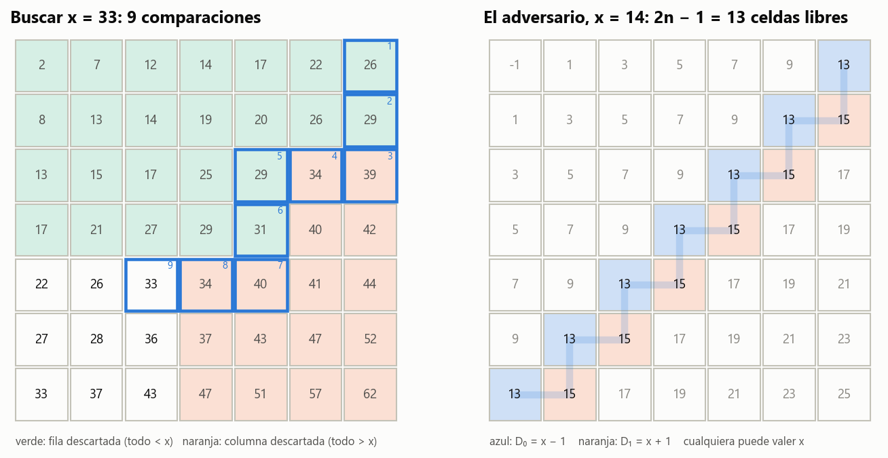

# Ejercicio 6 · Buscar en una matriz con filas y columnas ordenadas

> ★★ Una matriz $n \times n$ tiene filas y columnas ordenadas de forma creciente. Diseña un algoritmo que decida si contiene un valor $x$ en $O(n)$ comparaciones, demuestra su correctitud con un invariante, y demuestra con un adversario que no se puede en $o(n)$. (C3, C5)

## Respuesta

- **Algoritmo (búsqueda en escalera).** Se empieza en la esquina superior derecha. Si la celda es mayor que $x$, se descarta su columna y se va a la izquierda; si es menor, se descarta su fila y se baja.
- **Invariante.** $x$ no está en las filas de arriba de $i$ ni en las columnas a la derecha de $j$.
- **Potencial.** $(n - i) + (j + 1)$. Da **a lo sumo $2n - 1$ comparaciones** y memoria $O(1)$.
- **Adversario.** Las $2n - 1$ celdas de las dos antidiagonales $i + j = n-1$ y $i + j = n$ forman una escalera. Hay una matriz ordenada sin $x$ en la que **cualquiera** de esas celdas, por separado, se puede cambiar por $x$ sin desordenar nada. Un algoritmo que no las mira todas no distingue las dos matrices.
- **Conclusión.** Hacen falta **al menos $2n - 1$** comparaciones: no solo $\Omega(n)$, sino exactamente lo que usa la búsqueda en escalera. El algoritmo es **óptimo exacto**. En la matriz del adversario recorre justamente esa escalera, y una búsqueda exhaustiva sobre todos los patrones posibles confirma el óptimo $2n - 1$ para $n \le 3$.

---

## 1. El problema y el modelo

$M$ es una matriz $n\times n$ con $M[i][j] < M[i][j+1]$ y $M[i][j] < M[i+1][j]$. El algoritmo también funciona con desigualdades no estrictas, y las pruebas lo comprueban. Hay que decidir si $x$ es alguna entrada.

**Modelo.** Comparaciones de tres salidas ($<$, $=$, $>$) entre $x$ y una entrada de $M$, como en la búsqueda binaria de la C5, §3. El costo es la cantidad de comparaciones.

## 2. El algoritmo

```python
def escalera(M, x):
    n = len(M)
    i, j = 0, n - 1
    while i < n and j >= 0:
        if M[i][j] == x:
            return True
        if M[i][j] > x:
            j -= 1          # la columna j, de la fila i para abajo, es > x
        else:
            i += 1          # la fila i, de la columna j para la izquierda, es < x
    return False
```

La esquina superior derecha es la única, junto con la inferior izquierda, donde una comparación siempre descarta algo. Es la mayor de su fila y la menor de su columna.



**Figura 1.** Izquierda: buscar $x = 33$ en una matriz al azar. Los números azules son el orden de las comparaciones; en verde las filas descartadas, en naranja las columnas descartadas. Derecha: la matriz del adversario para $n = 7$. Las 13 celdas de la escalera (azul $= x - 1$, naranja $= x + 1$) son exactamente las que la búsqueda recorre, y cualquiera de ellas podría valer $x$.

## 3. Correctitud: el invariante

**(I)** Al empezar cada vuelta, $x \ne M[r][c]$ para toda celda con $r < i$ o $c > j$. La región descartada, las filas de arriba y las columnas de la derecha, no contiene a $x$.

*Demostración.*

- **Inicialización.** Con $i = 0$ y $j = n-1$ no hay filas arriba ni columnas a la derecha.
- **Mantenimiento.** Sea $v = M[i][j] \ne x$.
  - **$v > x$.** Para $r \ge i$, $M[r][j] \ge M[i][j] > x$, porque la columna crece hacia abajo. Las celdas de la columna $j$ con $r < i$ ya estaban descartadas por (I). Así que toda la columna $j$ está libre de $x$, y $j \leftarrow j-1$ mantiene (I).
  - **$v < x$.** Simétrico: para $c \le j$, $M[i][c] \le M[i][j] < x$, y las celdas con $c > j$ ya estaban descartadas. Toda la fila $i$ queda libre de $x$, y $i \leftarrow i+1$ mantiene (I).
- **Conclusión.** Si se devuelve `True`, es porque se vio $M[i][j] = x$. Si el ciclo termina sin verlo, es porque $i = n$ o $j = -1$, y la región descartada es toda la matriz, así que por (I) $x$ no está. $\blacksquare$

## 4. Costo: el potencial

Sea $\Phi = (n - i) + (j + 1)$, la cantidad de filas más la cantidad de columnas que todavía no se descartaron.

- $\Phi_0 = 2n$.
- Cada comparación que no encuentra a $x$ descarta una fila o una columna, así que baja $\Phi$ en exactamente 1.
- El ciclo solo da otra vuelta si $i < n$ y $j \ge 0$, o sea si quedan al menos una fila y una columna: $\Phi \ge 2$.

Así que hay a lo sumo $2n - 2$ comparaciones sin encontrar a $x$ antes de la última vuelta, más la última: **a lo sumo $2n - 1$ comparaciones**. Más concretamente, si se hicieron $a$ bajadas y $b$ pasos a la izquierda, el ciclo termina cuando $a = n$ o $b = n$, con el otro a lo sumo $n-1$, así que $a + b \le 2n-1$. La memoria es $O(1)$.

Compárese con buscar binariamente en cada fila, que hace $n\lceil\log_2(n+1)\rceil$ comparaciones (12 contra 7 con $n = 4$, y 2304 contra 511 con $n = 256$).

## 5. La cota mínima: el adversario

**Teorema.** Todo algoritmo que decide si $x$ está en $M$ comparando $x$ con entradas hace, en el peor caso, al menos $2n - 1$ comparaciones.

*Demostración.* Sean las dos antidiagonales

```math
D_0 = \lbrace (i,j) : i + j = n-1\rbrace \quad (n \text{ celdas}), \qquad D_1 = \lbrace (i,j) : i + j = n\rbrace \quad (n-1 \text{ celdas}).
```

Con $x = 2n$ definimos la matriz $M^\ast$ según la antidiagonal $i + j$ de cada celda:

- $M^\ast[i][j] = 2(i+j) - 1$ si $i + j < n-1$ (todas $< x-1$);
- $M^\ast[i][j] = x - 1$ si $(i,j) \in D_0$;
- $M^\ast[i][j] = x + 1$ si $(i,j) \in D_1$;
- $M^\ast[i][j] = 2(i+j) + 1$ si $i + j > n$ (todas $> x+1$).

**$M^\ast$ está ordenada y no contiene a $x$.** El valor solo depende de $i + j$ y crece con $i + j$. Un paso a la derecha o hacia abajo sube $i+j$ en 1, y eso sube el valor estrictamente.

**Cada celda de la escalera es libre.** Sea $c \in D_0 \cup D_1$ y sea $M_c$ la matriz $M^\ast$ con la celda $c$ cambiada por $x$. Sigue ordenada:

- Si $c \in D_0$, sus vecinos de arriba y de la izquierda tienen $i + j = n-2$ y valen a lo sumo $2n - 5 < x$. Los de abajo y la derecha están en $D_1$ y valen $x + 1 > x$.
- Si $c \in D_1$, sus vecinos de arriba y de la izquierda están en $D_0$ y valen $x - 1 < x$. Los de abajo y la derecha tienen $i+j = n+1$ y valen $2n + 3 > x$.

Las otras desigualdades no involucran a $c$. Así que $M_c$ es una matriz ordenada que **sí** contiene a $x$, y difiere de $M^\ast$ **solo en $c$**.

**El adversario.** Contesta cada comparación según $M^\ast$:

- responde $<$ para las celdas con $i + j \le n - 1$;
- responde $>$ para las demás.

Si el algoritmo termina habiendo comparado menos de $2n - 1$ veces, hay una celda $c$ de la escalera que no miró. $M^\ast$ y $M_c$ dan exactamente las mismas respuestas a todas sus comparaciones, así que el algoritmo responde lo mismo para las dos. Pero en una está $x$ y en la otra no: se equivoca en alguna. $\blacksquare$

**El algoritmo es óptimo exacto.** La búsqueda en escalera usa a lo sumo $2n - 1$, y la cota dice que hacen falta $2n - 1$. Además, en $M^\ast$ la búsqueda **recorre exactamente la escalera**, $(0, n-1), (1, n-1), (1, n-2), \dots, (n-1, 0)$, porque cada celda de $D_0$ le dice "baja" y cada una de $D_1$ "ve a la izquierda". La matriz del adversario es el peor caso del algoritmo, como el torneo y el segundo mayor en la C5, §7.

| $n$ | comparaciones en $M^\ast$ | $2n - 1$ | recorre la escalera | cada celda de la escalera puede ser $x$ |
|---|---|---|---|---|
| 2 | 3 | 3 | sí | sí |
| 10 | 19 | 19 | sí | sí |
| 100 | 199 | 199 | sí | sí |
| 1000 | 1999 | 1999 | sí | (no se probó) |

**Confirmación por fuerza bruta.** Para decidir si $x$ está, lo único que importa es el **signo** de cada $M[i][j] - x$. Los patrones de signos posibles son los que no decrecen por filas y columnas y no tienen dos ceros vecinos, porque los valores son estrictamente crecientes. El código enumera todos esos patrones para $n \le 3$ (3, 13 y 63 patrones) y calcula por búsqueda exhaustiva la profundidad del mejor árbol de decisión posible. Da **1, 3 y 5**, que es $2n-1$ en los tres casos.

**Si se permite comparar entradas entre sí.** El adversario sigue funcionando con una sola corrección. Si el algoritmo nunca **toca** una celda $c$ de la escalera (ni contra $x$ ni contra otra entrada), $M^\ast$ y $M_c$ dan las mismas respuestas, porque solo difieren en $c$. Cada comparación toca a lo sumo dos celdas, así que hacen falta al menos $(2n-1)/2$ comparaciones, que sigue siendo $\Omega(n)$.

**El caso típico no es la garantía.** En matrices al azar el peor caso medido queda lejos de $2n - 1$: 66 contra 127 con $n = 64$, y 236 contra 511 con $n = 256$. La cota de $2n - 1$ la fuerzan matrices con estructura, como $M^\ast$, donde los valores cercanos a $x$ están todos sobre una escalera.

**Matrices rectangulares.** En una matriz de $m \times n$, la búsqueda en escalera usa $m + n - 1$ comparaciones. Si $m \ll n$ conviene otra cosa, por ejemplo una búsqueda binaria por fila, con $m\lceil\log_2(n+1)\rceil$. Lo óptimo es del orden de $m\log(n/m)$, pero eso queda fuera del ejercicio.

## 6. Verificación: código y pruebas

- [`codigo/ejercicio_06.py`](codigo/ejercicio_06.py) implementa la búsqueda en escalera con invariante vigilado, la búsqueda binaria por filas, el generador de matrices, la matriz del adversario, la escalera $D_0 \cup D_1$ y el cálculo del óptimo exacto por búsqueda exhaustiva.
- [`codigo/test_ejercicio_06.py`](codigo/test_ejercicio_06.py) tiene 8 pruebas:

| prueba | qué comprueba |
|---|---|
| `test_correcta_contra_fuerza_bruta` | 3000 matrices, con $x$ presente y ausente |
| `test_no_decreciente_tambien` | con filas y columnas solo no decrecientes |
| `test_invariante_vigilado` | (I) al empezar cada vuelta |
| `test_a_lo_sumo_2n_menos_1` | el potencial: $\le 2n-1$ comparaciones |
| `test_matriz_del_adversario` | $M^\ast$ ordenada, sin $x$, y la búsqueda recorre la escalera, $n < 40$ |
| `test_cada_celda_de_la_escalera_puede_ser_x` | $M_c$ ordenada, con $x$, y difiere solo en $c$ |
| `test_un_algoritmo_que_se_salta_una_celda_falla` | las respuestas coinciden fuera de $c$ y la verdad cambia |
| `test_optimo_exacto_por_fuerza_bruta` | óptimo $= 2n-1$ para $n \le 3$ |

```bash
cd codigo
python ejercicio_06.py --figuras
python -m pytest test_ejercicio_06.py
```

## 7. Resumen

- **Búsqueda en escalera:** cada comparación descarta una fila o una columna. El invariante es "lo descartado no tiene a $x$" y el potencial, filas más columnas vivas: $\le 2n-1$ comparaciones, $O(1)$ memoria.
- **Adversario:** las antidiagonales $i+j = n-1$ (valor $x-1$) e $i+j = n$ (valor $x+1$) forman una escalera de $2n-1$ celdas, cada una cambiable por $x$ sin desordenar la matriz. Hay que mirarlas todas.
- **Cota exacta:** $2n - 1$, que es lo que usa el algoritmo. Óptimo exacto, confirmado por fuerza bruta para $n \le 3$.
- Una escalera de $2n-1$ celdas reaparece en el ejercicio 7, pero perpendicular a esta. Cruza la frontera entre $<$ y $>$ en lugar de seguirla, y por eso ahí basta una búsqueda binaria.
