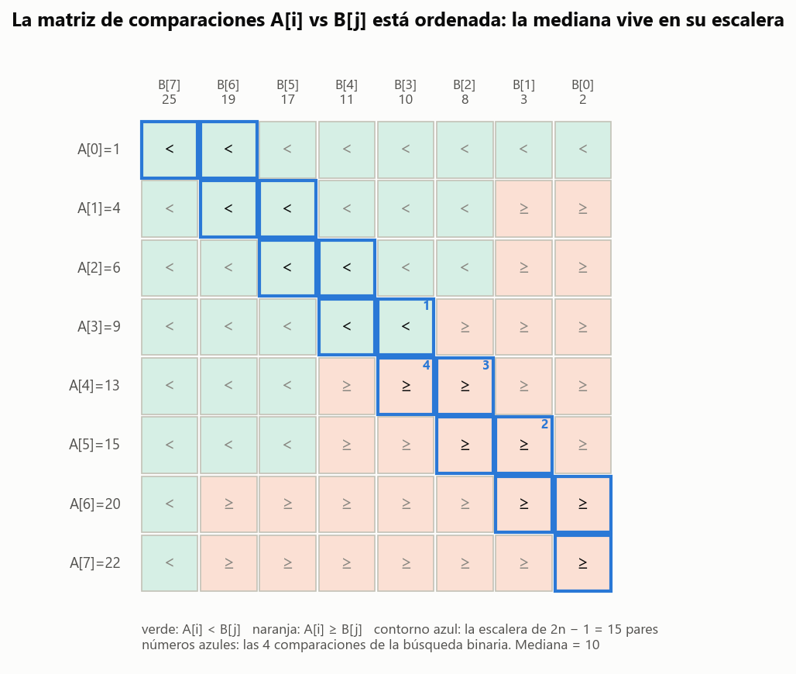
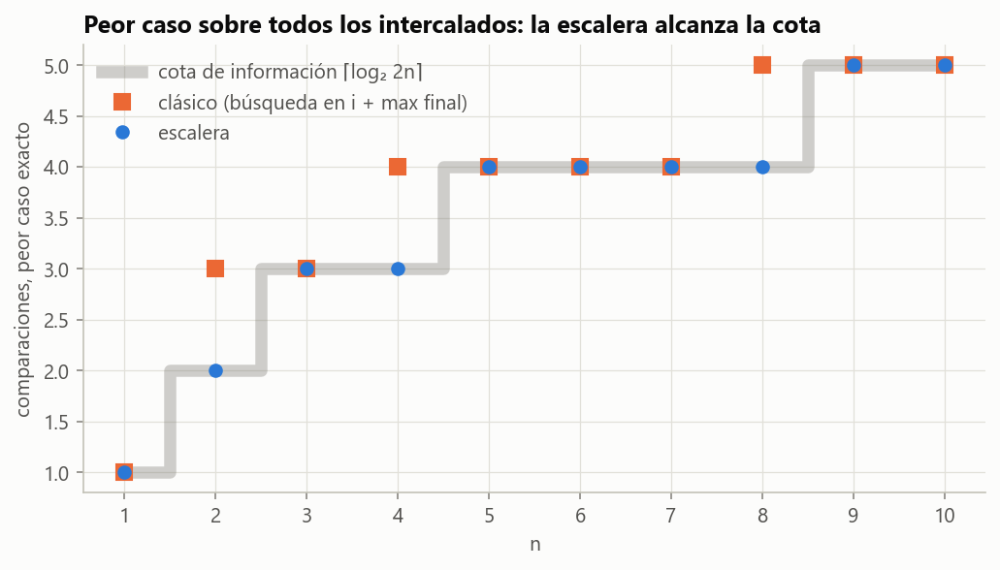

# Ejercicio 7 · La mediana de dos arreglos ordenados

> ★★★ Mediana de dos arreglos ordenados de largo $n$: el $n$-ésimo menor de los $2n$ elementos. Diseña un algoritmo $O(\log n)$, demuestra su correctitud y da la cota de información. (C2, C3, C5)

## Respuesta

- **La idea.** El $n$-ésimo menor es el máximo de las primeras $n$ posiciones de la mezcla. Esas $n$ posiciones son los primeros $i$ de $A$ y los primeros $n-i$ de $B$ para el único corte $i$ que deja todo lo de la izquierda menor o igual que todo lo de la derecha (Lema 1).
- **Algoritmo clásico.** Búsqueda binaria del corte $i^\ast$ sobre $i \in \lbrace 0,\dots,n\rbrace$, comparando $A[i]$ con $B[n-1-i]$, y una comparación final para el máximo. Usa $\lceil\log_2(n+1)\rceil + 1$ comparaciones como mucho.
- **Algoritmo de la escalera** (el que proponemos). Los $2n-1$ pares $(A[i], B[n-1-i])$ y $(A[i], B[n-2-i])$, puestos en orden, forman una **escalera** sobre la que el predicado "$A[i] < B[j]$" es monótono (Lema 2). Una sola búsqueda binaria del primer falso da la mediana directamente (Teorema 3), con **$\lceil\log_2 2n\rceil$ comparaciones**.
- **Cota de información.** Cualquiera de los $2n$ elementos puede ser la mediana, y con valores distintos cada comparación tiene solo dos respuestas. Así que hacen falta **$\lceil\log_2 2n\rceil$ comparaciones** (Teorema 4).
- **Conclusión.** La escalera alcanza la cota **exactamente, para todo $n$**. Lo verificamos sobre todos los intercalados posibles, hasta 184 756 entradas con $n = 10$. El clásico gasta una comparación de más cuando $n \ge 2$ es potencia de 2.
- **Conexión con el ejercicio 6.** La matriz de signos de $A[i] - B[j]$ es una matriz ordenada como la del ejercicio 6, y en las dos aparece una escalera de $2n - 1$ celdas, pero son perpendiculares. Allá la escalera del adversario corre **a lo largo** de la frontera entre $<$ y $>$, cada celda puede ser $x$ por su cuenta, y hay que leerla entera. Acá la escalera **cruza** la frontera una sola vez, el predicado es monótono sobre ella, y alcanza con una búsqueda binaria.

---

## 1. El problema y el modelo

$A[0..n)$ y $B[0..n)$ están ordenados de forma no decreciente, y puede haber repetidos. Se busca el $n$-ésimo menor del multiconjunto $A \cup B$, o sea la mediana inferior de los $2n$ elementos.

**Modelo:** comparaciones entre un elemento de $A$ y uno de $B$. Las comparaciones dentro de un mismo arreglo no dan información, porque ya están ordenados. El costo es la cantidad de comparaciones.

## 2. El corte

**Lema 1.** Sea $i \in \lbrace 0, \dots, n\rbrace$, $j = n - i$, y sea $L_i = A[0..i) \cup B[0..j)$, que tiene $n$ elementos. Supongamos que todo elemento de $L_i$ es menor o igual que todo elemento del resto, o sea

$$A[i-1] \le B[j] \quad\text{y}\quad B[j-1] \le A[i],$$

omitiendo las desigualdades con índices fuera de rango. Entonces el $n$-ésimo menor es $\max L_i = \max(A[i-1], B[j-1])$.

*Demostración.* Como los arreglos están ordenados, las dos desigualdades dicen que $\max L_i \le \min(\text{resto})$. Entonces la mezcla ordenada puede listar primero los $n$ elementos de $L_i$ y después el resto, y su posición $n$ es $\max L_i$. $\blacksquare$

**Lema 2.** Sea $g(i) = [\,A[i] \ge B[n-1-i]\,]$ para $0 \le i < n$, y sea $g(n)$ verdadero. Entonces $g$ es monótona: falsa, ..., falsa, verdadera, ..., verdadera. Y en $i^\ast = \min\lbrace i : g(i)\rbrace$ el corte cumple las hipótesis del Lema 1.

*Demostración.*

**Monotonía.** Al subir $i$, $A[i]$ sube y $B[n-1-i]$ baja, así que una vez verdadera, $g$ sigue verdadera.

**Las dos desigualdades en $i^\ast$, con $j^\ast = n - i^\ast$.**

- Si $i^\ast < n$, $g(i^\ast)$ da $B[j^\ast - 1] \le A[i^\ast]$. Si $i^\ast = n$, entonces $j^\ast = 0$ y no hay nada que ver.
- Si $i^\ast > 0$, $g(i^\ast - 1)$ es falsa, o sea $A[i^\ast - 1] < B[n - i^\ast] = B[j^\ast]$. Si $i^\ast = 0$, no hay nada que ver. $\blacksquare$

**El algoritmo clásico** es una búsqueda binaria de $i^\ast$ en $[0, n]$, con el invariante "$i^\ast \in [lo, hi]$" y el potencial $hi - lo$, como en el ejercicio 2. Hace $\lceil\log_2(n+1)\rceil$ comparaciones, más **una** para el máximo final cuando $0 < i^\ast < n$.

## 3. El algoritmo de la escalera

La comparación final del clásico, $A[i^\ast-1]$ contra $B[j^\ast-1]$, no es una comparación cualquiera: cae justo entre dos de las que la búsqueda ya hace. Ponemos todas en una sola sucesión.

**La escalera.** Son los $2n - 1$ pares

$$P_0 = (0, n-1),\ P_1 = (0, n-2),\ P_2 = (1, n-2),\ P_3 = (1, n-3),\ \dots,\ P_{2n-2} = (n-1, 0).$$

Es decir, $P_{2i} = (i, n-1-i)$ y $P_{2i+1} = (i, n-2-i)$. Sea $q(k) = [\,A[i] < B[j]\,]$ para $P_k = (i,j)$.

**Lema 2' (monotonía en la escalera).** $q(0), q(1), \dots, q(2n-2)$ es verdadero, ..., verdadero, falso, ..., falso. Vale también con repetidos.

*Demostración.* De $P_k$ a $P_{k+1}$, o baja $j$ en 1 con $i$ fijo, o sube $i$ en 1 con $j$ fijo. En los dos casos $A[i]$ no baja y $B[j]$ no sube, así que si $A[i] < B[j]$ era falso, sigue siendo falso. $\blacksquare$

Una forma de verlo es en la matriz de signos de $A[i] - B[j]$. Si se invierten las columnas de $B$, crece hacia la derecha y hacia abajo, como la del ejercicio 6, y la escalera pasa a ser un camino que alterna un paso a la derecha y uno hacia abajo. Un camino monótono así cruza **una sola vez** la frontera entre $<$ y $\ge$, que es otra forma de decir el Lema 2'. La escalera del adversario del ejercicio 6 es la perpendicular: corre a lo largo de esa frontera.



*Figura 1. La matriz $A[i]$ vs $B[j]$ para un ejemplo con $n = 8$, con las columnas de $B$ en orden inverso. Verde es $A[i] < B[j]$ y naranja $A[i] \ge B[j]$. La frontera entre los dos colores baja hacia la izquierda. El camino de los 15 pares de la escalera (contorno azul) baja hacia la derecha y la cruza una sola vez. Los números azules son las 4 comparaciones de la búsqueda binaria, que dan la mediana 10.*

**Teorema 3.** Sea $s$ el primer índice con $q(s)$ falso ($s = 2n - 1$ si son todos verdaderos). Entonces la mediana es

$$\begin{cases} A\big[(s-1)/2\big] & \text{si } s \text{ es impar},\\ B\big[n - 1 - s/2\big] & \text{si } s \text{ es par}.\end{cases}$$

*Demostración.* Las posiciones pares son $q(2i) = \lnot g(i)$, así que $i^\ast$ es el primer $i$ con $q(2i)$ falso.

**Dónde cae $s$.** Por la monotonía (Lema 2'), $q(2i^\ast - 2)$ es verdadero si $i^\ast \ge 1$, y $q(2i^\ast)$ es falso si $i^\ast \le n-1$. Así que $s \in \lbrace 2i^\ast - 1, 2i^\ast\rbrace$. El par del medio es $P_{2i^\ast - 1} = (i^\ast - 1, n - 1 - i^\ast) = (i^\ast - 1, j^\ast - 1)$, justo la comparación final del clásico. Hay dos casos:

- **$q(2i^\ast - 1)$ verdadero:** $A[i^\ast-1] < B[j^\ast-1]$. El máximo del Lema 1 es $B[j^\ast - 1]$, y $s = 2i^\ast$ es par, con $B[n-1-s/2] = B[j^\ast-1]$.
- **$q(2i^\ast - 1)$ falso:** el máximo es $A[i^\ast - 1]$, y $s = 2i^\ast - 1$ es impar, con $A[(s-1)/2] = A[i^\ast - 1]$.

**Los bordes.**

- Si $i^\ast = 0$, entonces $q(0)$ es falso y $s = 0$. La fórmula da $B[n-1]$: todo $B$ va antes que todo $A$.
- Si $i^\ast = n$, todos los $q$ son verdaderos y $s = 2n-1$. La fórmula da $A[n-1]$.

$\blacksquare$

**El algoritmo** es una búsqueda binaria del primer falso:

```python
def mediana_escalera(A, B):
    n = len(A)
    lo, hi = 0, 2 * n - 1                  # invariante: s está en [lo, hi]
    while lo < hi:
        k = (lo + hi) // 2
        i, j = k // 2, n - 1 - k // 2 - k % 2
        if A[i] < B[j]:
            lo = k + 1                     # q(k) verdadero: s > k
        else:
            hi = k                         # q(k) falso: s <= k
    s = lo
    return A[(s - 1) // 2] if s % 2 else B[n - 1 - s // 2]
```

**Correctitud.**

- **Invariante:** $s \in [lo, hi]$. Vale al principio porque $s \in \lbrace 0, \dots, 2n-1\rbrace$. Se mantiene por la monotonía: si $q(k)$ es verdadero, el primer falso está después de $k$; si es falso, está en $k$ o antes.
- **Potencial:** $hi - lo$. Baja a lo sumo a la mitad en cada vuelta, como en el ejercicio 2.
- Al terminar, $lo = hi = s$, y el Teorema 3 da la mediana.

**Costo.** Hay $2n$ valores posibles de $s$, así que la búsqueda binaria hace a lo sumo $\lceil\log_2 2n\rceil = 1 + \lceil\log_2 n\rceil$ comparaciones. La memoria es $O(1)$. Comparado con el clásico, $\lceil\log_2(n+1)\rceil + 1$, es igual salvo cuando $n \ge 2$ es potencia de 2, donde ahorra una. Con $n = 1$ los dos hacen una sola comparación, porque el clásico no necesita la del máximo final.

## 4. La cota de información

**Teorema 4.** Todo algoritmo de comparaciones que calcula la mediana de dos arreglos ordenados de largo $n$ hace, en el peor caso, al menos $\lceil\log_2 2n\rceil$ comparaciones.

*Demostración.* Hay dos pasos, como en la C5, §3.

**Hay $2n$ salidas posibles.** Cualquiera de los $2n$ elementos puede ser la mediana. Para que $A[i]$ lo sea, alcanza con un intercalado donde $A[i]$ tenga debajo exactamente $i$ elementos de $A$ y $n-1-i$ de $B$, y eso es posible porque $0 \le n-1-i \le n-1$. Igual para $B[j]$. El algoritmo nunca ve los valores, solo las respuestas, así que su salida es una **posición**, "$A[i]$" o "$B[j]$". Dos entradas con medianas en posiciones distintas no pueden terminar en la misma hoja.

**El árbol es binario en esas entradas.** Restringimos a entradas con los $2n$ valores distintos. Ahí ninguna comparación entre $A$ y $B$ responde "$=$", y las comparaciones dentro de un arreglo tienen respuesta conocida. Las ejecuciones viven en un árbol binario con al menos $2n$ hojas, que tiene altura al menos $\lceil\log_2 2n\rceil$ (C5, Lema 1). $\blacksquare$

**Corolario (optimalidad exacta).** El algoritmo de la escalera hace exactamente $\lceil\log_2 2n\rceil$ comparaciones en el peor caso, para todo $n$.

Lo comprobamos recorriendo **todos** los $\binom{2n}{n}$ intercalados de $2n$ valores distintos:

| $n$ | intercalados | salidas posibles | cota $\lceil\log_2 2n\rceil$ | escalera, peor caso | clásico, peor caso |
|---|---|---|---|---|---|
| 1 | 2 | 2 | 1 | 1 | 1 |
| 2 | 6 | 4 | 2 | 2 | **3** |
| 3 | 20 | 6 | 3 | 3 | 3 |
| 4 | 70 | 8 | 3 | 3 | **4** |
| 5 | 252 | 10 | 4 | 4 | 4 |
| 6 | 924 | 12 | 4 | 4 | 4 |
| 7 | 3 432 | 14 | 4 | 4 | 4 |
| 8 | 12 870 | 16 | 4 | 4 | **5** |
| 9 | 48 620 | 18 | 5 | 5 | 5 |
| 10 | 184 756 | 20 | 5 | 5 | 5 |

La columna "salidas posibles" confirma que los $2n$ elementos aparecen como mediana. La escalera coincide con la cota en cada fila, y el clásico se pasa por una justo en $n = 2, 4, 8$.



*Figura 2. Peor caso exacto sobre todos los intercalados. La escalera (azul) cae sobre la cota en cada $n$. El clásico (naranja) sube una comparación en las potencias de 2.*

**Una cota de información que sí cierra.** En la C5, §4 la información se quedaba corta para el máximo y el segundo mayor, porque ahí el trabajo estaba en verificar la respuesta. Acá cierra exactamente: hay $2n$ respuestas, y cada comparación de la escalera parte el conjunto de respuestas todavía posibles por la mitad. Es la búsqueda binaria del ejercicio 2, sobre una sucesión que no está escrita en ningún arreglo y que hubo que descubrir.

## 5. Las dos escaleras: ejercicio 6 contra ejercicio 7

| | ejercicio 6 | ejercicio 7 |
|---|---|---|
| matriz | $M$, ordenada | signos de $A[i] - B[j]$, ordenada |
| qué se busca | una celda igual a $x$ | dónde cruza la frontera entre $<$ y $\ge$ un camino dado |
| la escalera de $2n-1$ celdas | corre **a lo largo** de la frontera; cada celda puede ser $x$ por su cuenta | **cruza** la frontera; el predicado es monótono sobre ella |
| costo óptimo | $2n - 1$: hay que leerla entera | $\lceil\log_2 2n\rceil$: búsqueda binaria |

Las dos escaleras tienen $2n - 1$ celdas y viven en una matriz ordenada, pero son perpendiculares. Lo que cambia el costo de lineal a logarítmico es esa dirección. A lo largo de la frontera las celdas son independientes, y un adversario puede esconder $x$ en cualquiera. A través de la frontera el predicado es monótono, y cada comparación descarta la mitad.

**Generalización.** El mismo argumento encuentra el $k$-ésimo menor de dos arreglos de largos $m$ y $n$, recorriendo la escalera de la antidiagonal $i + j = k-1$ recortada a la matriz. Son $O(\log\min(m, n, k))$ comparaciones.

## 6. Verificación: código y pruebas

- [`codigo/ejercicio_07.py`](codigo/ejercicio_07.py) implementa los dos algoritmos con contador de comparaciones, el predicado sobre la escalera, el generador de todos los intercalados, el peor caso exacto, el conjunto de salidas posibles, las tablas y las figuras.
- [`codigo/test_ejercicio_07.py`](codigo/test_ejercicio_07.py) tiene 8 pruebas:

| prueba | qué comprueba |
|---|---|
| `test_correctas_con_repetidos` | los dos algoritmos contra el oráculo, 5000 entradas con repetidos |
| `test_escalera_cubre_los_pares` | los $2n-1$ pares, en rango y distintos |
| `test_predicado_monotono` | Lema 2', también con repetidos |
| `test_peor_caso_exacto_igual_a_la_cota` | el corolario sobre todos los intercalados, $n \le 8$ |
| `test_clasico_una_de_mas_en_potencias_de_dos` | el clásico se pasa por una exactamente en las potencias de 2 |
| `test_hay_2n_salidas_posibles` | la base de la cota de información |
| `test_arbol_binario_con_2n_hojas` | sobre el árbol real de la escalera, $n \le 7$: ninguna comparación empata, cada hoja da una sola posición y hay exactamente $2n$ hojas |
| `test_comparaciones_en_arreglos_grandes` | $\le\lceil\log_2 2n\rceil$ con $n$ hasta $10^5$ |

```bash
cd codigo
python ejercicio_07.py --figuras
python -m pytest test_ejercicio_07.py
```

## 7. Resumen

- **Corte:** la mediana es $\max(A[i^\ast-1], B[j^\ast-1])$, donde $i^\ast$ es el primer $i$ con $A[i] \ge B[n-1-i]$. Esa condición es monótona en $i$.
- **Clásico:** búsqueda binaria de $i^\ast$ y un máximo final, $\lceil\log_2(n+1)\rceil + 1$ comparaciones.
- **Escalera:** intercalando la comparación del máximo entre las de la búsqueda se obtiene una sucesión monótona de $2n-1$ comparaciones. Una búsqueda binaria del primer falso da la mediana con $\lceil\log_2 2n\rceil$ comparaciones.
- **Cota de información:** hay $2n$ medianas posibles y, con valores distintos, el árbol es binario, así que hacen falta $\lceil\log_2 2n\rceil$. La escalera es **óptima exacta** para todo $n$, verificado sobre todos los intercalados hasta $n = 10$.
