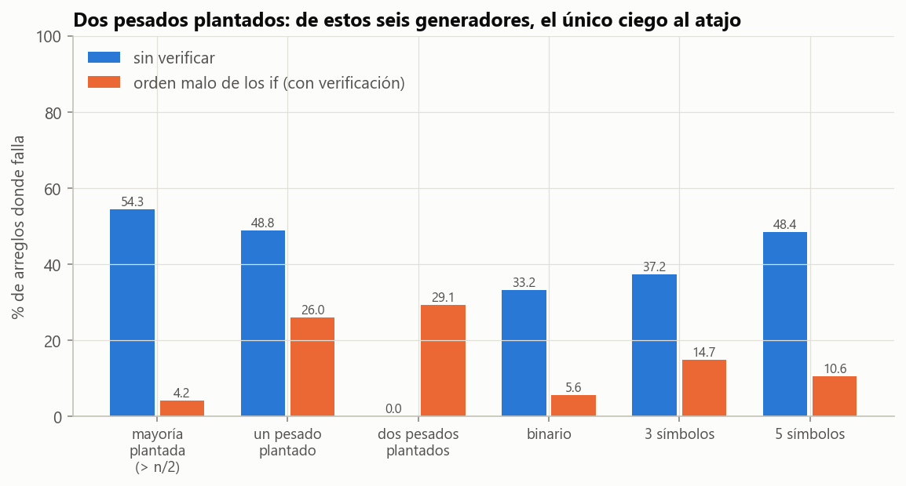

# Ejercicio 8 · Los elementos que aparecen más de $n/3$ veces

> ★★ El elemento que aparece más de $n/3$ veces. Generaliza Boyer-Moore con dos candidatos, enuncia el invariante reforzado y demuéstralo. Después escribe la versión que devuelve los candidatos con contador positivo sin verificarlos, y busca un generador de pruebas que no la atrape. Cuidado: el análogo del generador binario de la conferencia 3 sí la atrapa. (C3)

## Respuesta

- **Algoritmo.** Dos pares candidato-contador. Si $x$ es un candidato, su contador sube. Si no, y hay un contador en 0, $x$ ocupa ese lugar. Si no, los dos contadores bajan. Una segunda pasada cuenta los candidatos. Cuesta $O(n)$ tiempo y $O(1)$ memoria, y solo compara por igualdad.
- **Invariante reforzado.** El prefijo procesado se parte en **ternas de elementos distintos** más $c_1$ copias del candidato 1 y $c_2$ copias del candidato 2, y los dos candidatos son distintos. De ahí sale que **todo elemento con más de $n/3$ apariciones es un candidato con contador positivo**.
- **La versión sin verificar** nunca pierde un elemento pesado, pero puede devolver de más.
  - El análogo del generador binario la atrapa. Con 3 símbolos, los contadores finales son exactamente $f - f_{\min}$ (Lema 4), así que devuelve todo símbolo más frecuente que el menos frecuente.
  - Con 2 símbolos los contadores son las frecuencias mismas.
- **El generador que no la atrapa** planta **dos** elementos con más de $n/3$ apariciones cada uno. Los dos tienen que ocupar los dos lugares, y no queda lugar para un intruso (Teorema 3): 0 % de fallos en 5000 pruebas, contra 33 % a 54 % de los otros generadores.

---

## 1. El problema

Entrada: un arreglo $A$ de $n$ elementos que **solo se pueden comparar por igualdad**, como en la C3, §2. Salida: todos los elementos que aparecen más de $n/3$ veces. Hay a lo sumo dos, porque tres de ellos sumarían más de $n$ apariciones. Queremos $O(n)$ tiempo y $O(1)$ memoria extra.

## 2. El algoritmo

```python
def primera_pasada(A):
    cand, cont = [None, None], [0, 0]
    for x in A:
        if x == cand[0]:                 # 1. es un candidato: sube
            cont[0] += 1
        elif x == cand[1]:
            cont[1] += 1
        elif cont[0] == 0:               # 2. hay un lugar libre: lo ocupa
            cand[0], cont[0] = x, 1
        elif cont[1] == 0:
            cand[1], cont[1] = x, 1
        else:                            # 3. se cancela con una copia de cada candidato
            cont[0] -= 1
            cont[1] -= 1
    return list(zip(cand, cont))

def mas_de_un_tercio(A):
    candidatos = {c for c, k in primera_pasada(A) if k > 0}
    return sorted(c for c in candidatos if 3 * A.count(c) > len(A))    # segunda pasada
```

La idea de cancelación es la de la C3, ahora de a tres. Si se tachan tres elementos distintos, todo elemento con más de un tercio de las apariciones conserva más de un tercio en lo que queda. Tenía $k > n/3$ copias y pierde a lo sumo una, y $k - 1 > (n-3)/3$.

El **orden** de las reglas importa. Primero se pregunta si $x$ ya es candidato, y recién después si hay lugar libre. La sección 6 muestra qué pasa al revés.

Traza sobre `ABCAACBAAB`:

| | $x$ | regla | candidato 1 | candidato 2 |
|---|---|---|---|---|
| 1 | A | lugar libre | (A, 1) | (–, 0) |
| 2 | B | lugar libre | (A, 1) | (B, 1) |
| 3 | C | terna {A, B, C} | (A, 0) | (B, 0) |
| 4 | A | es candidato | (A, 1) | (B, 0) |
| 5 | A | es candidato | (A, 2) | (B, 0) |
| 6 | C | lugar libre | (A, 2) | (C, 1) |
| 7 | B | terna {A, C, B} | (A, 1) | (C, 0) |
| 8 | A | es candidato | (A, 2) | (C, 0) |
| 9 | A | es candidato | (A, 3) | (C, 0) |
| 10 | B | lugar libre | (A, 3) | (B, 1) |

A aparece 6 veces en 10 y es la respuesta. La versión sin verificar devuelve también a B, que aparece 3 veces, y $3 \le 10/3$.

## 3. El invariante reforzado

**Lema 1 (cuándo un multiconjunto se parte en ternas).** Un multiconjunto de $3T$ elementos se puede partir en $T$ ternas de elementos distintos si y solo si ningún elemento aparece más de $T$ veces.

*Demostración.*

- **($\Rightarrow$)** Cada terna tiene a lo sumo una copia de cada elemento, así que nadie aparece más de $T$ veces.
- **($\Leftarrow$)** Se escriben los elementos en una fila, agrupando las copias iguales, y se arma la terna $j$ con las posiciones $j$, $j+T$ y $j+2T$, para $j = 0, \dots, T-1$. Si una terna tuviera dos elementos iguales, ese elemento ocuparía un bloque de posiciones seguidas que va de $j$ a $j+T$ (o de $j + T$ a $j+2T$): al menos $T+1$ posiciones, contra la hipótesis. $\blacksquare$

Es la generalización exacta del lema de las parejas de la C3, §4. La prueba `test_lema_de_las_ternas` lo contrasta con una búsqueda exhaustiva de particiones en todos los multiconjuntos de hasta 9 elementos.

**(I)** Después de procesar $A[1..i]$:

1. el multiconjunto $A[1..i]$ es la unión de algunas ternas de elementos distintos, $c_1$ copias de `cand[0]` y $c_2$ copias de `cand[1]`;
2. si los dos candidatos están definidos, son distintos.

**Teorema 2.** (I) vale para todo prefijo. En consecuencia, al terminar, **todo elemento con más de $n/3$ apariciones es un candidato con contador positivo**, y las dos pasadas devuelven exactamente la respuesta correcta.

*Demostración.*

**Inicialización.** El prefijo vacío no tiene ternas, $c_1 = c_2 = 0$, y no hay candidatos.

**Mantenimiento.** Se procesa $x$, con un caso por rama del `if`:

- **$x$ es un candidato** (aunque su contador esté en 0): se agrega una copia y el contador sube. Los candidatos no cambian, así que (2) sigue valiendo.
- **$x$ no es candidato y un contador está en 0**: $x$ pasa a ser ese candidato con contador 1. Las copias del candidato viejo eran 0, así que no hay nada que reacomodar. Como $x$ no era igual a ninguno de los dos, el nuevo par sigue siendo de distintos: (2).
- **$x$ no es candidato y los dos contadores son positivos**: se forma la terna $\lbrace x, \texttt{cand[0]}, \texttt{cand[1]}\rbrace$ con una copia de cada candidato. Sus tres elementos son distintos, porque $x$ no es candidato y por (2). Los dos contadores bajan en 1.

**Conclusión.** Al final, $A$ se parte en $T = (n - c_1 - c_2)/3$ ternas de distintos más las copias de los candidatos. Si $m$ aparece más de $n/3$ veces y no fuera un candidato con contador positivo, todas sus apariciones estarían en las ternas, a lo sumo una por terna. Serían a lo sumo $T \le n/3$, una contradicción. La segunda pasada cuenta a los candidatos y se queda con los que superan $n/3$, que por lo anterior son todos los pesados. $\blacksquare$

El invariante "que uno escribe primero", "si hay un elemento con más de $n/3$, es un candidato", no es inductivo, igual que en la C3. No dice nada del estado cuando el prefijo no tiene pesados. La partición en ternas sí se sostiene sola. El código la **vigila** en cada prefijo de 1500 arreglos al azar (`invariante` y `test_invariante_vigilado`).

**Costo.** La primera pasada hace a lo sumo 2 comparaciones por elemento y la segunda $2n$, así que $O(n)$ tiempo. La memoria son dos candidatos y dos contadores, $O(1)$.

**Cota mínima.** Hay que leer $\Omega(n)$ posiciones. En un arreglo con $\lfloor n/3\rfloor$ copias de $a$ y el resto distintos, $a$ no es pesado. Si un algoritmo no lee alguna posición sin $a$, cambiarla por $a$ hace a $a$ pesado sin cambiar nada de lo que el algoritmo vio. Es el mismo argumento de la C3, §4.

**Generalización (Misra y Gries, 1982).** Con $k-1$ pares candidato-contador y "grupos de $k$ distintos" en lugar de ternas, la misma demostración da todos los elementos con más de $n/k$ apariciones, en $O(nk)$ tiempo y $O(k)$ memoria. El caso $k=2$ es Boyer-Moore y el $k = 3$ es este ejercicio.

## 4. La versión sin verificar

```python
def sin_verificar(A):
    return sorted({c for c, k in primera_pasada(A) if k > 0})
```

**La mitad correcta.** Por el Teorema 2, todo pesado está en la salida: nunca hay falsos negativos. Lo que puede fallar es la otra mitad: un candidato con contador positivo que no es pesado. El contraejemplo mínimo, hallado por búsqueda exhaustiva, es `AAB`. Los contadores terminan en $(A,2)$ y $(B,1)$, y B aparece 1 vez, que no supera $3/3$.

### Por qué el análogo del generador binario sí la atrapa

En la C3 el generador binario no veía el atajo porque, con dos símbolos, el contador final es la diferencia entre las dos cuentas (ejercicio 3 de la C3). El análogo con dos candidatos tiene dos versiones posibles, y las dos atrapan el error.

**Con 2 símbolos** nunca hay una terna, porque hacen falta tres distintos. Los contadores son las frecuencias exactas, y la versión sin verificar devuelve **todo símbolo que aparece**, sea o no pesado.

**Con 3 símbolos**, que es el análogo exacto (tantos símbolos como candidatos más uno), los contadores tienen una forma cerrada:

**Lema 4.** Si $A$ usa tres símbolos con frecuencias $f_A, f_B, f_C$, los contadores finales son exactamente $f_s - f_{\min}$ para los símbolos con $f_s > f_{\min}$.

*Demostración.* Por (I), $A$ se parte en $T$ ternas de distintos más las copias de los candidatos. Con tres símbolos, cada terna tiene exactamente una copia de cada uno, así que $f_s = T + (\text{copias de } s \text{ como candidato})$. Hay a lo sumo dos candidatos con contador positivo, así que algún símbolo $s_0$ no tiene copias sueltas y $f_{s_0} = T$. Los demás tienen $f_s \ge T$, así que $T = f_{\min}$, y el contador de cada candidato es $f_s - f_{\min}$. $\blacksquare$

El código lo comprueba en las $3^\ell$ palabras de cada largo $\ell \le 9$. Por el lema, la versión sin verificar devuelve $\lbrace s : f_s > f_{\min}\rbrace$, y eso está mal cada vez que algún símbolo tiene $f_{\min} < f_s \le n/3$. Por ejemplo, con frecuencias $(4, 3, 2)$ y $n = 9$ devuelve los dos más frecuentes, pero solo el primero es pesado. Esa es la diferencia con la C3. Allá, con dos símbolos, "contador positivo" era lo mismo que "mayoría". Acá, "más que el mínimo" no es lo mismo que "más de un tercio".

### El generador que no la atrapa

**Teorema 3.** Si $A$ tiene **dos** elementos con más de $n/3$ apariciones cada uno, la versión sin verificar devuelve exactamente la respuesta correcta.

*Demostración.* Por el Teorema 2, los dos pesados son candidatos con contador positivo. Solo hay dos lugares, así que la salida tiene exactamente a esos dos y a nadie más. $\blacksquare$

Así que un generador que planta dos pesados no puede ver el error nunca. La hipótesis del Teorema 2 dice dónde mirar. Su conclusión, "todo pesado es candidato", no habla de los candidatos que **no** son pesados, y esos aparecen solo cuando hay menos pesados que lugares ocupados. Hay otro generador ciego, más curioso: el de **todos distintos con $n$ múltiplo de 3**. Cada tres elementos el estado vuelve a vacío (lugar libre, lugar libre, terna), así que no queda ningún candidato y la respuesta vacía es correcta. Con $n$ que no es múltiplo de 3, sí falla.

Medido con 4000 arreglos de largo 1 a 15 por generador:

| generador | sin verificar | orden malo (sección 6) | dos pasadas |
|---|---|---|---|
| mayoría plantada ($> n/2$) | 54,3 % | 4,2 % | 0,0 % |
| un pesado plantado | 48,8 % | 26,0 % | 0,0 % |
| **dos pesados plantados** | **0,0 %** | 29,1 % | 0,0 % |
| binario | 33,2 % | 5,6 % | 0,0 % |
| 3 símbolos | 37,2 % | 14,7 % | 0,0 % |
| 5 símbolos | 48,4 % | 10,6 % | 0,0 % |



**Figura 1.** Porcentaje de arreglos donde cada versión se equivoca. De estos seis generadores, "dos pesados plantados" es el único ciego al atajo, por el Teorema 3, pero no al error de la sección 6. El otro generador ciego, el de todos distintos con $n$ múltiplo de 3, no está en la figura.

Hay una inversión respecto de la C3, donde "mayoría plantada" era ciego al atajo. Acá la mayoría plantada lo atrapa en más de la mitad de los casos, porque una mayoría ocupa un solo lugar y deja el otro libre para un intruso.

## 5. Qué dice la hipótesis

Como en la C3, §5, la lista de casos que hay que probar sale de leer el teorema:

- "**todo** pesado es candidato" se prueba con arreglos que tienen pesados, y ahí el atajo acierta;
- lo que el teorema **no** dice, "todo candidato es pesado", se prueba con arreglos que tienen **menos pesados que lugares ocupados**: ninguno o uno.

El generador que solo produce dos pesados es exactamente el que no visita esa parte.

## 6. Otro error: el orden de los `if`

Si se pregunta primero por un lugar libre y después si $x$ es candidato, el invariante (2) se rompe. Con `AA`, la segunda A ocupa el lugar libre aunque ya era el otro candidato, y quedan $(A,1)$ y $(A,1)$. Llega una B y se forma la "terna" $\lbrace B, A, A\rbrace$, que no es de distintos. Se pierden dos A de golpe y la A, que es pesada en `AAB`, desaparece de los candidatos. Con este error **hasta la versión verificada** falla, y por falsos negativos. La búsqueda exhaustiva da `AAB` también como contraejemplo mínimo, y el generador de dos pesados lo atrapa en el 29 % de los casos. Que dos errores tengan el mismo contraejemplo mínimo y generadores ciegos distintos es otra razón para no confiar en una sola batería de pruebas.

## 7. Verificación: código y pruebas

- [`codigo/ejercicio_08.py`](codigo/ejercicio_08.py) implementa la primera pasada (con invariante vigilado y la variante del orden malo), las dos pasadas, la versión sin verificar, el oráculo, los seis generadores y la búsqueda exhaustiva de contraejemplos mínimos.
- [`codigo/test_ejercicio_08.py`](codigo/test_ejercicio_08.py) tiene 9 pruebas:

| prueba | qué comprueba |
|---|---|
| `test_dos_pasadas_exhaustivo` | todas las palabras de largo $\le 8$ sobre 4 símbolos |
| `test_dos_pasadas_al_azar` | 3000 arreglos con alfabetos de 1 a 8 símbolos |
| `test_invariante_vigilado` | (I) en cada prefijo de 1500 arreglos |
| `test_lema_de_las_ternas` | Lema 1 contra particiones por búsqueda exhaustiva |
| `test_tres_simbolos_contadores_f_menos_fmin` | Lema 4 en todas las palabras de largo $\le 9$ sobre 3 símbolos |
| `test_sin_verificar_nunca_pierde_un_pesado` | la mitad correcta del atajo |
| `test_dos_pesados_no_atrapan_al_atajo` | Teorema 3 en 5000 arreglos |
| `test_todos_distintos_con_n_multiplo_de_3` | el generador ciego curioso, y que con $n = 4$ sí falla |
| `test_contraejemplos_minimos` | `AAB` para los dos errores |

```bash
cd codigo
python ejercicio_08.py --figuras
python -m pytest test_ejercicio_08.py
```

## 8. Resumen

- Dos candidatos y la regla "sube, ocupa un lugar libre, o forma una terna", en ese orden.
- **Invariante reforzado:** ternas de distintos más copias de los candidatos, con candidatos distintos. Por el Lema 1 da que todo pesado es un candidato con contador positivo. $O(n)$ y $O(1)$.
- **Sin verificar:** nunca pierde un pesado, pero puede devolver de más.
  - Lo atrapan los generadores binario y de 3 símbolos. Con 3 símbolos los contadores son $f - f_{\min}$.
  - Lo atrapan también los de uno o ningún pesado.
  - No lo atrapa el que planta **dos** pesados, porque llenan los dos lugares.
- El orden de los `if` es parte de la correctitud: al revés, dos lugares con el mismo candidato rompen las ternas, y falla hasta la versión verificada.
