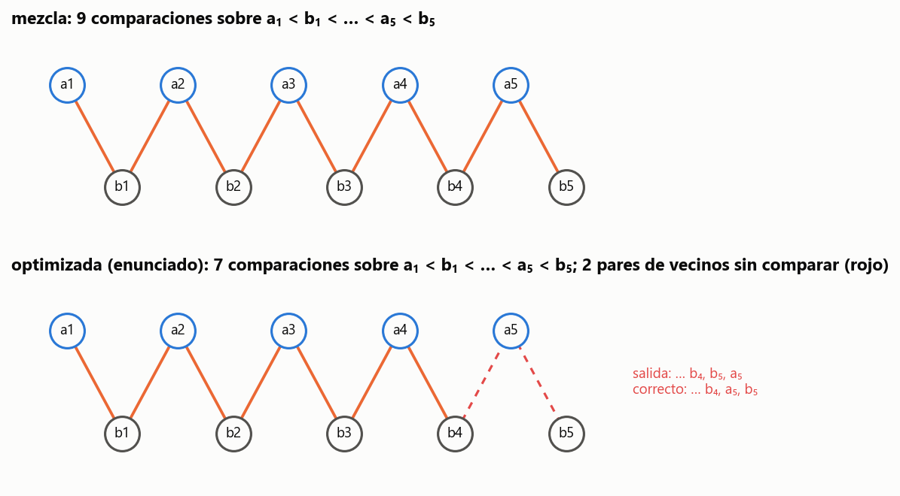

# Ejercicio 9 · La mezcla "optimizada"

> ★★ Una mezcla "optimizada" de dos listas ordenadas de largo $n$ deja de comparar cuando a la primera lista le queda un solo elemento, y lo pone al final. Cuenta cuántas comparaciones hace en el peor caso. Sin probarla, usa la sección 6 de la conferencia 5 para decidir si es correcta, y construye con el adversario la entrada en la que falla. (C5)

## Respuesta

- **Comparaciones.** En el peor caso hace exactamente **$2n - 2$** (y 0 si $n = 1$), contra $2n - 1$ de la mezcla de siempre.
- **¿Es correcta?** No, y no hace falta probarla. La C5, §6 demuestra que **toda** mezcla correcta hace $2n - 1$ comparaciones en el peor caso. Una que nunca pasa de $2n - 2$ está mal.
- **La entrada donde falla.** El adversario contesta como si la entrada fuera el intercalado perfecto $a_1 < b_1 < \dots < a_n < b_n$. La mezcla optimizada termina sin haber comparado los vecinos $(b_{n-1}, a_n)$ y $(a_n, b_n)$. Intercambiar $a_n$ y $b_n$ da otra entrada con las mismas respuestas pero otro orden correcto, así que se equivoca en una de las dos, y es el propio intercalado: con $A = [0,2,4,6,8]$ y $B = [1,3,5,7,9]$ devuelve $[\dots, 7, 9, 8]$.
- **Exactamente cuándo falla.** Si y solo si $a_n < b_n$, o sea cuando el máximo está en $B$: la **mitad** de las entradas. La "optimización" supone en silencio que el máximo está en $A$.
- **El adversario como detector.** El mismo procedimiento, aplicado a cualquier mezcla como caja negra, fabrica la entrada que la hace fallar si compara de menos. Lo probamos con dos "optimizaciones" malas, donde la encuentra, y con dos mezclas correctas, donde no encuentra nada.

---

## 1. La mezcla optimizada

```python
def mezcla_optimizada(A, B):
    R, i, j = [], 0, 0
    while len(A) - i > 1 and j < len(B):      # se detiene cuando a A le queda uno
        if B[j] < A[i]:
            R.append(B[j]); j += 1
        else:
            R.append(A[i]); i += 1
    if j == len(B):
        return R + A[i:]
    return R + B[j:] + A[i:]                  # el último de A, al final
```

La mezcla de siempre es igual, con la condición `i < len(A) and j < len(B)`. La optimizada deja de comparar un elemento antes, y cuando lo hace pone el último de $A$ después de todo lo que queda de $B$.

## 2. Cuántas comparaciones hace

**Teorema 1.** Para $n \ge 2$, la mezcla optimizada hace a lo sumo $2n - 2$ comparaciones, y hay entradas donde hace exactamente $2n - 2$. Para $n = 1$ no compara nada.

*Demostración.* Cada comparación saca exactamente un elemento a la salida. El ciclo se detiene la primera vez que a $A$ le queda un elemento o que $B$ se vacía. En ese momento hay dos casos:

- $A$ sacó $n-1$ y $B$ no se vació, así que sacó a lo sumo $n-1$: en total a lo sumo $2n-2$;
- $B$ sacó $n$ y a $A$ le quedan al menos 2, así que sacó a lo sumo $n-2$: otra vez a lo sumo $2n-2$.

La cota se alcanza con $b_1 < a_1 < b_2 < a_2 < \dots < b_{n-1} < a_{n-1} < \lbrace a_n, b_n\rbrace$: salen alternados $2n - 2$ elementos y recién ahí a $A$ le queda uno. Con $n = 1$, a $A$ le queda un elemento desde el principio. $\blacksquare$

Recorriendo todos los $\binom{2n}{n}$ intercalados para $n \le 9$, el peor caso medido es exactamente $2n - 2$, y el de la mezcla de siempre exactamente $2n - 1$.

**De paso, el promedio.** Sobre intercalados al azar, la mezcla de siempre hace en promedio **$2n - \frac{2n}{n+1}$** comparaciones. Hace $2n$ menos la cola que queda en una lista cuando la otra se vacía, y la cola esperada es $\sum_{k \ge 1}\Pr[\text{las últimas } k \text{ son de la misma lista}] = 2\binom{2n}{n-1}/\binom{2n}{n} = \frac{2n}{n+1}$. La medición coincide con la fórmula en las cuatro cifras para cada $n \le 9$. La "optimización" ahorra a lo sumo una comparación sobre algo que ya cuesta en promedio casi $2n - 2$.

## 3. Sin probarla: la cota de la C5, §6

**Teorema (C5, §6).** Mezclar dos listas ordenadas de largo $n$ requiere $2n - 1$ comparaciones en el peor caso.

Recordemos la demostración, porque es la herramienta de la sección siguiente. El adversario contesta como si la entrada fuera el **intercalado perfecto** $a_1 < b_1 < a_2 < b_2 < \dots < a_n < b_n$. Esa cadena tiene $2n-1$ pares de vecinos, y cada par tiene un elemento de cada lista. Si el algoritmo termina sin haber comparado un par de vecinos $(u, v)$, se intercambian sus valores. Las dos listas siguen ordenadas, porque $u$ y $v$ son vecinos y no hay nada entre ellos. Todas las comparaciones hechas dan la misma respuesta, porque ninguna involucraba a $u$ y $v$ juntos y su orden respecto del resto no cambió. Pero el orden correcto de $u$ y $v$ se invirtió. El algoritmo produce la misma salida para las dos entradas, así que se equivoca en una.

**Aplicación.** Por el Teorema 1, la mezcla optimizada nunca pasa de $2n - 2 < 2n - 1$, así que **no es correcta**. Es la lección de la C5, §8: *una cota mínima es también una especificación*. Un algoritmo que promete menos trabajo que una cota demostrada está mal, aunque no hayamos leído su código ni corrido una prueba.

## 4. El adversario construye la entrada

Se corre la mezcla optimizada contestando según el intercalado perfecto. Compara

```math
(a_1, b_1),\ (b_1, a_2),\ (a_2, b_2),\ \dots,\ (a_{n-1}, b_{n-1}),
```

que son $2n - 3$ pares. Al sacar $a_{n-1}$ a $A$ le queda solo $a_n$, y se detiene. Quedan sin comparar los dos últimos pares de vecinos, $(b_{n-1}, a_n)$ y $(a_n, b_n)$.

El adversario toma uno, por ejemplo $(a_n, b_n)$, y arma las dos entradas indistinguibles:

- **el intercalado**, donde $a_n < b_n$: la salida correcta termina en $b_{n-1}, a_n, b_n$;
- **el intercambiado**, donde $b_n < a_n$: la salida correcta termina en $b_{n-1}, b_n, a_n$.

La mezcla optimizada da la misma salida para las dos, $\dots, b_{n-1}, b_n, a_n$, así que falla **en el intercalado perfecto**. Con $n = 5$, $A = [0, 2, 4, 6, 8]$ y $B = [1, 3, 5, 7, 9]$, devuelve $[0,1,2,3,4,5,6,7,9,8]$.



**Figura 1.** El intercalado perfecto con $n = 5$. Cada línea es un par de vecinos. La mezcla compara los 9 (naranja). La optimizada compara 7 y deja dos sin comparar (rojo punteado), y en esos dos pares está su error.

**El detector.** El procedimiento no depende del algoritmo: se le da cualquier mezcla como caja negra, con un comparador que registra qué pares se compararon. El código (`adversario`) lo hace con cuatro mezclas, para $n = 6$:

| mezcla | comparaciones en el intercalado | resultado del adversario |
|---|---|---|
| la de siempre | 11 | compara los 11 vecinos: no hay entrada que la haga fallar |
| con atajo, correcta (`A[-1] <= B[0]` concatena) | 12 | compara los 11 vecinos, más la comparación del atajo: no hay entrada que la haga fallar |
| optimizada (la del enunciado) | 9 | falla en $A = [0,2,4,6,8,10]$, $B = [1,3,5,7,9,11]$ |
| "sin la última" (con uno en cada lista, pone primero el de $A$) | 10 | falla en $A = [0,2,4,6,8,11]$, $B = [1,3,5,7,9,10]$ |

La mezcla con atajo hace $12 = 2n$ comparaciones en el intercalado, una más que la de siempre, porque el atajo no se aplica y su comparación se pierde. La cota de la C5 dice cuántas comparaciones hacen falta como mínimo, no que toda mezcla correcta use exactamente esas.

Así, el intercalado y sus $2n-1$ variantes con un par de vecinos intercambiado forman una batería de $2n$ entradas. Cualquier mezcla que compare de menos sobre el intercalado falla en alguna de ellas. No es una batería universal contra todos los errores, solo contra los que ahorran comparaciones. Pero esos son justamente los que una "optimización" introduce.

## 5. Exactamente cuándo falla

**Teorema 2.** La mezcla optimizada da la salida correcta si y solo si $a_n \ge b_n$.

*Demostración.*

- **Si $a_n \ge b_n$.** Hasta detenerse funciona como la mezcla de siempre, así que la salida parcial es correcta. Si se detuvo porque $B$ se vació, agrega el resto de $A$, que es lo correcto. Si se detuvo porque a $A$ le queda $a_n$, agrega el resto de $B$, que está ordenado y es mayor o igual que todo lo ya sacado, y después $a_n$, que es mayor o igual que todo $B$. Es correcto.
- **Si $a_n < b_n$.** $B$ no puede vaciarse antes, porque para sacar $b_n$ tendría que ser menor que la cabeza de $A$, que es a lo sumo $a_n < b_n$. Así que se detiene con $a_n$ en $A$ y $b_n$ todavía en $B$, y pone $a_n$ después de $b_n$, que es mayor. Es incorrecto. $\blacksquare$

**Corolario.** Con valores distintos falla exactamente en la **mitad** de los intercalados: el máximo de los $2n$ está en $A$ o en $B$, y hay $\binom{2n-1}{n-1}$ intercalados de cada tipo. Lo comprobamos para cada $n \le 9$, y con repetidos se cumple la versión con $\ge$.

**La hipótesis escondida.** La "optimización" es correcta bajo una precondición que nadie escribió: el máximo de todo está en $A$. Como en la C3, §5, el error está en lo que la hipótesis no cubre.

**Qué ven las pruebas.** Este error no es sutil: lo atrapa el 50,5 % de las entradas al azar. Pero el generador decide todo:

| generador | fallos |
|---|---|
| valores al azar | 50,5 % |
| $A$ entero menor que $B$ | 100 % |
| $B$ entero menor que $A$ | **0 %** |

Un programador que solo probara listas donde $B$ va primero no lo vería nunca. La cota mínima lo detecta sin ninguna prueba, y el adversario dice exactamente qué entrada usar.

## 6. Verificación: código y pruebas

- [`codigo/ejercicio_09.py`](codigo/ejercicio_09.py) implementa las cuatro mezclas sobre un comparador que cuenta y registra pares, todos los intercalados, el intercalado perfecto, el **adversario como detector genérico**, las tablas y la figura.
- [`codigo/test_ejercicio_09.py`](codigo/test_ejercicio_09.py) tiene 8 pruebas:

| prueba | qué comprueba |
|---|---|
| `test_peor_caso_de_la_optimizada` | Teorema 1: exactamente $2n - 2$ |
| `test_la_mezcla_usa_2n_menos_1_y_es_correcta` | la mezcla de siempre: correcta y $2n - 1$ |
| `test_promedio_exacto_de_la_mezcla` | $2n - 2n/(n+1)$ |
| `test_falla_si_y_solo_si_a_n_menor_que_b_n` | Teorema 2 en todos los intercalados, $n \le 8$ |
| `test_falla_exactamente_en_la_mitad` | el corolario |
| `test_con_repetidos_tambien` | con empates: correcta si y solo si $a_n \ge b_n$ |
| `test_falla_en_el_intercalado_perfecto` | la entrada del adversario, con $2n - 3$ comparaciones |
| `test_detector_del_adversario` | encuentra la falla de las dos malas y ninguna en las dos correctas |

```bash
cd codigo
python ejercicio_09.py --figuras
python -m pytest test_ejercicio_09.py
```

## 7. Resumen

- **Comparaciones:** la mezcla optimizada hace a lo sumo $2n - 2$, y hay entradas donde hace exactamente eso.
- **Sin probarla:** la C5, §6 dice que toda mezcla correcta necesita $2n - 1$ en el peor caso. Con $2n - 2$, está mal.
- **El adversario:** contesta según $a_1 < b_1 < \dots < a_n < b_n$. La optimizada no compara $(a_n, b_n)$, y al intercambiarlos aparecen dos entradas indistinguibles; falla en el intercalado mismo.
- **Cuándo falla:** si y solo si $a_n < b_n$, la mitad de las entradas. La "optimización" supone que el máximo está en $A$.
- El mismo adversario, aplicado a cualquier mezcla como caja negra, fabrica la entrada que la hace fallar si compara de menos.
