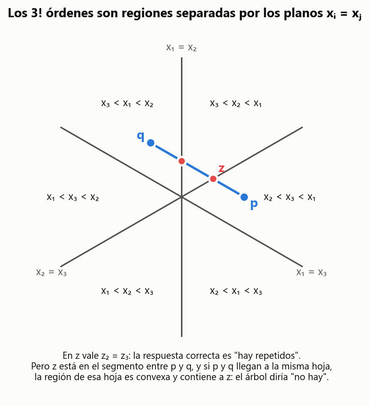
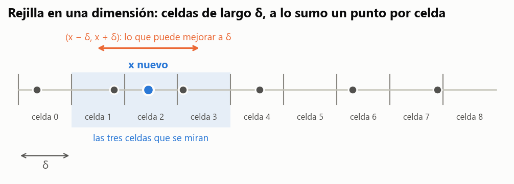
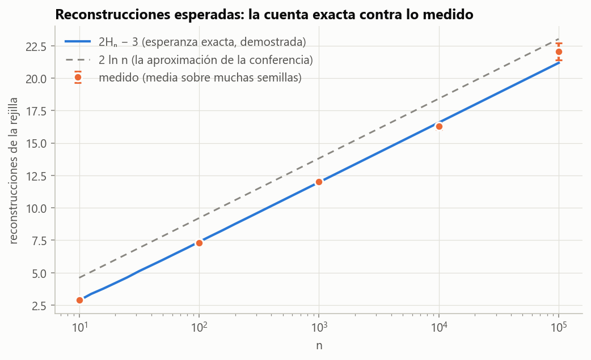
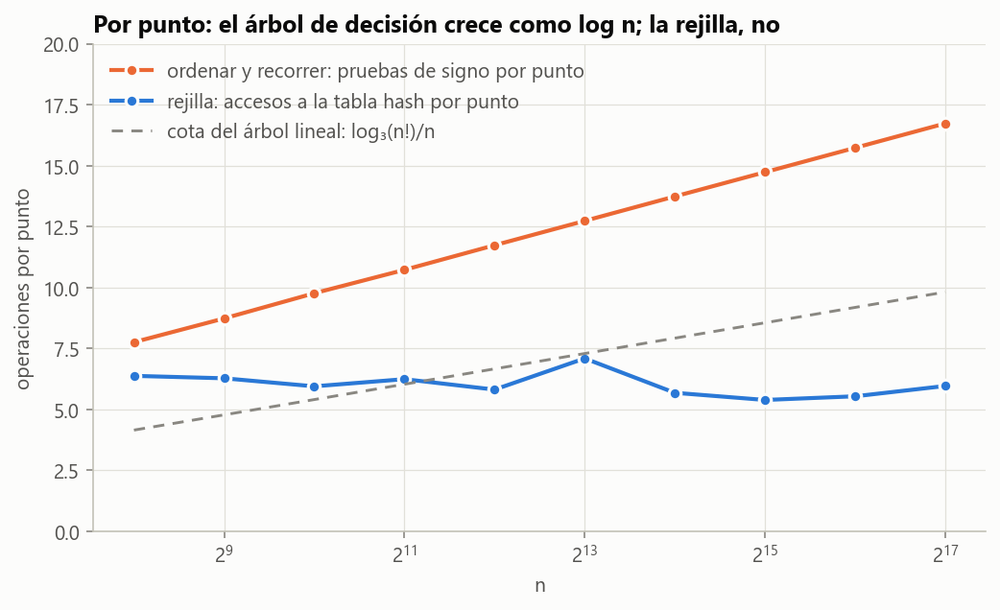

# Ejercicio 10 · Par más cercano en una dimensión

> ★★ Par más cercano en una dimensión. Demuestra $\Omega(n\log n)$ en árboles de decisión algebraicos por reducción desde distinción de elementos. Después di qué algoritmo de la conferencia 2 rompe la cota, en qué modelo, y adáptalo a una dimensión. (C2, C5)

## Respuesta

**Cota mínima.** En una dimensión la reducción desde distinción de elementos es la identidad: hay dos números iguales si y solo si la distancia mínima es 0. Un árbol de decisión que encuentra el par más cercano con profundidad $T(n)$, con una prueba de signo más al final, decide distinción de elementos con profundidad $T(n)+1$. Por el teorema de Ben-Or, $T(n) = \Omega(n\log n)$ en árboles algebraicos (Teorema 5). En árboles de decisión **lineales** demostramos la cota completa, sin citar nada: hacen falta al menos $\lceil\log_3 n!\rceil - 1$ pruebas (Teoremas 3 y 5). Ordenar y recorrer alcanza la cota, así que es óptimo en esos modelos.

**Quién la rompe.** El algoritmo incremental aleatorio con rejilla de la C2, §9 (Rabin, 1976; Kleinberg y Tardos, §13.7). Trabaja en una RAM con **parte entera** y **direccionamiento indirecto** (una tabla hash), por ejemplo la word RAM con coordenadas enteras. Ninguna de esas dos operaciones es una prueba de signo de un polinomio. El azar no es lo que rompe la cota: con azar, los árboles algebraicos siguen necesitando $\Omega(n\log n)$.

**Adaptado a una dimensión.** Celdas de largo $\delta$, no $\delta/2$, y **3 celdas** por punto en lugar de 25 (Lemas 6 y 7). El costo esperado es $O(n)$ para toda entrada (Teorema 9). Damos la esperanza **exacta** de reconstrucciones cuando el par más cercano es único en cada paso, $2H_n - 3$ (con empates es menor), y la comprobamos promediando sobre las $n!$ órdenes de inserción. Sin barajar, una entrada explícita lo obliga a $\Theta(n^2)$.

---

## 1. El problema

**Par más cercano en una dimensión.** Entrada: una lista $x_1,\dots,x_n$ de $n \ge 2$ números. Salida: índices $i < j$ que minimizan $|x_i - x_j|$, y esa distancia $\delta$.

Las tres precisiones de la C2, §2:

- **Repetidos.** Es una lista, así que puede haberlos, y entonces $\delta = 0$.
- **Empates.** Se devuelve cualquier par mínimo.
- **No hay raíces cuadradas.** En una dimensión la distancia es un valor absoluto.

Usamos dos modelos, y la mitad del ejercicio es no confundirlos:

- **Árboles de decisión** (C2, §8 y C5, §2). Cada nodo interno prueba el signo de una función de la entrada y se abre en tres ramas ($<0$, $=0$, $>0$). Cada hoja da una respuesta. El costo es la profundidad, y toda la aritmética es gratis. En un árbol **algebraico** las funciones son polinomios de grado acotado; en uno **lineal**, funciones afines $a_0 + \sum_k a_k x_k$. Un árbol lineal es un caso particular de uno algebraico.
- **RAM** (C1, §4 y §9), donde además de comparar y operar se puede usar un número calculado como dirección de memoria.

## 2. El algoritmo que alcanza la cota: ordenar y recorrer

**Lema 1 (C2, §3, con empates).** Si $y_1 \le y_2 \le \dots \le y_n$, entonces $\displaystyle\min_{i<j} (y_j - y_i) = \min_{1\le k<n} (y_{k+1} - y_k)$.

*Demostración.* Para $i < j$ la diferencia se descompone en huecos consecutivos, todos $\ge 0$ porque la sucesión está ordenada:

```math
y_j - y_i = \sum_{k=i}^{j-1} (y_{k+1} - y_k) \;\ge\; y_{i+1} - y_i.
```

Así que el mínimo sobre todos los pares es al menos el mínimo sobre los consecutivos. Como los consecutivos son pares, también es a lo sumo ese mínimo. $\blacksquare$

Esta demostración no supone que el par sea único ni que los valores sean distintos, que es lo que pide el ejercicio 1 de la C2. Con empates, algún par consecutivo alcanza el mínimo. Con repetidos, el mínimo es 0 y lo alcanza un hueco consecutivo nulo.

**Teorema 2.** Ordenar con mezcla y quedarse con el menor de los $n-1$ huecos consecutivos es correcto y hace $O(n\log n)$ operaciones. Además es un **árbol de decisión lineal** de profundidad $O(n\log n)$.

*Demostración.* La correctitud es el Lema 1. El costo es el de mezcla, $n\lceil\log_2 n\rceil - 2^{\lceil\log_2 n\rceil} + 1$ comparaciones en el peor caso (verificado en el ejercicio 1), más $n-2$ comparaciones entre huecos. Las únicas pruebas son de dos tipos, y las dos son signos de funciones lineales de la entrada:

- comparar dos elementos es el signo de $x_a - x_b$;
- comparar dos huecos es el signo de $(x_c - x_d) - (x_a - x_b)$.

Todo lo demás (índices, el orden resultante) depende solo de las respuestas. $\blacksquare$

## 3. La cota mínima

### 3.1 Por qué no alcanza con contar salidas

La herramienta de la C5, §3, cuenta respuestas posibles. Distinción de elementos tiene dos ("sí" y "no"), y par más cercano tiene $\binom n2$, así que un árbol ternario necesita profundidad $\log_3\binom n2 < 2\log_3 n$. No sirve: igual que con el máximo (C5, §4), la salida es chica pero justificarla cuesta mucho. Hace falta contar otra cosa, y lo que se cuenta son **regiones del espacio de entradas**.

### 3.2 La cota en árboles lineales, demostrada entera

**Lema (las hojas de un árbol lineal son convexas).** El conjunto $R_\ell \subseteq \mathbb R^n$ de las entradas que llegan a una hoja $\ell$ es convexo.

*Demostración.* Una entrada llega a $\ell$ si y solo si cada prueba del camino de la raíz a $\ell$ le da el signo de ese camino. Cada condición $f(x) < 0$, $f(x) = 0$ o $f(x) > 0$, con $f$ afín, define un semiespacio abierto o un hiperplano, y los dos son convexos. $R_\ell$ es la intersección de esos conjuntos, y una intersección de convexos es convexa. $\blacksquare$

**Teorema 3 (distinción de elementos en árboles lineales).** Todo árbol de decisión lineal que decide si $n$ números son todos distintos tiene profundidad al menos $\lceil\log_3 n!\rceil$.

*Demostración.* Para cada permutación $\pi$ de $\lbrace 1,\dots,n\rbrace$ sea $p^\pi \in \mathbb R^n$ la entrada con $p^\pi_i = \pi(i)$. Sus coordenadas son distintas, así que el árbol tiene que responder "todos distintos". Vamos a ver que dos permutaciones distintas $\pi \ne \sigma$ llegan a hojas distintas.

Supongamos que $p = p^\pi$ y $q = p^\sigma$ llegan a la misma hoja $\ell$. Como $\pi \ne \sigma$, hay dos índices $i, j$ que quedan en orden distinto: $p_i < p_j$ y $q_i > q_j$. La función

```math
g(t) = (1-t)(p_i - p_j) + t\,(q_i - q_j)
```

es continua, negativa en $t=0$ y positiva en $t=1$, así que se anula en algún $t^\ast \in (0,1)$. El punto $z = (1-t^\ast)\ p + t^\ast q$ tiene $z_i = z_j$: tiene repetidos. Pero $z$ está en el segmento entre $p$ y $q$, que están en $R_\ell$, y $R_\ell$ es convexo, así que $z$ también llega a $\ell$. El árbol le contesta "todos distintos" y se equivoca. Contradicción.

Así que las $n!$ entradas $p^\pi$ llegan a $n!$ hojas distintas. Un árbol ternario de profundidad $h$ tiene a lo sumo $3^h$ hojas (el Lema 1 de la C5 con tres ramas), así que $3^h \ge n!$ y $h \ge \lceil\log_3 n!\rceil$. $\blacksquare$



**Figura 1.** Con $n=3$, cortando $\mathbb R^3$ con el plano $x_1+x_2+x_3=0$. Los planos $x_i = x_j$ separan las $3! = 6$ regiones donde la entrada tiene un orden fijo. Cualquier segmento entre dos órdenes distintos cruza un plano de repetidos. Si una hoja convexa contuviera a $p$ y a $q$, contendría al punto rojo $z$.

Con la cota de la C5 (Lema 3), $\log_2 n! \ge n\log_2 n - 1{,}443\ n$, y dividiendo entre $\log_2 3$:

```math
\lceil\log_3 n!\rceil \;\ge\; \frac{n\log_2 n - 1{,}443\,n}{\log_2 3} = \Omega(n\log n).
```

Este argumento es de Dobkin y Lipton (1979). Lo demostramos entero porque no usa nada fuera del curso.

**Experimento: los $n!$ caminos se ven.** El código toma el algoritmo del Teorema 2 más la prueba final de la sección 3.4, registra el signo de cada prueba que hace, y lo corre sobre las $n!$ permutaciones. El teorema dice que todos los caminos tienen que ser distintos, y lo son:

| $n$ | $n!$ | caminos distintos | todos responden "distintos" | profundidad máxima | $\lceil\log_3 n!\rceil$ |
|---|---|---|---|---|---|
| 3 | 6 | 6 | sí | 5 | 2 |
| 4 | 24 | 24 | sí | 8 | 3 |
| 5 | 120 | 120 | sí | 12 | 5 |
| 6 | 720 | 720 | sí | 16 | 6 |
| 7 | 5040 | 5040 | sí | 20 | 8 |

### 3.3 En árboles algebraicos: el teorema de Ben-Or

En un árbol algebraico las hojas ya no son convexas, ni siquiera conexas. Una sola prueba, $x_1^2 - 1 > 0$, manda a la misma rama a $x_1 = -2$ y a $x_1 = 2$, y el segmento entre ellos pasa por $x_1 = 0$, que va a la otra rama. El argumento de arriba se rompe exactamente en el paso de convexidad.

**Teorema 4 (Ben-Or, 1983; citado en la C2, §8).** Distinción de elementos requiere $\Omega(n\log n)$ en árboles de decisión algebraicos.

La idea es la misma con una herramienta más fuerte. El conjunto de entradas con todos los valores distintos tiene $n!$ componentes conexas, una por orden, porque para pasar de un orden a otro de forma continua hay que atravesar algún $x_i = x_j$. Un teorema de Milnor y Thom acota cuántas componentes puede tener la región de una hoja de profundidad $h$. Así, un árbol de profundidad $h$ separa a lo sumo $c^h$ componentes en total, de donde $h = \Omega(\log n!) = \Omega(n\log n)$. Lo usamos sin demostrarlo, como la conferencia.

### 3.4 La reducción

**Teorema 5.** Todo árbol de decisión algebraico que resuelve el par más cercano en una dimensión tiene profundidad $\Omega(n\log n)$. Si el árbol es lineal, la profundidad es al menos $\lceil\log_3 n!\rceil - 1$.

*Demostración.* Sea $A$ un árbol de profundidad $T(n)$ que resuelve el par más cercano: cada hoja tiene un par $(i,j)$ que es correcto para toda entrada que llega a ella. Construimos un árbol $B$ para distinción de elementos. Se reemplaza cada hoja $(i,j)$ de $A$ por un nodo que prueba el signo de $x_i - x_j$: si da $= 0$, la respuesta es "hay repetidos", y si da $<0$ o $>0$, "todos distintos".

- Si la entrada tiene repetidos, la distancia mínima es 0, y el par $(i,j)$ de la hoja, que es un par mínimo, cumple $x_i = x_j$. $B$ dice "hay repetidos".
- Si la entrada no tiene repetidos, todo par cumple $x_i \ne x_j$. $B$ dice "todos distintos".

$B$ es correcto y tiene profundidad $T(n)+1$. La prueba agregada tiene grado 1, así que si $A$ es lineal, $B$ también. Por el Teorema 4, $T(n)+1 = \Omega(n\log n)$, y por el Teorema 3, en el caso lineal, $T(n) + 1 \ge \lceil\log_3 n!\rceil$. $\blacksquare$

**Comparación con la reducción de la C2.** En el plano la conferencia transformaba $x_i \mapsto (x_i, 0)$. En una dimensión no hace falta transformar nada: el par más cercano en la recta **es** distinción de elementos con regla. De hecho, la reducción de la C2 es la composición de dos: distinción de elementos se reduce a par más cercano en la recta, y la recta se mete en el plano como el eje $x$.

**Variantes del enunciado.** Si el árbol devuelve la distancia en lugar del par, cada hoja tiene que dar una expresión como $x_i - x_j$, y se agrega la misma prueba. Si es la versión de decisión "¿es $\delta \le t$?", con $t = 0$ es exactamente distinción de elementos.

**Conclusión del ciclo.** En árboles algebraicos ordenar y recorrer es óptimo: $\Theta(n\log n)$. En árboles lineales la cota y el algoritmo coinciden salvo la constante del término principal. El algoritmo hace unas $n\log_2 n$ pruebas y la cota es $n\log_2 n/\log_2 3$, así que el cociente tiende a $\log_2 3 \approx 1{,}585$. Medido con entradas al azar:

| $n$ | cota $\lceil\log_3 n!\rceil - 1$ | pruebas del algoritmo | cociente |
|---|---|---|---|
| 64 | 186 | 366 | 1,968 |
| 512 | 2 444 | 4 463 | 1,826 |
| 4 096 | 27 287 | 48 107 | 1,763 |
| 32 768 | 280 293 | 482 980 | 1,723 |

## 4. Quién rompe la cota, y en qué modelo

El algoritmo de la C2, §9: inserción incremental en orden aleatorio, con una rejilla guardada en una tabla hash. Hace dos cosas que ningún árbol de decisión algebraico puede hacer (C2, §10):

1. **Calcula una parte entera**, $\lfloor x/\delta\rfloor$, la celda del punto. No es un polinomio y ni siquiera es continua.
2. **Usa ese número como dirección**: va a la tabla hash a buscar *esa* celda. Un nodo de un árbol se abre en tres ramas. Un acceso a la tabla "se abre" en tantas ramas como celdas hay, en tiempo $O(1)$.

**El azar no es lo que rompe la cota.** Grigoriev, Karpinski, Meyer auf der Heide y Smolensky (1996) demostraron que distinción de elementos sigue necesitando $\Omega(n\log n)$ en árboles algebraicos aleatorizados. El azar le sirve al algoritmo para que se esperen pocas reconstrucciones; lo que lo saca del modelo son la parte entera y el direccionamiento. Es el mismo truco que el ordenamiento por conteo de la C5, §9: usar los valores como índices.

**El modelo concreto.** La word RAM con coordenadas enteras de $w$ bits:

- $\lfloor x/\delta\rfloor$ es una división entera de costo $O(1)$;
- la tabla hash cuesta $O(1)$ esperado por operación;
- el azar se usa para barajar.

No conviene decir "una RAM real con parte entera de costo 1": como la multiplicación de celdas sin límite de la C1, §9, una parte entera de costo unitario sobre números reales arbitrarios da un modelo irrazonablemente poderoso. Que la entrada sea entera tampoco es lo que rompe la cota: distinción de elementos sigue necesitando $\Omega(n\log n)$ en árboles algebraicos aun restringida a enteros (Lubiw y Rácz, 1991).

**Otra salida, determinista.** Si las coordenadas son enteros en $[0, n^c)$, el radix sort ordena en $O(n)$ sin comparar (C5, ejercicio 7), y después se recorre. Sirve solo para rangos acotados. La rejilla funciona con enteros cualesquiera de $w$ bits.

## 5. La rejilla en una dimensión

```python
def rejilla_1d(xs, semilla=0):
    orden = list(range(len(xs)))
    random.Random(semilla).shuffle(orden)
    a, b = orden[0], orden[1]
    delta, par = abs(xs[a] - xs[b]), (a, b)
    if delta == 0:
        return 0, par
    rejilla = {xs[a] // delta: a, xs[b] // delta: b}      # celda -> índice
    for t in range(2, len(xs)):
        i = orden[t]
        c, antes = xs[i] // delta, delta
        for d in (-1, 0, 1):                                 # tres celdas
            j = rejilla.get(c + d)
            if j is not None and abs(xs[i] - xs[j]) < delta:
                delta, par = abs(xs[i] - xs[j]), (j, i)
        if delta == 0:
            return 0, par
        if delta < antes:                                    # δ bajó: reconstruir
            rejilla = {xs[k] // delta: k for k in orden[:t + 1]}
        else:
            rejilla[c] = i
    return delta, par
```

Hay tres diferencias con la versión del plano:

- **Las celdas miden $\delta$, no $\delta/2$.** En el plano, el diámetro de un cuadrado de lado $s$ es $s\sqrt2$, y para que sea menor que $\delta$ hace falta $s < \delta/\sqrt2$. En la recta el "diámetro" de una celda semiabierta $[k\delta, (k+1)\delta)$ es su largo, y dos puntos dentro están a distancia **menor** que $\delta$.
- **Se miran 3 celdas, no 25.**
- **Si $\delta$ llega a 0, se termina.** No se puede bajar más, y las celdas de largo 0 no están definidas.



**Figura 2.** Celdas de largo $\delta$ con a lo sumo un punto cada una. Todo lo que puede mejorar a $\delta$ está en $(x-\delta, x+\delta)$, que cae dentro de la celda de $x$ y sus dos vecinas.

**Lema 6 (un punto por celda).** Si todos los pares de un conjunto están a distancia al menos $\delta > 0$, no hay dos puntos del conjunto con la misma celda $\lfloor x/\delta\rfloor$.

*Demostración.* Si $\lfloor x/\delta\rfloor = \lfloor y/\delta\rfloor = k$, los dos están en $[k\delta, (k+1)\delta)$, y entonces $|x-y| < \delta$. $\blacksquare$

**Lema 7 (tres celdas bastan).** Si $|x - y| < \delta$, entonces $\big|\lfloor x/\delta\rfloor - \lfloor y/\delta\rfloor\big| \le 1$.

*Demostración.* $|x/\delta - y/\delta| < 1$. Si $a \le b < a+1$, entonces $\lfloor a\rfloor \le \lfloor b\rfloor \le \lfloor a\rfloor + 1$. $\blacksquare$

**Teorema 8 (correctitud).** El algoritmo devuelve siempre un par a distancia mínima. Es un algoritmo **Las Vegas**: el azar afecta el tiempo, nunca la respuesta.

*Demostración.* Sea $S_t$ el conjunto de los primeros $t$ puntos insertados. El invariante, al terminar de insertar $S_t$, tiene dos partes:

- **(I1)** $\delta$ es la distancia mínima de $S_t$, y `par` la alcanza;
- **(I2)** la rejilla contiene exactamente los puntos de $S_t$, cada uno en la celda $\lfloor x/\delta\rfloor$.

Por el Lema 6, (I1) implica que cada celda tiene a lo sumo un punto, así que la tabla `celda -> índice` no pierde ninguno.

- **Inicialización** ($t = 2$). $\delta = |x_a - x_b|$ es la única distancia de $S_2$. Si es 0 se devuelve, y 0 es el mínimo posible. Si no, los dos puntos están en celdas distintas por el Lema 6.
- **Mantenimiento.** Llega $x = x_i$. La nueva distancia mínima es $\delta' = \min\big(\delta,\ \min_{y\in S_t}|x-y|\big)$.
  - Si ningún $y \in S_t$ está a menos de $\delta$ de $x$, entonces $\delta' = \delta$. El algoritmo no cambia $\delta$, porque solo lo baja cuando encuentra algo menor.
  - Si alguno lo está, el más cercano de ellos está en una de las tres celdas (Lema 7), y el algoritmo lo examina, porque mira todos los puntos de esas celdas. Así que termina con $\delta = \delta'$ y con un par que la alcanza. Esto da (I1).

  Para (I2): si $\delta$ bajó, la rejilla se reconstruye con el $\delta$ nuevo, y eso es (I2) por construcción. Si no bajó, la celda de $x$ estaba vacía: otro punto en ella estaría a menos de $\delta$ y lo habría bajado. Así que $x$ se inserta sin pisar a nadie.
- **Conclusión.** Con $t = n$, (I1) dice que el resultado es correcto. Si en algún paso $\delta' = 0$, se devuelve 0, que es el mínimo.
- **Terminación.** Un ciclo `for` sobre $n$ puntos. $\blacksquare$

El código de prueba vigila los dos invariantes después de cada inserción en 400 entradas al azar, y el algoritmo tiene `assert` que comprueban el Lema 6 en cada reconstrucción.

**Teorema 9 (costo esperado).** Para **toda** entrada, con el orden de inserción uniforme al azar:

```math
\mathbb E[\text{reconstrucciones}] \le 2H_n - 3, \qquad \mathbb E[\text{puntos reinsertados}] \le 2(n-2),
```

con igualdad cuando cada subconjunto tiene un único par más cercano (por ejemplo, si todas las distancias son distintas). Aquí $H_n = 1 + \frac12 + \dots + \frac1n$. El costo esperado total es $O(n)$.

*Demostración (análisis hacia atrás, C2, §9).* Sea $m \ge 3$ y sea $S_m$ el conjunto de los primeros $m$ puntos. Insertar el punto $m$-ésimo provoca una reconstrucción si y solo si $\delta(S_m) < \delta(S_m \setminus \lbrace p_m\rbrace)$, es decir, si y solo si $p_m$ está en **todos** los pares más cercanos de $S_m$.

- Si $S_m$ tiene un único par más cercano, hay exactamente 2 puntos que cumplen eso.
- Si tiene dos o más pares distintos, su intersección tiene a lo sumo un punto.

En los dos casos, a lo sumo 2 puntos de $S_m$ provocan la reconstrucción. Como el orden es una permutación uniforme, condicionado al conjunto $S_m$, el último en llegar es uniforme entre sus $m$ elementos. Así que

```math
\Pr[\text{reconstruir en el paso } m] \le \frac{2}{m},
```

con igualdad cuando el par más cercano de $S_m$ es único. Por linealidad de la esperanza:

```math
\mathbb E[\text{reconstrucciones}] \le \sum_{m=3}^{n}\frac2m = 2H_n - 3, \qquad \mathbb E[\text{reinserciones}] \le \sum_{m=3}^{n}\frac2m\cdot m = 2(n-2).
```

Cada inserción hace 3 consultas y a lo sumo una escritura. El total esperado de accesos a la tabla es a lo sumo $3(n-2) + (n-2) + 2(n-2) + 2 \approx 6n$, que es $O(n)$. $\blacksquare$

Este análisis afina un poco el de la conferencia, por dos lados. Primero, cubre los empates: la conferencia supone que el par es único, y con empates la probabilidad solo puede bajar. Segundo, da la constante exacta. Como $H_n = \ln n + \gamma + O(1/n)$, la esperanza es $2\ln n + 2\gamma - 3 \approx 2\ln n - 1{,}85$, así que la aproximación $2\ln n$ de la conferencia sobrestima en casi 2. Ese ajuste vale igual en el plano, donde el análisis es el mismo. El 13,3 que mide la C2 para $n = 1000$ con tres semillas es compatible con el valor exacto 11,97, porque con tres corridas el error estándar es de unas 2 reconstrucciones.

**El peor caso sin barajar es $\Theta(n^2)$.** Sea $x_1 = 0$ y $x_{k+1} = x_k + (n-k)$: los huecos, en orden de inserción, son $n-1, n-2, \dots, 1$. Al insertar el punto $k+1$, el hueco nuevo es menor que todos los anteriores, así que $\delta$ baja en cada paso. Hay $n-2$ reconstrucciones y $\sum_{m=3}^{n} m = \frac{n(n+1)}{2} - 3$ reinserciones. Barajando, la misma entrada vuelve a $2H_n - 3$ en promedio:

| $n$ | reconstrucciones sin barajar | reinserciones sin barajar | barajada (media de 200) | $2H_n - 3$ |
|---|---|---|---|---|
| 100 | 98 | 5 047 | 7,17 | 7,37 |
| 1000 | 998 | 500 497 | 11,95 | 11,97 |
| 3000 | 2998 | 4 501 497 | 14,20 | 14,17 |

La garantía del Teorema 9 es para cada entrada fija, en esperanza sobre el azar del algoritmo. No es un promedio sobre entradas. Es la distinción del resumen del tema: el caso típico no es la garantía.

## 6. Experimentos

**La esperanza exacta, sin azar.** Para comprobar el Teorema 9 sin depender de semillas, la prueba `test_esperanza_exacta_sobre_todos_los_ordenes` toma $x = (0, 1, 3, 7, \dots, 2^{n-1}-1)$, cuyas diferencias $2^j - 2^i$ son todas distintas. Corre la rejilla con **cada una** de las $n!$ órdenes de inserción, para $n \le 7$. Con aritmética racional, el promedio da exactamente $2H_n - 3$ reconstrucciones y exactamente $2(n-2)$ reinserciones. Con todos los huecos iguales ($x = 0, 1, \dots, n-1$), el promedio queda por debajo de $2H_n - 3$, como predice el caso de empates.

**Con entradas grandes al azar**, enteros distintos en el intervalo $[0, 10^{12})$:

| $n$ | corridas | reconstrucciones (media ± error) | $2H_n - 3$ | $2\ln n$ | reinserciones $/(n-2)$ |
|---|---|---|---|---|---|
| 10 | 4000 | 2,878 ± 0,020 | 2,858 | 4,61 | 2,02 |
| 100 | 2000 | 7,298 ± 0,055 | 7,375 | 9,21 | 1,98 |
| 1000 | 1000 | 12,003 ± 0,105 | 11,971 | 13,82 | 1,96 |
| 10 000 | 200 | 16,305 ± 0,267 | 16,575 | 18,42 | 1,99 |
| 100 000 | 40 | 22,050 ± 0,660 | 21,180 | 23,03 | 2,26 |

Todas las medias están a menos de dos errores estándar de $2H_n - 3$, y las reinserciones por punto rondan 2, como predice el teorema.



**Figura 3.** La esperanza exacta $2H_n-3$ (azul) pasa por las mediciones; $2\ln n$ (gris) queda siempre casi 2 por encima.

**Operaciones por punto.** En las operaciones de cada modelo, las pruebas de signo del Teorema 2 crecen como $\log_2 n$ por punto, por encima de la cota $\log_3(n!)/n$. Los accesos de la rejilla quedan en unos 6 por punto, que es la cuenta $3 + 1 + 2$ del Teorema 9.



**Figura 4.** Por punto: el árbol de decisión, y la cota que lo obliga, crecen con $\log n$; la rejilla se queda constante.

**Tiempos en Python.** Con un millón de puntos, `sorted` más recorrer tarda 1,0 s y la rejilla 2,5 s. El `sorted` de Python está escrito en C y la rejilla en Python puro, así que la constante favorece al algoritmo asintóticamente peor. Es la lección de la C1: se mide en un modelo, y la comparación justa es la de las operaciones de la Figura 4.

## 7. Verificación: código y pruebas

- [`codigo/ejercicio_10.py`](codigo/ejercicio_10.py) implementa la fuerza bruta (oráculo), ordenar y recorrer con registro de cada prueba de signo, la reducción a distinción de elementos, la rejilla en 1D con invariantes vigilados, la entrada de huecos decrecientes, todas las tablas y las figuras.
- [`codigo/test_ejercicio_10.py`](codigo/test_ejercicio_10.py) tiene 14 pruebas:

| prueba | qué comprueba |
|---|---|
| `test_todos_los_algoritmos_coinciden_con_la_fuerza_bruta` | 1500 entradas, con repetidos, negativos y empates, contra el oráculo |
| `test_casos_borde` | $n = 2$, todos iguales, enteros de 100 bits |
| `test_fracciones_exactas` | la rejilla con coordenadas racionales |
| `test_lema_1_con_empates` | Lema 1 con muchos empates |
| `test_tres_celdas_bastan` | Lema 7 en 20 000 casos |
| `test_un_punto_por_celda` | Lema 6 en 2000 conjuntos |
| `test_invariantes_vigilados` | (I1) e (I2) después de cada inserción |
| `test_los_n_factorial_ordenes_van_a_hojas_distintas` | Teorema 3 sobre el árbol de la reducción, $n \le 6$ |
| `test_la_reduccion_decide_distincion` | el árbol $B$ del Teorema 5 decide bien |
| `test_las_pruebas_son_lineales_y_las_cuenta_el_camino` | el camino tiene exactamente las comparaciones de la mezcla más $n - 2$ pruebas de huecos, y no cambia al escalar y trasladar la entrada, como corresponde a pruebas que son diferencias lineales |
| `test_huecos_decrecientes_sin_barajar` | $n-2$ reconstrucciones y $\frac{n(n+1)}2 - 3$ reinserciones |
| `test_esperanza_exacta_sobre_todos_los_ordenes` | Teorema 9 con igualdad exacta, sobre las $n!$ órdenes |
| `test_con_empates_la_esperanza_no_sube` | Teorema 9 con empates |
| `test_esperanza_con_semillas` | la media a menos de 4 errores estándar de $2H_n - 3$ |

Las coordenadas son enteros o fracciones exactas. Con números de punto flotante, $\lfloor x/\delta\rfloor$ puede redondear mal en un borde de celda, y el Lema 7 dejaría de valer al pie de la letra.

Para reproducir todo (Python 3, con `matplotlib` para las figuras):

```bash
cd codigo
python ejercicio_10.py --figuras
python -m pytest test_ejercicio_10.py
```

## 8. Resumen

- En una dimensión, ordenar y mirar los $n-1$ huecos consecutivos es correcto (con empates y repetidos) y cuesta $O(n\log n)$. Es un árbol de decisión lineal.
- **Cota mínima.** La reducción desde distinción de elementos es la identidad más una prueba: hay repetidos si y solo si $\delta = 0$. Con Ben-Or da $\Omega(n\log n)$ en árboles algebraicos. En árboles lineales la demostramos entera: $n!$ órdenes, hojas convexas y un segmento que cruza $x_i = x_j$ dan $\lceil\log_3 n!\rceil - 1$.
- **Quién la rompe.** La rejilla aleatoria de la C2, §9. Usa la parte entera y el direccionamiento indirecto de la RAM, que los árboles no tienen. El azar no la saca del modelo.
- **En una dimensión.** Celdas de largo $\delta$, tres celdas por punto y la misma demostración por invariante. En esperanza, a lo sumo $2H_n - 3$ reconstrucciones y $2(n-2)$ reinserciones para toda entrada, con igualdad cuando los pares más cercanos son únicos (por ejemplo, si todas las distancias son distintas). Sin barajar, $\Theta(n^2)$ con huecos decrecientes.
- La cota y el algoritmo lineal no se contradicen: viven en modelos distintos.
