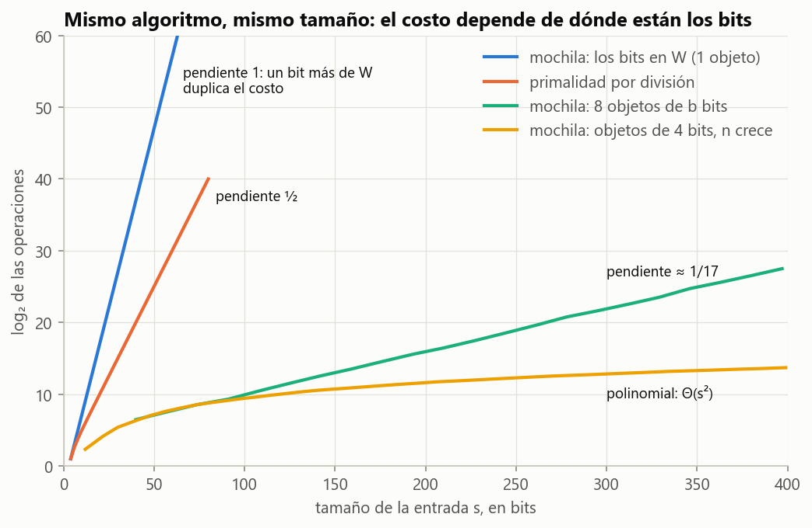
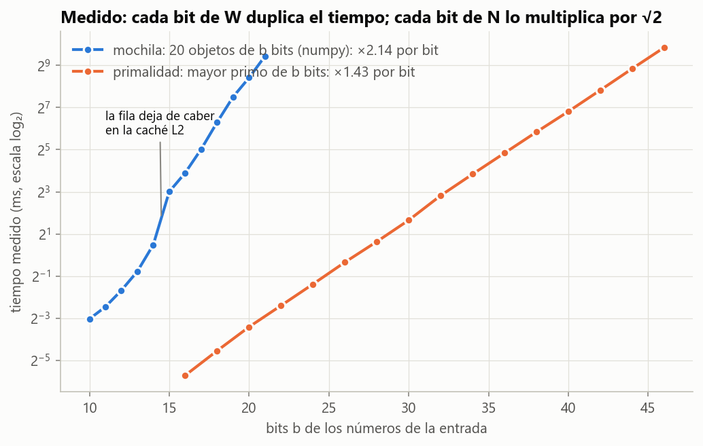
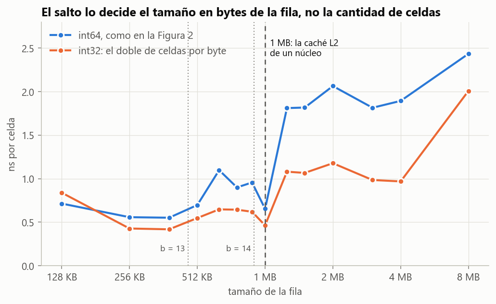

# Ejercicio 11 · La mochila en $O(nW)$ no es polinomial

> ★★ La mochila entera se resuelve con programación dinámica en $O(nW)$, donde $W$ es la capacidad (lo vieron en Estructuras de Datos). Mide el tamaño de la entrada en bits, como en la sección 8 de la conferencia 1. ¿Es polinomial ese algoritmo? ¿En qué se parece a la primalidad por división? (C1)

## Respuesta

**No es polinomial.** Su costo es $\Theta(nW)$, polinomial en la *cantidad* de objetos $n$ y en el *valor* de la capacidad $W$. Pero $W$ se escribe con $\lfloor\log_2 W\rfloor + 1$ bits, así que puede valer $2^{b}$ con solo $b$ bits de entrada. Medido en el tamaño $s$ de la entrada en bits, el costo en el peor caso es $2^{\Theta(s)}$ (Teorema 3). El algoritmo es **pseudopolinomial**: polinomial si los números se escribieran en unario, exponencial con los números en binario.

**Se parece a la primalidad por división en el mecanismo exacto del error.** En los dos algoritmos un ciclo da tantas vueltas como el *valor* de un número de la entrada: $\sqrt N = 2^{b/2}$ divisiones en un caso y $W + 1 \approx 2^{b}$ columnas en el otro. Un solo `for` parece barato, pero cuenta hasta un número que es exponencial en su cantidad de bits. Cada bit más en $W$ duplica el costo de la mochila, y cada bit más en $N$ lo multiplica por $\sqrt 2$. Lo medimos en la Figura 2.

**Y se diferencian en lo que viene después.** La primalidad tiene algoritmos polinomiales en $b$ (Miller-Rabin, aleatorio, y AKS, determinista desde 2002): el costo exponencial era culpa del algoritmo. Para la mochila no se conoce ninguno, y encontrarlo demostraría $\mathrm{P} = \mathrm{NP}$ (Tema 3): ahí el costo pseudopolinomial es, hasta donde se sabe, lo mejor posible.

---

## 1. El problema y el algoritmo

**Problema.** Entrada: $n$ objetos con pesos $w_1,\dots,w_n \ge 1$ y valores $v_1,\dots,v_n \ge 1$ enteros, y una capacidad entera $W \ge 0$. Salida: el mayor $\sum_{i\in S} v_i$ entre los subconjuntos $S \subseteq \lbrace 1,\dots,n\rbrace$ con $\sum_{i\in S} w_i \le W$, y un $S$ que lo alcance. "Entera" quiere decir que cada objeto se lleva entero o no se lleva.

**Modelo.** Word RAM (C1, §9). En las secciones 1 a 3 suponemos que los pesos, los valores y sus sumas caben en una palabra. La sección 3 dice qué cambia si no caben.

**Algoritmo.** Se llena una tabla $D$ de $n+1$ filas y $W+1$ columnas:

$$D[0][c] = 0, \qquad D[i][c] = \begin{cases} \max\big(D[i-1][c],\ v_i + D[i-1][c-w_i]\big) & \text{si } w_i \le c,\\ D[i-1][c] & \text{si } w_i > c. \end{cases}$$

La respuesta es $D[n][W]$. Para recuperar el conjunto se recorre la tabla hacia atrás desde $(n, W)$: si $D[i][c] \ne D[i-1][c]$, el objeto $i$ está en la solución y se sigue en $(i-1, c-w_i)$; si no, se sigue en $(i-1, c)$.

```python
def mochila(pesos, valores, W):
    n = len(pesos)
    tabla = [[0] * (W + 1)]
    for i in range(1, n + 1):
        w, v = pesos[i - 1], valores[i - 1]
        previa = tabla[i - 1]
        fila = [0] * (W + 1)
        for c in range(W + 1):                   # W + 1 vueltas: el ciclo culpable
            fila[c] = previa[c]
            if w <= c and previa[c - w] + v > fila[c]:
                fila[c] = previa[c - w] + v
        tabla.append(fila)
    elegidos, c = [], W
    for i in range(n, 0, -1):
        if tabla[i][c] != tabla[i - 1][c]:
            elegidos.append(i - 1)
            c -= pesos[i - 1]
    return tabla[n][W], sorted(elegidos)
```

La versión completa, con un contador de celdas, está en [`codigo/ejercicio_11.py`](codigo/ejercicio_11.py).

## 2. Correctitud

Sea $\mathrm{OPT}(i, c)$ el mayor valor de un subconjunto de los objetos $1,\dots,i$ con peso total a lo sumo $c$. El conjunto vacío siempre sirve, así que $\mathrm{OPT}(i,c) \ge 0$ está bien definido.

**Teorema 1.** Para todo $0 \le i \le n$ y $0 \le c \le W$, $D[i][c] = \mathrm{OPT}(i, c)$. En particular, $D[n][W]$ es el óptimo.

*Demostración.* Invariante: *al terminar de calcular la fila $i$, $D[i][c] = \mathrm{OPT}(i,c)$ para todo $c$.*

- **Inicialización** ($i = 0$). Sin objetos, el único subconjunto es el vacío, así que $\mathrm{OPT}(0, c) = 0 = D[0][c]$.
- **Mantenimiento.** Supongamos que la fila $i-1$ cumple el invariante y fijemos $c$. Sea $S$ un subconjunto óptimo para $(i, c)$.
  - Si $i \notin S$, entonces $S$ es factible para $(i-1, c)$ y $\mathrm{OPT}(i,c) \le \mathrm{OPT}(i-1, c)$.
  - Si $i \in S$, entonces $w_i \le c$ y $S \setminus \lbrace i\rbrace$ es factible para $(i-1, c-w_i)$, así que $\mathrm{OPT}(i,c) \le v_i + \mathrm{OPT}(i-1, c-w_i)$.

  En los dos casos $\mathrm{OPT}(i,c)$ es a lo sumo el máximo de las opciones disponibles. Al revés, cada opción es el valor de un subconjunto factible para $(i,c)$: un óptimo de $(i-1,c)$, o un óptimo de $(i-1, c-w_i)$ más el objeto $i$, que pesa a lo sumo $(c - w_i) + w_i = c$. Así que $\mathrm{OPT}(i,c)$ es exactamente ese máximo, que por hipótesis de inducción es lo que el algoritmo escribe en $D[i][c]$.
- **Conclusión.** Con $i = n$ y $c = W$, $D[n][W] = \mathrm{OPT}(n, W)$. $\blacksquare$

**La reconstrucción también es correcta.** Su invariante es: *el valor de los objetos ya elegidos más $D[i][c]$ es $D[n][W]$, y su peso más $c$ es a lo sumo $W$.* Al empezar, con $(n, W)$ y nada elegido, vale.

- Si $D[i][c] = D[i-1][c]$, se pasa a $(i-1, c)$ sin elegir nada y el invariante se conserva.
- Si $D[i][c] \ne D[i-1][c]$, el máximo de la recurrencia vino de la segunda opción, así que $w_i \le c$ y $D[i][c] = v_i + D[i-1][c-w_i]$. Elegir $i$ suma $v_i$ al valor elegido y le resta $v_i$ a $D$, suma $w_i$ al peso y le resta $w_i$ a $c$: el invariante se conserva.

Al llegar a $i = 0$, $D[0][c] = 0$: el valor elegido es $D[n][W]$ y el peso es a lo sumo $W - c \le W$.

**Terminación.** Son ciclos `for` sobre rangos finitos: $n$ filas de $W+1$ columnas, y $n$ pasos de reconstrucción.

## 3. Costo

**Proposición 2.** En **toda** entrada, el algoritmo evalúa la recurrencia exactamente $n\,(W+1)$ veces. Con aritmética de costo 1, el tiempo es $\Theta(n\,(W+1))$ y la memoria es $\Theta(n\,(W+1))$, o $\Theta(W)$ si solo se quiere el valor y se guarda una fila.

*Demostración.* Los dos ciclos anidados recorren $i = 1..n$ y $c = 0..W$ sin salidas tempranas, y cada vuelta hace un número constante de operaciones. La reconstrucción agrega $O(n)$. $\blacksquare$

Que el costo sea el mismo en toda entrada importa para la sección siguiente: no hace falta buscar una entrada "mala", basta con que $W$ sea grande.

Si los números no caben en una palabra, cada suma o comparación de valores cuesta $O(\lceil \log_2(\sum v_i) / w\rceil)$ operaciones (C1, §9). Eso multiplica el costo por un factor polinomial en el tamaño de la entrada y no cambia ninguna conclusión. En particular, la cota inferior del Teorema 3 cuenta celdas, y cada celda cuesta al menos 1 en cualquier modelo.

## 4. El tamaño de la entrada en bits

**Definición.** Con $\mathrm{bits}(x) = \lfloor\log_2 x\rfloor + 1$ para $x \ge 1$, y $\mathrm{bits}(0) = 1$:

$$s = \mathrm{bits}(n) + \sum_{i=1}^{n}\big(\mathrm{bits}(w_i) + \mathrm{bits}(v_i)\big) + \mathrm{bits}(W).$$

Una codificación real necesita separar los números, por ejemplo duplicando cada bit y usando `01` como separador. Eso da un tamaño entre $s$ y $4s$, y un factor constante no cambia si algo es polinomial o exponencial: $2^{\Theta(s)}$ sigue siendo $2^{\Theta(s)}$.

El punto clave está en la definición: **$n$ cuenta cosas y $W$ es un valor**. Cada objeto aporta al menos 2 bits, así que $n \le s$. En cambio, un número de $b$ bits puede valer hasta $2^{b} - 1$, así que $W < 2^{s}$. El producto $nW$ mezcla una cantidad polinomial en $s$ con un valor exponencial en $s$.

**Definición (C1, §8).** Un algoritmo es polinomial si existe $d$ tal que su costo en el peor caso, $T(s) = \max\lbrace\text{costo}(I) : s(I) \le s\rbrace$, es $O(s^d)$.

**Teorema 3.** El costo en el peor caso de la programación dinámica cumple $2^{s-3} \le T(s) \le s\cdot 2^{s}$ para $s \ge 4$. Es decir, $T(s) = 2^{\Theta(s)}$, y el algoritmo no es polinomial.

*Demostración.*

- **Cota inferior.** Sea $I_b$ la instancia de un objeto con $w_1 = v_1 = 1$ y capacidad $W = 2^b - 1$. Su tamaño es $s = 1 + 1 + 1 + b = b + 3$. Por la Proposición 2, el algoritmo calcula $1\cdot(W+1) = 2^{b} = 2^{s-3}$ celdas. Si fuera $T(s) \le C s^d$ para algún $d$, tendríamos $2^{s-3} \le C s^d$ para todo $s$. Eso es falso, porque $s^d \in o(2^s)$ (C1, §5).
- **Cota superior.** En cualquier instancia de tamaño $s$, $n \le s$ y $W + 1 \le 2^{s}$, así que $n(W+1) \le s\cdot 2^s$. $\blacksquare$

**Observación: no es culpa de una instancia tonta.** $I_b$ tiene un solo objeto, y una mejora evidente la vuelve barata: reemplazar $W$ por $\min(W, \sum w_i)$, que no cambia la respuesta (se prueba en el código). Pero la mejora no salva al algoritmo. Sea $J_b$ la instancia con dos objetos de pesos $2^{b-1}$ y $2^{b-1}+1$, valores 1, y $W = 2^b$. Los dos objetos no caben juntos, $\sum w_i = 2^b + 1 > W$, y el recorte no cambia nada. Su tamaño es $s = 2 + 2b + 2 + (b+1) = 3b + 5$ y el algoritmo calcula $2(2^b + 1) > 2^{(s-5)/3 + 1}$ celdas, todavía $2^{\Omega(s)}$. Con el recorte, el costo es $n\cdot\min(W, \sum w_i)$, que sigue siendo exponencial en los bits de los pesos.

**Las tres familias, medidas.** La última columna, $\log_2(\text{celdas})/s$, es la pendiente de la Figura 1: tiende a 1 cuando todos los bits están en $W$, a $1/3$ con dos objetos, y a $1/17$ con ocho objetos de $b$ bits, porque cada uno de los 17 números aporta $b$ bits pero solo $W$ aporta al costo.

| familia | $b$ | $s$ | celdas | $\log_2(\text{celdas})/s$ |
|---|---|---|---|---|
| $I_b$: un objeto, los bits en $W$ | 16 | 19 | $6{,}55\cdot10^{4}$ | 0,842 |
| | 64 | 67 | $1{,}84\cdot10^{19}$ | 0,955 |
| $J_b$: dos objetos | 16 | 53 | $1{,}31\cdot10^{5}$ | 0,321 |
| | 64 | 197 | $3{,}69\cdot10^{19}$ | 0,330 |
| ocho objetos de $b$ bits | 16 | 278 | $1{,}79\cdot10^{6}$ | 0,075 |
| | 64 | 1094 | $2{,}95\cdot10^{20}$ | 0,062 |

**Mismo tamaño, distinto reparto.** El costo no es función de $s$ sola: depende de dónde están los bits. Con $s \approx 512$ bits repartidos entre $n$ objetos con pesos y valores de $b$ bits, y $W$ igual a la mitad del peso total, a $10^9$ celdas por segundo:

| objetos $n$ | bits por número $b$ | $s$ | celdas | tiempo |
|---|---|---|---|---|
| 1 | 170 | 510 | $3{,}7\cdot10^{50}$ | $1{,}2\cdot10^{34}$ años |
| 2 | 102 | 512 | $5{,}1\cdot10^{30}$ | $1{,}6\cdot10^{14}$ años |
| 4 | 56 | 508 | $2{,}9\cdot10^{17}$ | 9,1 años |
| 8 | 29 | 499 | $1{,}3\cdot10^{10}$ | 12,8 s |
| 16 | 15 | 503 | $3{,}2\cdot10^{6}$ | 3,2 ms |
| 32 | 7 | 465 | $4{,}9\cdot10^{4}$ | 49 µs |

Los bits que se gastan en *más objetos* cuestan polinomialmente, y los que se gastan en *números más grandes* cuestan exponencialmente.



*Figura 1. Logaritmo de las operaciones contra el tamaño de la entrada. Las exponenciales son rectas: pendiente 1 si todos los bits están en $W$, $1/2$ para la primalidad por división y $\approx 1/17$ con ocho objetos de $b$ bits. Con números de 4 bits y cada vez más objetos, la curva se aplana: es $\Theta(s^2)$.*

**Proposición 4 (lo que sí es polinomial).**

1. Si los números se escriben en unario, con tamaño $s_u = n + \sum w_i + \sum v_i + W$, el costo es a lo sumo $s_u^2$.
2. Restringido a entradas con $W \le p(n)$ para un polinomio no decreciente $p$, el costo es a lo sumo $s\,(p(s)+1)$, polinomial en $s$.

*Demostración.* (1) Si $n = 0$ no hay celdas. Si $n \ge 1$, entonces $n \le s_u$ y $W + 1 \le n + W \le s_u$, así que $n(W+1) \le s_u^2$. (2) $n(W+1) \le n\,(p(n)+1) \le s\,(p(s)+1)$, porque $n \le s$. $\blacksquare$

Eso es exactamente lo que significa **pseudopolinomial** (C1, §8): polinomial en el valor de los números, no en sus bits. La Figura 1 lo muestra con la curva amarilla, objetos de 4 bits con $W \le 15n$, que crece como $s^2$.

## 5. Cuánto cuesta en la práctica

La tabla de la C1, §8, rehecha para la mochila con $n = 100$ objetos y capacidad de $b$ bits ($W = 2^b - 1$), a $10^9$ celdas por segundo. La última columna es la primalidad por división de un primo de $b$ bits, sacada de la conferencia.

| bits de $W$ | celdas | tiempo | memoria (una fila) | memoria (tabla) | primalidad, $b$ bits |
|---|---|---|---|---|---|
| 16 | $6{,}6\cdot10^{6}$ | 6,6 ms | 524 KB | 53 MB | 0,26 µs |
| 32 | $4{,}3\cdot10^{11}$ | 7,2 min | 34 GB | 3,5 TB | 66 µs |
| 48 | $2{,}8\cdot10^{16}$ | 0,89 años | 2,3 PB | 227 PB | 17 ms |
| 64 | $1{,}8\cdot10^{21}$ | 58 500 años | 148 EB | 15 ZB | 4,3 s |
| 128 | $3{,}4\cdot10^{40}$ | $1{,}1\cdot10^{24}$ años | — | — | 585 años |

Con 32 bits el tiempo todavía se aguanta (siete minutos), pero la tabla completa pide 3,5 TB. Como dice la C1, §6, la memoria se acaba antes que la paciencia. Con 64 bits, que es el tamaño de un `long` cualquiera, no hay nada que hacer.

**Medido en una computadora real.** La Figura 2 mide el tiempo de la mochila (20 objetos con pesos y valores de $b$ bits, una sola fila en numpy) y el de la primalidad por división (el mayor primo de $b$ bits). Las pendientes ajustadas son $\times 2{,}14$ por bit para la mochila y $\times 1{,}43 \approx \sqrt 2$ por bit para la primalidad. La de la mochila se ajusta desde $b = 15$, cuando la fila ya no cabe en la caché (ver más abajo). En cinco corridas quedó entre $\times 2{,}05$ y $\times 2{,}14$, y la de la primalidad entre $\times 1{,}42$ y $\times 1{,}43$. Es lo que predicen $n\,2^b$ y $2^{b/2}$. La mochila queda un poco por encima de 2 porque el tiempo por celda todavía sube algo al crecer la fila: de 1,8 a 2,4 ns entre 1,25 MB y 8 MB, en la tabla de más abajo.



*Figura 2. Tiempos reales en escala $\log_2$. El salto de la mochila, que en esta corrida cayó entre $b = 14$ y $b = 15$, aparece cuando la fila de trabajo deja de caber en la caché L2 del procesador, como comprueba la Figura 3. El modelo RAM no lo ve, porque supone que todo acceso a memoria cuesta lo mismo. Es un factor constante, así que no cambia la pendiente, que es lo que el análisis predice. Toda cota viene con un modelo.*

**El salto es de la caché: la comprobación.** Si el salto viene de la memoria, tiene que depender de los **bytes** de la fila, no de $b$ ni de cuántas celdas tiene. Para separar las dos cosas corrimos la misma programación dinámica sobre filas de distintos tamaños, primero con enteros de 64 bits y después con enteros de 32, que meten el doble de celdas en los mismos bytes. Si el salto dependiera de la cantidad de celdas, con int32 aparecería en la mitad de los bytes. Si es la caché, aparece en los mismos bytes. Con 20 objetos, mínimo de 9 corridas por punto (Tabla 6 del script):

| fila | int64, ns por celda | int32, ns por celda |
|---|---|---|
| 128 KB | 0,714 | 0,839 |
| 256 KB | 0,557 | 0,427 |
| 384 KB | 0,551 | 0,418 |
| 512 KB | 0,697 | 0,547 |
| 640 KB | 1,098 | 0,647 |
| 768 KB | 0,899 | 0,644 |
| 896 KB | 0,956 | 0,619 |
| 1 MB | 0,653 | 0,463 |
| 1,25 MB | 1,811 | 1,080 |
| 1,5 MB | 1,817 | 1,066 |
| 2 MB | 2,064 | 1,177 |
| 3 MB | 1,815 | 0,984 |
| 4 MB | 1,894 | 0,968 |
| 8 MB | 2,435 | 2,008 |

Los dos tipos saltan en el mismo lugar, entre 1 MB y 1,25 MB, aunque con int32 eso es el doble de celdas. En las cinco corridas que hicimos saltaron siempre juntos, entre 896 KB y 1,25 MB. El salto lo decide el tamaño en bytes, y cae en el tamaño de la caché L2 de un núcleo de la computadora donde se midió (AMD Ryzen 7 8845HS, 1 MB por núcleo). Con 20 objetos de $b$ bits, la fila mide 465 KB con $b = 13$ y 913 KB con $b = 14$, justo en el borde. Por eso, según la corrida, el salto de la Figura 2 cae entre 13 y 14 o entre 14 y 15. En 8 MB los dos vuelven a subir, otra vez juntos: es el escalón siguiente de la jerarquía de memoria, que no estudiamos en detalle.



*Figura 3. Tiempo por celda de la mochila según el tamaño de la fila, con enteros de 64 y de 32 bits. Los dos saltan al pasar de 1 MB, el tamaño de la caché L2 de un núcleo, aunque con 32 bits eso es el doble de celdas. Las líneas punteadas marcan dónde cae la fila de la Figura 2 con $b = 13$ y $b = 14$.*

## 6. ¿En qué se parece a la primalidad por división?

| | primalidad por división (C1, §1 y §8) | mochila con programación dinámica |
|---|---|---|
| entrada | un número $N$ de $b$ bits | $n$ objetos y una capacidad $W$ de $b$ bits |
| costo en función del valor | $\Theta(\sqrt N)$ divisiones (peor caso: $N$ primo) | $\Theta(nW)$ celdas, en toda entrada |
| costo en función de los bits | $\Theta(2^{b/2})$ | $\Theta(n\,2^{b})$ |
| un bit más | $\times\sqrt 2$ | $\times 2$ |
| el ciclo culpable | `while d * d <= n` | `for c in range(W + 1)` |
| con los números en unario | polinomial | polinomial (Proposición 4) |
| clasificación | pseudopolinomial | pseudopolinomial |

**El diagnóstico común.** En los dos algoritmos el número de vueltas de un ciclo es un **valor** que viene en la entrada, no una **cantidad** de cosas en la entrada. Un número de $b$ bits puede valer $2^b$, así que un ciclo que cuenta hasta ese valor es exponencial en $b$ aunque se escriba como un solo `for`. Es el error que el resumen del tema atribuye a la C1: "llamar polinomial a algo exponencial en bits". Queda una regla práctica: cuando un costo depende de un número de la entrada y no de cuántos datos hay, hay que preguntarse cuántos bits ocupa ese número.

**El costo de peor caso de la primalidad, verificado.** El mayor primo de $b$ bits hace $\lfloor\sqrt p\rfloor - 1$ divisiones. El código lo comprueba contra el algoritmo de la conferencia para $b \le 24$, reproduce los 8, 99, 999 y 31 621 divisiones de la C1, §1, y da 254 divisiones para 16 bits, 65 534 para 32 y 4 294 967 294 para 64 (el primo $18\,446\,744\,073\,709\,551\,557$).

**Las diferencias, que son las que importan.**

1. **El que tiene arreglo es la primalidad.** Miller-Rabin (aleatorio) y AKS (determinista, 2002) son polinomiales en $b$. El costo exponencial de la división era culpa del algoritmo, no del problema. El propio código de este ejercicio lo muestra: encuentra primos de 81 bits al instante con Miller-Rabin, mientras que la división necesitaría unas $2^{40}$ divisiones para cada uno.
2. **La mochila, hasta donde se sabe, no tiene arreglo.** Su versión de decisión es NP-completa (Karp, 1972), y un algoritmo polinomial demostraría $\mathrm{P} = \mathrm{NP}$. Es lo que el Tema 3 va a precisar. Que tenga un algoritmo pseudopolinomial la ubica entre los problemas *débilmente* NP-difíciles: su dificultad vive entera en que los números pueden ser grandes.
3. **En la mochila hay una parte que sí es polinomial.** El costo es polinomial en $n$, la cantidad de objetos, y exponencial solo en los bits de los números. En la primalidad la entrada entera es el número, así que no queda ninguna parte barata.
4. **Pseudopolinomial no es inútil.** Con 1000 objetos y $W \le 10^6$, la tabla tiene $10^9$ celdas: un segundo. Igual que la división basta para números de 32 bits. Además, la programación dinámica pseudopolinomial es la base del esquema de aproximación de la mochila, que reduce la precisión de los valores para que la tabla sea polinomial (conferencia 23).

## 7. Verificación: código y pruebas

- [`codigo/ejercicio_11.py`](codigo/ejercicio_11.py) implementa la programación dinámica con contador de celdas, una versión con numpy para medir tiempos (con enteros de 64 o de 32 bits, para el experimento de la caché), la fuerza bruta, el tamaño en bits y en unario, las tres familias de instancias, la primalidad de la conferencia y un Miller-Rabin determinista para $N < 3{,}3\cdot10^{24}$. Imprime todas las tablas de este informe y genera las figuras.
- [`codigo/test_ejercicio_11.py`](codigo/test_ejercicio_11.py) tiene 15 pruebas:

| prueba | qué comprueba |
|---|---|
| `test_programacion_dinamica_coincide_con_fuerza_bruta` | Teorema 1 en 600 instancias al azar, con el conjunto reconstruido |
| `test_casos_borde` | sin objetos, capacidad 0, un objeto que no cabe, un caso donde el goloso falla |
| `test_celdas_exactas` | Proposición 2: exactamente $n(W+1)$ celdas |
| `test_version_rapida_coincide` | la versión numpy da lo mismo |
| `test_tamano_entrada` | la definición de $s$ en ejemplos a mano |
| `test_familia_capacidad_es_exponencial` | Teorema 3: $s = b+3$ y celdas $= 2^{s-3}$, hasta $b = 300$ |
| `test_familia_dos_objetos_resiste_el_recorte` | la observación: $s = 3b+5$ y el recorte no ayuda |
| `test_recorte_no_cambia_la_respuesta` | $\min(W, \sum w_i)$ da la misma respuesta |
| `test_cotas_superiores` | celdas $\le s\,2^s$ y celdas $\le s_u^2$ (Proposición 4.1) |
| `test_polinomial_con_numeros_acotados` | Proposición 4.2 con pesos de 4 bits, celdas $\le s^2$ |
| `test_reparto_del_mismo_tamano` | la tabla del reparto: más objetos y menos bits, más barato |
| `test_un_bit_mas` | un bit en $W$ duplica; dos bits en $N$ duplican |
| `test_es_primo_reproduce_la_conferencia_1` | 8, 99, 999 y 31 621 divisiones |
| `test_miller_rabin_coincide_con_la_division` | para $N < 30\,000$, y con pseudoprimos fuertes y números de Carmichael |
| `test_peor_caso_de_la_primalidad` | $\lfloor\sqrt p\rfloor - 1$ divisiones, y que no hay primos entre $p$ y $2^b$ |

Para reproducir todo (Python 3, con `numpy` y `matplotlib`):

```bash
cd codigo
python ejercicio_11.py --figuras
python -m pytest test_ejercicio_11.py
```

## 8. Resumen

- La programación dinámica de la mochila hace exactamente $n(W+1)$ pasos en toda entrada, y es correcta por el invariante "la fila $i$ es $\mathrm{OPT}(i,\cdot)$".
- Medido en bits, $n \le s$ pero $W$ puede valer $2^{s}$. El costo de peor caso es $2^{\Theta(s)}$: **no es polinomial**. Sigue sin serlo aunque se recorte $W$ a $\sum w_i$.
- Es **pseudopolinomial**: polinomial en unario, o cuando $W$ está acotado por un polinomio en $n$. Lo que decide el costo es dónde están los bits, no cuántos son.
- Con la primalidad por división comparte el mecanismo: un ciclo que cuenta hasta un valor de la entrada. Los distingue que la primalidad tiene algoritmos polinomiales y la mochila es NP-difícil.
