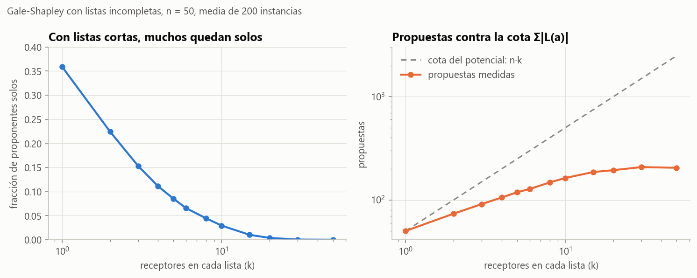

# Ejercicio 12 · Gale-Shapley con listas incompletas

> ★★★ Gale-Shapley con listas incompletas: cada proponente lista solo a algunos receptores, y prefiere quedarse solo antes que con uno que no listó. Adapta el algoritmo, su potencial y la definición de pareja bloqueante. ¿Sigue siendo estable el resultado? Demuéstralo. (C3)

## Respuesta

- **Pareja bloqueante, adaptada.** Un par $(a,b)$ que no está junto bloquea a $M$ si es **aceptable** y cada uno está **solo o prefiere al otro** a su pareja actual. Aceptable quiere decir que cada uno está en la lista del otro. En el enunciado, los receptores aceptan a todos. Los casos con "solo" son imprescindibles: sin ellos, el emparejamiento vacío sería "estable".
- **El algoritmo cambia en dos lugares.** El ciclo sigue mientras haya un proponente libre **al que le queden receptores en su lista**, y quien agota su lista queda solo. Un receptor rechaza a quien no está en su lista, cosa que en el enunciado nunca pasa.
- **Potencial.** $\Phi$ es la cantidad de propuestas pendientes, $\Phi = \sum_a \big(|L(a)| - \texttt{siguiente}[a]\big)$. Empieza en $m = \sum_a |L(a)|$, baja 1 por vuelta y nunca es negativo: a lo sumo $m$ propuestas.
- **Sí, el resultado sigue siendo estable**, para cualquier orden de ejecución (Teorema 2). Lo que se pierde es que sea **perfecto**: puede haber gente sola, y la sección 4 muestra el paso exacto donde se rompe la demostración de la C3.
- **Además** (Teoremas 3 y 4):
  - cada proponente recibe su mejor pareja válida, igual que en la C3, así que el resultado no depende del orden;
  - **todos** los emparejamientos estables dejan solas a exactamente las mismas personas.

  Todo está verificado contra la enumeración de todos los emparejamientos estables en 1500 instancias.

---

## 1. Definiciones adaptadas

Hay proponentes $a \in A$ y receptores $b \in B$, no necesariamente la misma cantidad. Cada proponente tiene una lista $L(a) \subseteq B$ ordenada de mejor a peor. Los receptores en $L(a)$ son los que $a$ prefiere antes que quedarse solo. Cada receptor tiene una lista $L(b) \subseteq A$. En el enunciado $L(b) = A$, pero el caso general no cuesta nada más.

- **Aceptable.** $(a, b)$ es aceptable si $b \in L(a)$ y $a \in L(b)$.
- **Emparejamiento.** Un conjunto $M$ de pares aceptables disjuntos. Quien no está en ningún par está **solo**, y escribimos $M(x) = \varnothing$.
- **Preferir a alguien sobre estar solo.** $a$ prefiere $b$ a $M(a)$ si $b \in L(a)$ y, o bien $M(a) = \varnothing$, o bien $b$ está antes que $M(a)$ en $L(a)$. Igual para $b$.
- **Pareja bloqueante.** $(a,b) \notin M$ aceptable, con $a$ prefiriendo $b$ a $M(a)$ y $b$ prefiriendo $a$ a $M(b)$.
- **Estable.** Un emparejamiento sin parejas bloqueantes.

Dos observaciones sobre la definición:

- Como $M$ solo tiene pares aceptables, nadie queda con alguien que prefiere menos que estar solo. Esa condición, llamada **racionalidad individual**, es la otra mitad de la estabilidad: si se permitiera emparejar a $a$ con un $b$ que no listó, $a$ "se bloquearía solo".
- Los casos con $\varnothing$ son los que hacen que la definición tenga contenido. Sin ellos, $M = \emptyset$ no tendría parejas bloqueantes. Con ellos, dos personas solas que se aceptan bloquean.

## 2. El algoritmo adaptado

```python
def gale_shapley(pref_a, pref_b):
    rango = [{a: lugar for lugar, a in enumerate(lista)} for lista in pref_b]
    siguiente = [0] * len(pref_a)
    pareja_de_b = [None] * len(pref_b)
    libres = deque(a for a in range(len(pref_a)) if pref_a[a])        # (1) solo si tienen lista
    while libres:
        a = libres.popleft()
        b = pref_a[a][siguiente[a]]
        siguiente[a] += 1
        actual = pareja_de_b[b]
        if a not in rango[b]:
            rechazado = a                                              # (2) b no acepta a a
        elif actual is None:
            pareja_de_b[b], rechazado = a, None
        elif rango[b][a] < rango[b][actual]:
            pareja_de_b[b], rechazado = a, actual
        else:
            rechazado = a
        if rechazado is not None and siguiente[rechazado] < len(pref_a[rechazado]):
            libres.append(rechazado)                                   # (1) si agotó su lista, queda solo
    ...
```

Los dos cambios respecto de la C3, §7, están marcados:

1. Un proponente libre vuelve a la cola solo si le quedan receptores en su lista. Así el ciclo sigue mientras haya un proponente libre **con propuestas pendientes**.
2. El receptor mira si el proponente está en su lista.

Como en la C3, el algoritmo es no determinista en qué proponente libre actúa, y todo lo que demostremos vale para cualquier elección. El código prueba cola, pila y dos órdenes al azar.

**Ejemplo.** Proponentes con listas incompletas y receptores con listas completas:

| proponente | su lista | | receptor | su lista |
|---|---|---|---|---|
| $a_0$ | $b_0 > b_1$ | | $b_0$ | $a_2 > a_1 > a_0 > a_3$ |
| $a_1$ | $b_0$ | | $b_1$ | $a_0 > a_2 > a_1 > a_3$ |
| $a_2$ | $b_1 > b_2 > b_0$ | | $b_2$ | $a_2 > a_3 > a_0 > a_1$ |
| $a_3$ | $b_2$ | | | |

| paso | propone | a | tenía | qué pasa |
|---|---|---|---|---|
| 1 | $a_0$ | $b_0$ | — | acepta |
| 2 | $a_1$ | $b_0$ | $a_0$ | cambia; $a_0$ queda libre |
| 3 | $a_2$ | $b_1$ | — | acepta |
| 4 | $a_3$ | $b_2$ | — | acepta |
| 5 | $a_0$ | $b_1$ | $a_2$ | cambia; $a_2$ queda libre |
| 6 | $a_2$ | $b_2$ | $a_3$ | cambia; $a_3$ queda libre **y agotó su lista** |

Resultado: $a_0$–$b_1$, $a_1$–$b_0$, $a_2$–$b_2$, con $a_3$ **solo**, en 6 propuestas. La enumeración de todos los emparejamientos dice que es el único estable de esta instancia. La versión "ingenua", que no cambia la condición del ciclo, revienta en el paso 7 con un `IndexError`: intenta que $a_3$ le proponga a un receptor que su lista no tiene.

## 3. Invariantes y potencial

Tres invariantes de una línea, como en la C3, que se demuestran leyendo el código:

- **(J1)** Un receptor que aceptó a alguien queda comprometido para siempre, y su pareja solo mejora en su lista.
- **(J2)** Cada proponente propone en el orden de su lista y nunca dos veces al mismo receptor, porque `siguiente[a]` solo avanza.
- **(J3)** Todo par comprometido es aceptable: $a$ solo propone a receptores de $L(a)$, y $b$ solo acepta a proponentes de $L(b)$.

**Teorema 1 (terminación, por potencial).** Sea $\Phi = \sum_a \big(|L(a)| - \texttt{siguiente}[a]\big)$, el número de pares $(a,b)$ con $b \in L(a)$ a los que $a$ todavía no les propuso.

- Al principio $\Phi = m = \sum_a |L(a)|$.
- Cada vuelta hace exactamente una propuesta nueva, por (J2), así que $\Phi$ baja exactamente 1.
- Un proponente solo está en la cola si `siguiente[a] < |L(a)|`, así que $\Phi \ge 0$ siempre.

Por lo tanto hay a lo sumo $m$ vueltas. Al terminar, la cola está vacía, y **cada proponente está comprometido o agotó su lista**. $\blacksquare$

El potencial es el de la C3 con una diferencia: allá empezaba en $n^2$ porque las listas eran completas, y acá empieza en el largo total de las listas. Si no se cambia la condición del ciclo, el potencial puede llegar a 0 con proponentes todavía en la cola, y la vuelta siguiente no tiene a quién proponer. Eso es el `IndexError` de la versión ingenua: **el potencial dice qué condición le falta al ciclo**.

## 4. Dónde se rompe "termina con un emparejamiento perfecto"

En la C3, §7, la demostración decía: "si un proponente $a$ está libre y ya le propuso a los $n$ receptores, los $n$ están comprometidos (J1) con $n$ proponentes distintos; pero $a$ está libre, así que solo hay $n-1$ comprometidos, contradicción". Con listas incompletas, $a$ solo les propuso a los de $L(a)$. Esos están comprometidos, pero **con otros**, y no hay contradicción: $a$ queda solo con todo derecho. Es lo que le pasa a $a_3$ en el ejemplo. Lo único que sobrevive es la afirmación del Teorema 1: cada uno está emparejado o agotó su lista.

## 5. Estabilidad

**Teorema 2.** Para cualquier orden de ejecución, el resultado $M$ es un emparejamiento estable.

*Demostración.* Por (J3), $M$ es un emparejamiento de pares aceptables. Supongamos que $(a,b) \notin M$ lo bloquea: $(a,b)$ es aceptable, $a$ prefiere $b$ a $M(a)$ y $b$ prefiere $a$ a $M(b)$.

**$a$ le propuso a $b$.** Hay dos casos:

- Si $a$ terminó solo, por el Teorema 1 agotó su lista, y $b \in L(a)$.
- Si $a$ terminó con $M(a)$, entonces $b$ está antes que $M(a)$ en $L(a)$, y por (J2) le propuso a $b$ antes que a $M(a)$.

**$b$ terminó con alguien que prefiere a $a$.** Cuando $a$ le propuso, $b$ no lo rechazó por no aceptarlo, porque $(a,b)$ es aceptable. Entonces:

- o lo aceptó y más tarde lo dejó por alguien que prefería;
- o lo rechazó en el momento porque tenía a alguien que prefería.

En los dos casos, desde ese momento $b$ estuvo comprometido con alguien que prefiere a $a$. Por (J1) terminó comprometido, así que no está solo, y con alguien al menos igual de bueno. Así que $b$ prefiere $M(b)$ a $a$, y $(a,b)$ no bloquea. Contradicción. $\blacksquare$

**Corolario.** Con listas incompletas sigue existiendo siempre un emparejamiento estable. El algoritmo vuelve a ser la demostración de existencia.

La demostración es la de la C3, §8, con un caso más ($a$ solo). Ese caso usa exactamente la nueva condición de terminación: quien queda solo, agotó su lista.

## 6. Optimalidad para los proponentes

Un receptor $b$ es **pareja válida** de $a$ si algún emparejamiento estable los junta. Si $a$ tiene parejas válidas, $\mathrm{mejor}(a)$ es la que está antes en $L(a)$.

**Teorema 3.** Para cualquier orden de ejecución, el algoritmo junta a cada proponente con $\mathrm{mejor}(a)$, y deja solos a los que no tienen ninguna pareja válida. En particular, el resultado no depende del orden.

*Demostración.* Primero un lema, por el **primer fallo** (C3, §9): ningún proponente es rechazado nunca por una pareja válida. Contamos como rechazo también que $b$ lo deje por otro.

Supongamos que no, y tomemos **el primer** rechazo de ese tipo en el tiempo: $b$ rechaza a $a$ por $a'$, que $b$ prefiere, y $b$ es pareja válida de $a$, así que hay un estable $M'$ con $(a,b) \in M'$. El rechazo no es por inaceptable, porque una pareja válida es aceptable. $a'$ le propuso a $b$, así que antes fue rechazado por todos los receptores que prefiere a $b$, y esos rechazos son anteriores al nuestro. Por minimalidad, ninguno de esos receptores es pareja válida de $a'$. Miremos a $a'$ en $M'$:

- **$a'$ está solo en $M'$.** $(a', b)$ es aceptable ($b$ aceptó a $a'$). $a'$ prefiere $b$ a estar solo, porque $b \in L(a')$, y $b$ prefiere $a'$ a $a = M'(b)$. Bloquea a $M'$. Contradicción.
- **$a'$ está con $b' \ne b$ en $M'$.** Entonces $b'$ es pareja válida de $a'$, así que no está entre los que $a'$ prefiere a $b$, y $a'$ prefiere $b$ a $b'$. Y $b$ prefiere $a'$ a $a$. $(a', b)$ bloquea a $M'$. Contradicción.

Ahora el teorema. Sea $M$ el resultado, que es estable por el Teorema 2.

- **Si $a$ no tiene parejas válidas**, no puede estar emparejado en $M$, porque su pareja sería válida.
- **Si las tiene**:
  - si $a$ terminó solo, agotó su lista y fue rechazado por $\mathrm{mejor}(a) \in L(a)$, lo que contradice el lema;
  - si terminó con $M(a)$, esa es una pareja válida, así que no es mejor que $\mathrm{mejor}(a)$;
  - si fuera peor, por (J2) $a$ habría pasado antes por $\mathrm{mejor}(a)$ y habría sido rechazado por ese receptor, otra vez contra el lema.

  Así que $M(a) = \mathrm{mejor}(a)$. $\blacksquare$

## 7. Más: los emparejamientos estables dejan sola a la misma gente

**Teorema 4 (de los "hospitales rurales").** Todos los emparejamientos estables de una instancia emparejan exactamente al mismo conjunto de proponentes y al mismo conjunto de receptores. En particular, todos tienen el mismo tamaño.

El resultado es de McVitie y Wilson (1970). El nombre viene de Roth (1986): un hospital rural que no consigue cubrir sus plazas en un emparejamiento estable no las cubre en ninguno. Lo demostramos con lo que ya tenemos.

*Demostración.* Sea $M_0$ el resultado de Gale-Shapley y $M$ un emparejamiento estable cualquiera.

1. **Proponentes.** Si $a$ está emparejado en $M$, tiene una pareja válida, y por el Teorema 3 está emparejado en $M_0$. Así que los proponentes emparejados en $M$ son un subconjunto de los emparejados en $M_0$.
2. **Receptores.** Si $b$ está emparejado en $M_0$, digamos con $a$, también lo está en $M$. Si no, $b$ estaría solo en $M$. Miremos a $a$ en $M$:
   - si $a$ está solo, $(a,b)$ es aceptable, los dos están solos, y bloquean $M$;
   - si $a$ está con $b' \ne b$, como $b = \mathrm{mejor}(a)$ y $b'$ es válida, $a$ prefiere $b$ a $b'$, y $b$ está solo: $(a, b)$ bloquea $M$.

   Las dos cosas son imposibles. Así que los receptores emparejados en $M_0$ son un subconjunto de los emparejados en $M$.
3. **Contar.** Cada emparejamiento tiene tantos proponentes emparejados como receptores emparejados, que es su tamaño. Por 1 y 2:

$$|M| \le |M_0| \le |M|.$$

Todas son igualdades, y una inclusión entre conjuntos finitos del mismo tamaño es una igualdad. $\blacksquare$

Para el ejercicio, esto dice algo fuerte sobre la pregunta "¿sigue siendo estable?". No solo el resultado es estable: **quién queda solo no depende de qué emparejamiento estable se elija**, ni de quién propone, ni del orden. Quedarse solo es una propiedad de la instancia.

## 8. Costo

Construir las tablas de rangos cuesta $O(\sum_b |L(b)|)$. Cada vuelta cuesta $O(1)$, y hay a lo sumo $m = \sum_a |L(a)|$ vueltas. En total:

$$O\Big(|A| + |B| + \sum_a |L(a)| + \sum_b |L(b)|\Big),$$

**lineal en el tamaño de la entrada**, como en la C3. En el caso del enunciado, con receptores completos, el término $\sum_b |L(b)| = |A|\cdot|B|$ domina.

**Medido** con $n = 50$ proponentes y receptores, cada proponente con $k$ receptores al azar en su lista, y media de 200 instancias:

| $k$ | fracción de proponentes solos | propuestas | cota $n k$ |
|---|---|---|---|
| 1 | 0,359 | 50,0 | 50 |
| 2 | 0,224 | 73,6 | 100 |
| 4 | 0,111 | 105,5 | 200 |
| 10 | 0,029 | 162,9 | 500 |
| 20 | 0,004 | 194,1 | 1000 |
| 50 | 0,000 | 204,8 | 2500 |

Con $k = 1$ el número de emparejados es la cantidad de receptores distintos elegidos, porque cada receptor elegido acepta a alguno. Así que la fracción esperada de solos es $(1-1/n)^n = 0{,}364 \approx 1/e$, y se midió 0,359. Con $k$ grande las propuestas quedan muy por debajo de la cota, como las $n \ln n$ de la C3, §8, contra $n^2$.



*Figura 1. A la izquierda, la fracción de proponentes que quedan solos según el largo de sus listas. A la derecha, las propuestas contra la cota del potencial.*

## 9. Dos errores, y qué pruebas los ven

| instancias generadas con | versión ingenua (no cambia el ciclo) | receptor que no mira su lista |
|---|---|---|
| receptores completos (el enunciado) | revienta en el 65,7 % | **0,0 %** de inestables |
| las dos listas incompletas | revienta en el 83,4 % | 57,8 % de inestables |

El segundo error es invisible en el caso del enunciado, porque con receptores completos todos los pares que un proponente lista son aceptables. Aparece en cuanto los receptores también tienen listas incompletas, y produce pares que $b$ no aceptaba, o sea emparejamientos que no son individualmente racionales. Otra vez, la hipótesis decide qué hay que probar. La prueba `test_receptor_que_no_mira_su_lista` comprueba los dos lados.

## 10. Verificación: código y pruebas

- [`codigo/ejercicio_12.py`](codigo/ejercicio_12.py) implementa el algoritmo adaptado (cola, pila o azar), las dos variantes con error, el verificador de parejas bloqueantes, la enumeración de **todos** los emparejamientos estables y los experimentos.
- [`codigo/test_ejercicio_12.py`](codigo/test_ejercicio_12.py) tiene 9 pruebas:

| prueba | qué comprueba |
|---|---|
| `test_estable_en_toda_estrategia` | Teorema 2 en 1500 instancias de hasta $8\times 8$, con cuatro órdenes |
| `test_potencial` | propuestas distintas, todas de la lista, a lo sumo $\sum_a \lvert L(a)\rvert$ |
| `test_al_terminar_cada_proponente_esta_emparejado_o_agoto_su_lista` | la nueva condición de terminación |
| `test_optimo_para_los_proponentes` | Teorema 3 contra la enumeración |
| `test_hospitales_rurales` | Teorema 4 contra la enumeración, y que siempre existe un estable |
| `test_ejemplo_del_informe` | el ejemplo y que es el único estable |
| `test_version_ingenua_revienta` | el `IndexError` y la versión correcta en el mismo caso |
| `test_receptor_que_no_mira_su_lista` | invisible con receptores completos, visible si no |
| `test_pares_bloqueantes_con_solos` | la definición adaptada: dos solos que se aceptan bloquean |

La tabla de verificación del script, con 1500 instancias de hasta $5\times 5$, comparadas con todos sus emparejamientos estables, da 1500 de 1500 en cada afirmación:

- el resultado es estable;
- es el mismo con cola, pila y dos órdenes al azar;
- cada proponente tiene su mejor pareja válida;
- todos los estables emparejan a las mismas personas;
- las propuestas no superan la cota.

```bash
cd codigo
python ejercicio_12.py --figuras
python -m pytest test_ejercicio_12.py
```

## 11. Resumen

- **Pareja bloqueante:** aceptable, y cada uno solo o prefiriendo al otro. Los emparejamientos solo tienen pares aceptables.
- **Algoritmo:** proponer mientras haya un libre **con propuestas pendientes**. El receptor rechaza a quien no listó. El potencial son las propuestas pendientes, $\le \sum_a |L(a)|$, y la versión que olvida cambiar el ciclo revienta.
- **Estable:** sí, para todo orden. Es la demostración de la C3 con un caso más, que usa que quien queda solo agotó su lista. Lo que se pierde es que sea perfecto.
- **Óptimo para los proponentes**, por el primer fallo. Y todos los estables dejan sola a la misma gente: quedarse solo no depende del algoritmo, depende de la instancia.
