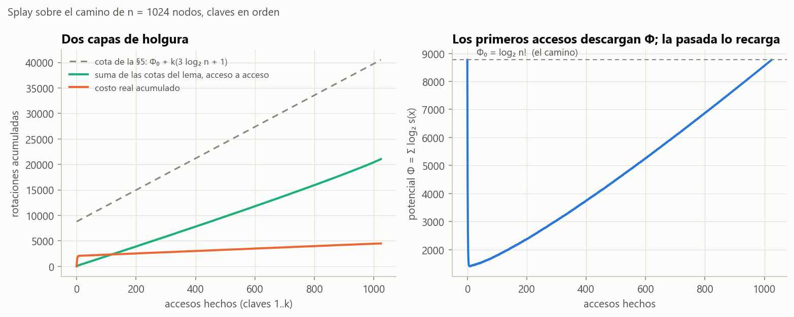
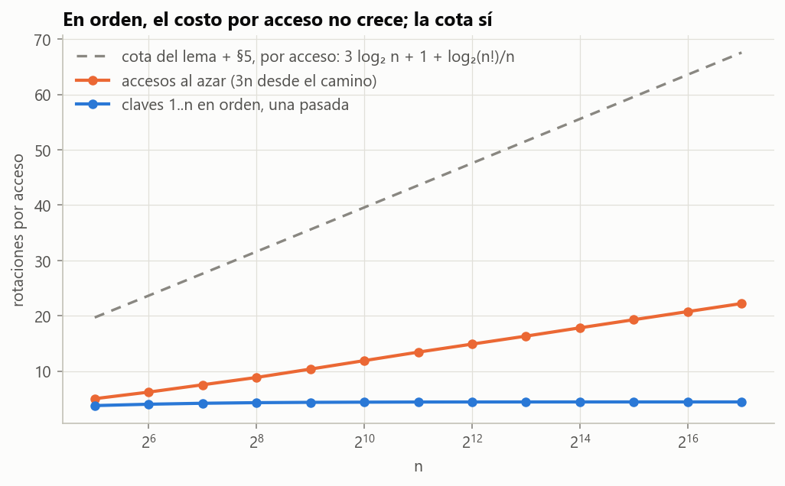

# Ejercicio 13 · Splay sobre un camino, accediendo en orden

> ★★ En un splay tree que empieza como un camino de $n$ nodos se accede a las claves $1, \dots, n$ en orden. Acota el costo total con el lema de acceso y la cuenta de la sección 5 de la conferencia 4, y compáralo con lo que mide la sección 6. ¿Es ajustada la cota? (C4)

## Respuesta

- **Cota del lema.** Sumando el lema de acceso y pagando aparte el potencial inicial del camino, $\Phi_0 = \log_2 n!$, el total es a lo sumo $n(3\log_2 n + 1) + \log_2 n! \le 4n\log_2 n + n$. Eso es $O(n\log n)$.
- **Lo que pasa de verdad.** Unas **4,4 rotaciones por acceso**: 4,16 con $n = 100$ y 4,41 con $n = 10^5$. Es $\Theta(n)$, y coincide con lo que mide la C4, §6 (4,2 a 4,4).
- **No, la cota no es ajustada.** Se pasa por un factor que crece como $\log n$: 6,3 veces con $n=100$ y 15 veces con $n = 10^5$. El costo real es lineal, por el **teorema del acceso secuencial** de Tarjan (1985).
- **Pero el lema no es flojo en general.** Con accesos al azar, el costo por acceso sí crece como $\log n$, y ningún árbol binario de búsqueda puede evitarlo. La holgura es de **esta** secuencia.
- **Además demostramos** que, después de la pasada, el árbol vuelve a ser **exactamente el camino de partida** (Teorema 2). De ahí salen dos cosas:
  - $\Phi_{\text{final}} = \Phi_0$, así que toda la holgura está en el lema de acceso y nada en el potencial;
  - cada ronda cuesta exactamente lo mismo, y por eso medir tres rondas, como la C4, da lo mismo que medir una.

---

## 1. El escenario

- **Árbol inicial.** El de la C4: $n$ en la raíz y cada clave hija izquierda de la siguiente, o sea un camino de profundidad $n-1$ con el 1 al fondo.
- **Secuencia.** Se busca la clave 1 y se hace splay, después la 2, y así hasta la $n$.
- **Costo.** Rotaciones, o 1 si la clave ya es la raíz, igual que en la C4, §6.
- **Potencial.** $\Phi = \sum_x \log_2 s(x)$, donde $s(x)$ es el tamaño del subárbol de $x$. El rango es $r(x) = \log_2 s(x)$.

## 2. La cota con el lema de acceso y la cuenta de la sección 5

**Lema de acceso** (C4, §5). El costo amortizado de hacer splay de $x$ en un árbol de raíz $t$ es a lo sumo $3(r(t) - r(x)) + 1$.

Sumando sobre los $n$ accesos y telescopiando el potencial:

```math
\sum_{i=1}^{n} c_i \;=\; \sum_{i=1}^{n}\hat c_i - (\Phi_n - \Phi_0) \;\le\; \sum_{i=1}^{n}\Big(3\big(\log_2 n - r(x_i)\big) + 1\Big) + \Phi_0 - \Phi_n.
```

La cuenta de la §5 usa tres simplificaciones:

- $r(x_i) \ge 0$, porque todo subárbol tiene al menos un nodo;
- $\Phi_n \ge 0$, porque todo rango es $\ge 0$;
- $\Phi_0 = \sum_{k=1}^n \log_2 k = \log_2 n!$, porque en el camino los subárboles tienen tamaños $1, 2, \dots, n$.

Con eso,

```math
\sum_{i=1}^n c_i \;\le\; n\,(3\log_2 n + 1) + \log_2 n! \;\le\; 4n\log_2 n + n.
```

El término $\log_2 n!$ es la deuda del camino: el árbol empieza con potencial alto y los primeros accesos la cobran. La C4 dice que en este caso "la condición $\Phi_m \ge \Phi_0$ no se cumple, y la demostración lo resuelve pagando $\Phi_0$ aparte". Eso es lo que hicimos.

## 3. Lo que mide la sección 6, y por qué tres rondas dan lo mismo que una

La C4, §6 midió, con tres rondas completas $1..n$, 4,2, 4,2, 4,3 y 4,4 rotaciones por acceso para $n = 100, 200, 400, 800$. Nuestras mediciones:

| $n$ | una ronda | tres rondas | solo las rondas 2 y 3 | subir a la raíz, tres rondas |
|---|---|---|---|---|
| 100 | 4,16 | 4,16 | 4,16 | 50,5 |
| 200 | 4,20 | 4,20 | 4,20 | 100,5 |
| 400 | 4,33 | 4,33 | 4,33 | 200,5 |
| 800 | 4,36 | 4,36 | 4,36 | 400,5 |

Las tres columnas de splay son **idénticas**, y no es casualidad.

**Teorema 2 (la pasada rehace el camino).** Después de acceder a la clave $k$, para $k = 1, \dots, n$:

**$(\mathrm{I}_k)$** la raíz es $k$, su subárbol izquierdo es el camino $k-1 \to k-2 \to \dots \to 1$, donde cada nodo tiene solo hijo izquierdo, y su subárbol derecho $R_k$ tiene las claves $k+1, \dots, n$.

En particular, después de acceder a $n$ el árbol es **exactamente el camino inicial**.

*Demostración.* Por inducción sobre $k$.

**Base.** Después de acceder a 1, la raíz es 1. Como 1 es la mínima, su subárbol izquierdo es vacío, que es el camino de $0$ nodos.

**Paso.** Supongamos $(\mathrm{I}_k)$ con $k < n$. La clave $k+1$ es la mínima de $R_k$. El camino desde la raíz baja una vez a la derecha, a la raíz $r_0$ de $R_k$, y desde ahí siempre a la izquierda hasta $k+1$, que no tiene hijo izquierdo.

- **Mientras $k+1$, su padre y su abuelo están dentro de $R_k$**, los pasos del splay son zig-zig hacia la izquierda. Solo tocan nodos de $R_k$, así que la raíz $k$ y su camino izquierdo no cambian. Además, en un zig-zig $x$ conserva su subárbol izquierdo (el $A$ de la Figura 2 de la C4), que acá es vacío. Y $x$ ocupa el lugar del antiguo abuelo: un hijo izquierdo, salvo que el abuelo fuera $r_0$.
- **El último paso involucra a la raíz $k$**, y hay dos formas:
  - **Zig:** $k+1$ es hijo derecho de $k$. La rotación deja a $k$ como hijo izquierdo de $k+1$. El hijo derecho de $k$ pasa a ser el subárbol izquierdo de $k+1$, que es vacío, y su izquierdo sigue siendo el camino.
  - **Zig-zag:** $k+1$ es hijo izquierdo de $p$ y $p$ es hijo derecho de $k$. Las dos rotaciones dejan a $k+1$ en la raíz, con $k$ a su izquierda y $p$ a su derecha. El hijo derecho de $k$ pasa a ser el antiguo subárbol izquierdo de $k+1$, que es vacío.

  No puede ser zig-zig, porque $k+1$ y $p$ tendrían que estar del mismo lado.

En los dos casos, el subárbol izquierdo de la nueva raíz $k+1$ es $k \to k-1 \to \dots \to 1$, todos sin hijo derecho, y eso es $(\mathrm{I}_{k+1})$. Con $k = n$, $R_n$ es vacío y el árbol es el camino $n \to n-1 \to \dots \to 1$. $\blacksquare$

**Corolarios.**

1. $\Phi_n = \Phi_0 = \log_2 n!$. El término $\Phi_0 - \Phi_n$ de la sección 2 vale **0**, y el costo real total es igual al amortizado total.
2. Cada ronda empieza desde el mismo árbol, así que cuesta exactamente lo mismo. Por eso medir tres rondas, como la C4, §6, da lo mismo que medir una.

La prueba `test_invariante_de_la_pasada` vigila $(\mathrm{I}_k)$ después de cada acceso para varios $n$, y `test_las_rondas_son_identicas` compara las rondas una por una.

## 4. ¿Es ajustada la cota?

**No.** Una sola pasada, comparada con la cota de la sección 2:

| $n$ | costo real | real $/\ n$ | cota $n(3\log_2 n+1) + \log_2 n!$ | cota $/$ real | primer acceso |
|---|---|---|---|---|---|
| 100 | 416 | 4,160 | 2 618 | 6,3 | 99 |
| 1 000 | 4 374 | 4,374 | 39 427 | 9,0 | 999 |
| 10 000 | 44 112 | 4,411 | 527 090 | 11,9 | 9 999 |
| 100 000 | 441 426 | 4,414 | 6 599 596 | 14,9 | 99 999 |

El costo real por acceso se estabiliza cerca de 4,41, mientras la cota por acceso crece como $4\log_2 n$. El cociente crece como $\log n$: la cota es un factor logarítmico más grande que la verdad.

**Lo que es cierto.** El costo es $\Theta(n)$.

- **Cota inferior.** El primer acceso solo ya cuesta $n - 1$, y cada uno de los demás al menos 1, así que el total es al menos $2n - 2$.
- **Cota superior.** Tarjan demostró en 1985 el **teorema del acceso secuencial**: recorrer en orden todas las claves de un splay tree cuesta $O(n)$, desde **cualquier** árbol inicial. Lo citamos sin demostrarlo, como la C4 hace con la cota de Tarjan para union-find.

Las mediciones dan $\approx 4\text{,}41\ n$ y se ve de dónde sale. Los primeros accesos cuestan $n-1,\ n/2,\ n/4,\ n/8, \dots$, porque cada splay deja el fondo del árbol a la mitad de profundidad, como explica la C4, §6. Con $n = 2^{14}$ son 16383, 8192, 4097, 2048, 1027, 513, …, y los primeros 14 suman 32 790, casi exactamente $2n$. El resto de la pasada cuesta unas 2,4 rotaciones por acceso.

**Dónde está la holgura.** Medimos el potencial en cada acceso:

| $n$ | $\sum$ real | $\sum$ amortizado real | $\sum$ cotas del lema | $\Phi_0$ | $\Phi_{\text{final}}$ | cota de la §5 |
|---|---|---|---|---|---|---|
| 100 | 416 | 416 | 1 442 | 525 | 525 | 2 618 |
| 400 | 1 732 | 1 732 | 7 211 | 2 886 | 2 886 | 13 659 |
| 1600 | 7 024 | 7 024 | 34 835 | 14 729 | 14 729 | 67 419 |

Como $\Phi_{\text{final}} = \Phi_0$ (Teorema 2), el amortizado total es igual al real total. Así que la holgura entera es del lema, en dos capas:

1. **El lema mismo.** La suma de las cotas $3(r(t) - r(x_i)) + 1$, con el rango real de cada $x_i$, ya es 3,5 a 5 veces el costo real. Cada acceso a $k+1$ es al mínimo de $R_k$, que tiene un subárbol chico, y el lema le cobra casi $3\log_2 n$. Pero el costo real de esos accesos es bajo, salvo los primeros, cuyo costo alto paga la caída de $\Phi$.
2. **La cuenta de la §5.** Reemplaza $r(x_i)$ por 0, lo que agrega $3\sum_i r(x_i)$, y suma $\Phi_0$ aparte.



**Figura 1.** Izquierda: el costo real acumulado (naranja) sube unos $2n$ en los primeros diez accesos ($n - 1$ el primero, después $n/2$, $n/4$, …) y luego crece despacio; la suma de las cotas del lema (verde) y la cota de la §5 (gris) quedan muy por encima al final. Derecha: los primeros accesos descargan el potencial del camino. El primero lo parte a la mitad (de 8769 a 4397 con $n = 1024$), desde el cuarto queda por debajo de la quinta parte de $\log_2 n!$, y en el octavo toca su mínimo, el 16 %. Después la pasada lo vuelve a cargar linealmente hasta el mismo valor. Por eso real y amortizado coinciden al final.

**El lema no es flojo en general.** Con accesos uniformes al azar desde el mismo camino, el costo por acceso sí crece como $\log n$:

| $n$ | rotaciones por acceso ($3n$ accesos al azar) | $\log_2 n$ |
|---|---|---|
| 100 | 7,27 | 6,64 |
| 1 000 | 11,85 | 9,97 |
| 10 000 | 16,76 | 13,29 |
| 100 000 | 21,63 | 16,61 |

Y ningún árbol binario de búsqueda puede hacerlo mejor en ese caso. Un árbol binario con $n$ nodos tiene a lo sumo $2^d$ nodos a profundidad $d$, así que la profundidad promedio de sus nodos es al menos la de un árbol completo, unos $\log_2 n - 2$. Una clave elegida al azar, independiente del árbol, tiene esa profundidad esperada, y bajar hasta ella cuesta eso. Así que el $O(\log n)$ del lema es del orden correcto para secuencias generales. Lo que lo hace flojo aquí es la estructura de la secuencia.



**Figura 2.** Rotaciones por acceso. En orden (azul) es plano en $\approx 4\text{,}4$. Al azar (naranja) crece como $\log n$. La cota del lema más la §5 (gris) crece como $4\log_2 n$.

**Comparación con subir a la raíz.** La C4, §6 midió $n/2$ rotaciones por acceso para subir a la raíz, que es $\Theta(n^2)$ en total (ejercicio 4 de la C4). Ahí ni siquiera vale el lema, porque su demostración necesita que el zig-zig rote primero el padre. Splay está a un factor $\log n$ de su cota y subir a la raíz a un factor $n$ del splay.

## 5. Verificación: código y pruebas

- [`codigo/ejercicio_13.py`](codigo/ejercicio_13.py) implementa el splay tree de la C4 (rotar, splay, subir a la raíz), el camino inicial, el potencial sin recursión, la descomposición acceso por acceso, los experimentos y las figuras.
- [`codigo/test_ejercicio_13.py`](codigo/test_ejercicio_13.py) tiene 8 pruebas:

| prueba | qué comprueba |
|---|---|
| `test_splay_preserva_el_arbol_de_busqueda` | orden, punteros a padre y tamaño después de cada acceso al azar |
| `test_invariante_de_la_pasada` | $(\mathrm{I}_k)$ después de cada acceso, y que se vuelve al camino |
| `test_las_rondas_son_identicas` | corolario 2: las tres rondas cuestan exactamente lo mismo |
| `test_lema_de_acceso_vigilado` | el lema en cada acceso, $\Phi_{\text{final}} = \Phi_0$ y real $\le$ cota |
| `test_potencial_del_camino` | $\Phi_0 = \log_2 n!$ |
| `test_costo_lineal_y_cota_no_ajustada` | entre 4 y 4,5 por acceso; cota/real crece con $\log n$ |
| `test_los_primeros_accesos_se_parten_a_la_mitad` | $n - 1, n/2, n/4, \dots$ |
| `test_al_azar_crece_como_log_n` | con accesos al azar el costo por acceso crece |

```bash
cd codigo
python ejercicio_13.py --figuras
python -m pytest test_ejercicio_13.py
```

## 6. Resumen

- **Cota:** lema de acceso más la cuenta de la §5 da $n(3\log_2 n + 1) + \log_2 n! = O(n\log n)$.
- **Medido:** unas 4,41 rotaciones por acceso, $\Theta(n)$ en total, igual que la C4, §6. La verdad la da el teorema del acceso secuencial de Tarjan.
- **No es ajustada:** se pasa por un factor que crece como $\log n$. Como el árbol vuelve exactamente al camino (Teorema 2), $\Phi_{\text{final}} = \Phi_0$ y toda la holgura es del lema de acceso, no del potencial.
- **El lema no es flojo en general:** con accesos al azar el costo por acceso sí es $\Theta(\log n)$, y ningún árbol de búsqueda puede evitarlo. Lo que el lema no ve es la estructura de esta secuencia.
