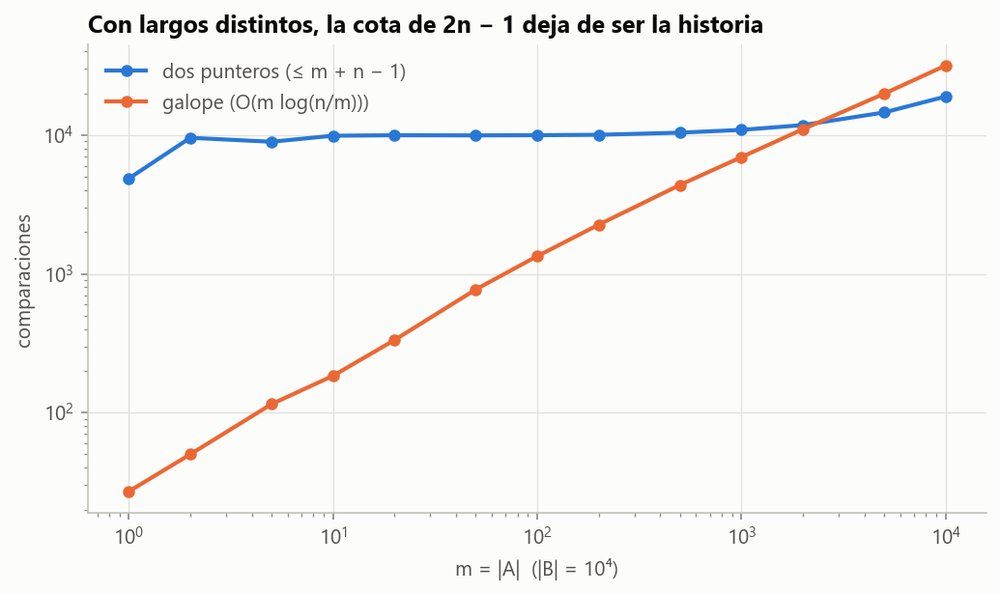

# Ejercicio 14 · El ciclo completo: intersección de dos listas ordenadas

> ★★★ Escoge un problema que no hayamos visto, recorre el ciclo completo de la conferencia 2 sobre él y consigue que el algoritmo y la cota mínima coincidan. Es el formato de la pregunta larga del examen final. (C2 a C5)

## Respuesta

**El problema elegido.** Dadas dos listas ordenadas de $n$ elementos distintos, calcular su intersección, o decidir si tienen algún elemento en común. Es lo que hace un motor de búsqueda con la consulta "*palabra1* AND *palabra2*": cada palabra tiene la lista ordenada de los documentos que la contienen, y la respuesta es la intersección.

| pregunta (C2, §1) | respuesta |
|---|---|
| ¿cuál es el problema? | $A \cap B$ con $A$, $B$ estrictamente crecientes de largo $n$; modelo: comparaciones de tres salidas entre un elemento de $A$ y uno de $B$ |
| ¿qué algoritmo? | dos punteros: comparar las cabezas y avanzar la menor, o las dos si son iguales |
| ¿es correcto? | invariante: "los comunes están o los dos ya procesados (y en la salida) o los dos sin procesar"; potencial: elementos sin procesar |
| ¿cuánto cuesta? | a lo sumo $2n - 1$ comparaciones, y exactamente $2n - 1$ en el intercalado perfecto; memoria $O(1)$ |
| ¿se puede mejor? | **no**: el adversario fuerza $2n - 1$ comparaciones, incluso para la versión de decisión |

**La coincidencia es exacta**, no solo asintótica: $2n - 1$ contra $2n - 1$. Antes de demostrarlo lo **medimos**: una búsqueda exhaustiva del mejor árbol de decisión posible da $1, 3, 5, 7$ para $n = 1, 2, 3, 4$.

**Además:**

- La información no alcanza: da solo $\approx 1{,}26\ n$, y hace falta el adversario, como en la C5.
- Los dos punteros son la búsqueda en escalera del ejercicio 6 sobre la matriz $A[i] - B[j]$, y el adversario es el intercalado del ejercicio 9.
- Fuera del modelo la historia cambia: con listas desordenadas y hashing se puede hacer en $O(n)$ esperado, y con largos muy distintos gana la búsqueda exponencial.

---

## 1. ¿Cuál es el problema?

**Entrada.** Dos listas $A[0..n)$ y $B[0..n)$, cada una **estrictamente creciente**, o sea conjuntos ordenados.

**Salida.** La lista ordenada de los elementos que están en las dos. La **versión de decisión** solo pregunta si $A \cap B \ne \emptyset$.

**Precisiones**, como pide la C2, §2:

- **Listas vacías.** La intersección es vacía.
- **Repetidos dentro de una lista.** No hay, porque son conjuntos. Con multiconjuntos la salida tendría que decir cuántas veces, y es otro problema.
- **Largos distintos.** La parte principal es para $|A| = |B| = n$. La sección 7 trata $m \ne n$, donde la respuesta cambia.

**Modelo.** Comparaciones de tres salidas ($<$, $=$, $>$) entre un elemento de $A$ y uno de $B$. Las comparaciones dentro de una misma lista no aportan nada, porque ya están ordenadas. El costo es la cantidad de comparaciones.

## 2. ¿Qué algoritmo lo resuelve?

**Cómo se le ocurre a uno.**

- La fuerza bruta compara todos los pares: $n^2$ comparaciones.
- Buscar cada elemento de $A$ en $B$ con búsqueda binaria cuesta $n\lceil\log_2(n+1)\rceil$.
- Pero las dos listas están ordenadas, igual que en la mezcla: si $A[i] < B[j]$, entonces $A[i]$ es menor que todo lo que queda de $B$ y no puede estar en $B$. Se descarta y se avanza.

```python
def interseccion(A, B):
    R, i, j = [], 0, 0
    while i < len(A) and j < len(B):
        if A[i] == B[j]:              # una comparación de tres salidas
            R.append(A[i]); i += 1; j += 1
        elif A[i] < B[j]:
            i += 1                     # A[i] < todo B[j:]: no está en B
        else:
            j += 1                     # B[j] < todo A[i:]: no está en A
    return R
```

La versión de decisión es la misma, devolviendo `True` en la primera igualdad.

## 3. ¿Es correcto?

**Invariante (I).** Al empezar cada vuelta:

1. $R$ tiene, en orden, los elementos comunes de $A[0..i)$ y $B[0..j)$;
2. $A[0..i) \cap B[j..n) = \emptyset$;
3. $A[i..n) \cap B[0..j) = \emptyset$.

En palabras: cada elemento común está o con sus dos copias ya procesadas (y entonces en $R$), o con las dos sin procesar.

*Demostración.*

**Inicialización.** Con $i = j = 0$, los tres enunciados hablan de conjuntos vacíos.

**Mantenimiento.** Hay un caso por resultado de la comparación.

- **$A[i] < B[j]$.** $A[i]$ no está en $B[j..n)$, porque todo eso es $\ge B[j] > A[i]$. Tampoco está en $B[0..j)$, por (3). Así que $A[i]$ no es común. Pasarlo a la parte procesada no cambia $R$, mantiene (2) porque $A[i] \notin B$, y (3) solo pierde un elemento.
- **$A[i] > B[j]$.** Simétrico.
- **$A[i] = B[j]$.** Es común. Por (2) y (3), ninguna de sus dos copias estaba emparejada con algo procesado. Al agregarlo a $R$ y avanzar los dos punteros vale (1). Vale (2), porque $A[i] = B[j] < B[j+1..n)$ y los demás de $A[0..i)$ ya cumplían. (3) vale por simetría.

**Conclusión.** Al salir, $i = n$ o $j = n$, así que $A[i..n) \cap B[j..n) = \emptyset$ porque uno de los dos es vacío. Partiendo $A \cap B$ según si cada copia está procesada o no,

```math
A \cap B = \underbrace{\big(A[0..i) \cap B[0..j)\big)}_{R \text{ por (1)}} \cup \underbrace{\big(A[0..i) \cap B[j..)\big)}_{\emptyset \text{ por (2)}} \cup \underbrace{\big(A[i..) \cap B[0..j)\big)}_{\emptyset \text{ por (3)}} \cup \underbrace{\big(A[i..) \cap B[j..)\big)}_{\emptyset},
```

así que $R = A \cap B$, y está en orden porque se agregó en orden creciente. $\blacksquare$

**Terminación.** El potencial $\Phi = (n - i) + (n - j)$ es la cantidad de elementos sin procesar. Es un entero $\ge 0$, y cada vuelta lo baja en 1 o en 2. $\blacksquare$

El código vigila (I) al empezar cada vuelta en 1000 entradas al azar (`test_invariante_vigilado`).

## 4. ¿Cuánto cuesta?

**Teorema 1.** Los dos punteros hacen a lo sumo $2n - 1$ comparaciones, y hay entradas donde hacen exactamente $2n - 1$. La memoria extra es $O(1)$, sin contar la salida.

*Demostración.* Cada comparación baja $\Phi$ en al menos 1. El ciclo solo sigue mientras $i < n$ y $j < n$, o sea mientras $\Phi \ge 2$, con al menos un elemento sin procesar en cada lista. $\Phi$ empieza en $2n$, así que hay a lo sumo $2n - 1$ comparaciones. En el **intercalado perfecto** $a_1 < b_1 < a_2 < b_2 < \dots < a_n < b_n$, cada comparación avanza un solo puntero, y se hacen exactamente $2n - 1$ antes de que $A$ se acabe. $\blacksquare$

**Experimentar antes de demostrar** (C2, §7; resumen del tema, §3). ¿Se puede hacer mejor que $2n - 1$? Antes de intentar una demostración lo calculamos. Para la versión de decisión, lo único que importa de una entrada es el **orden relativo** entre los elementos de $A$ y los de $B$, incluidos los empates. Ese orden es una sucesión de pasos $a$, $b$ o $=$, con $n$ de cada lista. El código enumera todos esos órdenes y calcula por búsqueda exhaustiva la profundidad del mejor árbol de decisión que decide si hay un paso $=$:

| $n$ | órdenes relativos posibles | óptimo exacto | $2n - 1$ |
|---|---|---|---|
| 1 | 3 | 1 | 1 |
| 2 | 13 | 3 | 3 |
| 3 | 63 | 5 | 5 |
| 4 | 321 | 7 | 7 |

Las cantidades de órdenes, 3, 13, 63, 321, son los **números de Delannoy centrales**, que cuentan caminos en una cuadrícula con pasos a la derecha, abajo o en diagonal. El experimento sugiere que el algoritmo es óptimo exacto. Falta demostrarlo para todo $n$.

## 5. ¿Se puede hacer mejor?

### 5.1 La información no alcanza

La versión de decisión tiene **dos** salidas, así que la información da una comparación. La intersección completa tiene tantas salidas como formas de elegir qué elementos de $A$ coinciden con cuáles de $B$: $\sum_k \binom{n}{k}^2 = \binom{2n}{n}$. Con comparaciones de tres salidas eso da $\lceil\log_3\binom{2n}{n}\rceil \approx 1{,}26\ n$:

| $n$ | información $\lceil\log_3\binom{2n}{n}\rceil$ | adversario $2n - 1$ | para comparar: información de la mezcla, $\lceil\log_2\binom{2n}{n}\rceil$ |
|---|---|---|---|
| 5 | 6 | 9 | 8 |
| 10 | 12 | 19 | 18 |
| 100 | 124 | 199 | 196 |
| 1000 | 1259 | 1999 | 1995 |

Como en la C5, §4, la información cuenta salidas, pero aquí el trabajo está en **verificar** que no hay más coincidencias que las encontradas. Hace falta un adversario.

### 5.2 El adversario

**Teorema 2.** Todo algoritmo de comparaciones que decide si dos listas ordenadas de largo $n$ tienen un elemento en común hace, en el peor caso, al menos $2n - 1$ comparaciones. Lo mismo vale para calcular la intersección, que permite decidir.

*Demostración.* Sea $I$ el intercalado perfecto $a_1 < b_1 < a_2 < \dots < a_n < b_n$, con intersección vacía. Su cadena tiene $2n-1$ pares de vecinos, cada uno con un elemento de cada lista.

**Las $2n - 1$ variantes.** Para cada par de vecinos $(u, v)$, con $u < v$, sea $I_{uv}$ la entrada que se obtiene bajando $v$ al valor de $u$:

- Las dos listas siguen estrictamente crecientes, porque entre $u$ y $v$ no había ningún elemento.
- $I_{uv}$ tiene a $u = v$ en común.
- Ninguna otra comparación entre $A$ y $B$ cambia de respuesta. Si $w \ne u$, $w$ estaba o por debajo de $u$ o por encima de $v$, y sigue igual respecto del nuevo $v$.

El código lo comprueba para cada par y $n < 25$.

**El argumento.** El adversario contesta según $I$. Si el algoritmo termina sin haber comparado algún par de vecinos $(u, v)$, todas sus respuestas son también las de $I_{uv}$. Así que da la misma salida para $I$ (sin comunes) y para $I_{uv}$ (con uno común), y se equivoca en una. Por lo tanto, sobre $I$ tiene que comparar los $2n - 1$ pares de vecinos, cada uno por separado: $2n - 1$ comparaciones. $\blacksquare$

Este conjunto de $2n$ entradas que ningún algoritmo rápido puede distinguir es un **conjunto engañoso**, el mismo recurso de la C5, §6 para la mezcla. Es la misma entrada, $I$, usada para otro problema.

### 5.3 Conclusión del ciclo

Por los Teoremas 1 y 2, los dos punteros son **óptimos exactos**: $2n - 1$ comparaciones en el peor caso, tanto para decidir como para calcular la intersección. El experimento de la sección 4 lo había anticipado para $n \le 4$, y la demostración lo extiende a todo $n$.

## 6. Lo que une este problema con el resto del tema

**Es la búsqueda en escalera del ejercicio 6.** La matriz $D[i][j] = A[i] - B[j]$ crece al bajar y decrece hacia la derecha. Invirtiendo las columnas es una matriz ordenada, y decidir si $A \cap B \ne \emptyset$ es buscar un $0$ en ella. Los dos punteros recorren esa matriz exactamente como la búsqueda en escalera.

![Dos punteros sobre la matriz A[i] − B[j]](figuras/ejercicio-14-matriz.png)

**Figura 1.** La matriz $A[i] - B[j]$ para un ejemplo con $n = 7$. Los recuadros azules son las 11 comparaciones de los dos punteros: cada una descarta una fila o una columna, o las dos cuando encuentra un 0. Los ceros son la intersección $\lbrace 9, 17\rbrace$.

Pero la cota del ejercicio 6 no se transfiere sola. Allá el adversario elegía matrices ordenadas cualesquiera, y las de la forma $A[i] - B[j]$ son una subclase muy particular: están determinadas por $2n$ números, no por $n^2$. El Teorema 2 demuestra que la cota $2n - 1$ sigue valiendo dentro de esa subclase. Comparamos además los **patrones de signos** posibles en los dos problemas. Con las columnas invertidas, todo patrón de $A[i] - B[j]$ es un patrón válido del ejercicio 6: no decrece hacia la derecha ni hacia abajo, y no tiene dos ceros vecinos, porque las listas son estrictamente crecientes. Lo contrario no es obvio, porque una matriz ordenada tiene $n^2$ entradas libres y la de diferencias solo $2n$. Pero para $n \le 3$ los dos conjuntos tienen el mismo tamaño (3, 13 y 63 patrones), así que son **el mismo conjunto**, y los dos juegos de decisión coinciden. La prueba `test_mismos_patrones_que_el_ejercicio_6` compara los conjuntos uno contra otro.

**Es el adversario de la mezcla.** El intercalado perfecto es la entrada de la C5, §6, y la misma que hizo fallar a la mezcla "optimizada" del ejercicio 9. Allá cada par de vecinos sin comparar se podía **intercambiar**. Acá se puede **igualar**. En los dos casos, cambiar un par de vecinos no toca ninguna otra comparación.

**¿Un problema nuevo, o la mezcla disfrazada?** La entrada difícil y la forma del adversario son las de la C5, §6, así que la pregunta es justa. Hay tres diferencias de fondo:

- **La cota de la mezcla no se transfiere.** Un algoritmo de intersección no tiene que producir el orden de $A \cup B$, así que la cota de la mezcla no se le aplica. Hizo falta un argumento propio, el Teorema 2. Que sobre el intercalado perfecto termine comparando todos los vecinos, y por lo tanto conociendo el orden completo, es una consecuencia de ese teorema, no una hipótesis.
- **Cada adversario solo sirve para su problema.** Para la mezcla, igualar un par de vecinos no sirve: con $u = v$ las dos formas de ordenarlos son correctas, y no hay contradicción. Para la intersección, intercambiarlos no sirve: la intersección sigue vacía y la respuesta no cambia.
- **La información se porta distinto.** En la mezcla, con valores distintos, hay $\binom{2n}{n}$ salidas en un árbol binario, y la información da $\lceil\log_2\binom{2n}{n}\rceil \approx 2n - \tfrac12\log_2(\pi n)$: 1995 contra 1999 con $n = 1000$ (última columna de la tabla de la sección 5.1). Casi alcanza al adversario. En la intersección la información da solo $\approx 1{,}26\ n$, y todo el resto lo pone el adversario.

## 7. Qué escondía el modelo

La cota es una afirmación sobre un modelo (C2, §10; C5, §9). Fuera de sus hipótesis cambia.

**Listas desordenadas.** Ordenar y aplicar los dos punteros cuesta $O(n\log n)$. En árboles de decisión algebraicos no se puede mejor: la disjunción de conjuntos requiere $\Omega(n\log n)$ (Ben-Or, 1983, el mismo teorema que la C2, §8 usa para distinción de elementos). Pero con una **tabla hash** se meten los elementos de $A$ y se busca cada uno de $B$, en $O(n)$ esperado. Igual que la rejilla de la C2, §9 y el conteo de la C5, §9, usa los valores como direcciones, que es lo que el modelo no tiene.

**Largos distintos, $|A| = m \le n = |B|$.** Los dos punteros cuestan hasta $m + n - 1$. El adversario del intercalado solo puede alternar $2m$ veces, así que solo fuerza unas $2m$ comparaciones. Cuando $m \ll n$, la cota y el algoritmo se separan, y gana otro algoritmo: por cada elemento de $A$, **búsqueda exponencial** (galope) en $B$ desde la última posición, que hace del orden de $m\log(n/m)$ comparaciones. Medido con $n = 10^4$:

| $m = \lvert A\rvert$ | dos punteros | galope | $m\log_2(n/m)$ |
|---|---|---|---|
| 1 | 9 708 | 27 | 13 |
| 10 | 9 981 | 215 | 100 |
| 100 | 10 085 | 1 370 | 664 |
| 1 000 | 10 909 | 7 080 | 3 322 |
| 10 000 | 19 074 | 31 861 | — |



**Figura 2.** Comparaciones según el largo de la lista corta. Con $m \ll n$ el galope gana por órdenes de magnitud. Con $m = n$ los dos punteros ganan, y son óptimos exactos.

La coincidencia exacta del Teorema 2 es entonces para listas del **mismo largo**, que es el problema que enunciamos. Para $m \ll n$ el orden correcto es otro, $m \log(n/m)$, y demostrar su cota mínima queda fuera de este ejercicio. Es la misma lección del caso típico y la garantía: la respuesta depende de qué parte del espacio de entradas importa.

## 8. Verificación: código y pruebas

- [`codigo/ejercicio_14.py`](codigo/ejercicio_14.py) implementa la intersección por dos punteros (con invariante vigilado), la versión de decisión, el galope, el intercalado perfecto con sus $2n - 1$ variantes, la enumeración de órdenes relativos, el óptimo exacto por búsqueda exhaustiva, las tablas y las figuras.
- [`codigo/test_ejercicio_14.py`](codigo/test_ejercicio_14.py) tiene 11 pruebas:

| prueba | qué comprueba |
|---|---|
| `test_correctos_contra_el_oraculo` | dos punteros, galope (en los dos órdenes) y decisión, 5000 entradas |
| `test_casos_borde` | vacías, iguales, de un elemento |
| `test_invariante_vigilado` | (I) en cada vuelta |
| `test_a_lo_sumo_2n_menos_1` | Teorema 1, cota superior |
| `test_intercalado_perfecto_usa_2n_menos_1` | Teorema 1, se alcanza (y la versión de decisión también) |
| `test_variantes_del_adversario` | cada $I_{uv}$ ordenada, con un común, y solo cambia su par |
| `test_quien_no_compara_un_par_no_distingue` | el corazón del Teorema 2 |
| `test_patrones_son_delannoy` | 3, 13, 63, 321, 1683 órdenes relativos |
| `test_mismos_patrones_que_el_ejercicio_6` | para $n \le 3$, los patrones de $A[i] - B[j]$ son exactamente los del ejercicio 6 |
| `test_optimo_exacto_por_fuerza_bruta` | óptimo $= 2n - 1$ para $n \le 3$ (el script llega a $n = 4$) |
| `test_galope_gana_con_listas_desparejas` | con $m = 10$ y $n = 10^4$, el galope usa menos de la décima parte |

```bash
cd codigo
python ejercicio_14.py --figuras
python -m pytest test_ejercicio_14.py
```

## 9. Resumen

- **Problema:** intersección (o disjunción) de dos listas ordenadas de largo $n$, en el modelo de comparaciones entre las listas.
- **Algoritmo:** dos punteros. **Correctitud:** invariante "los comunes están o los dos procesados o los dos sin procesar" y potencial "elementos sin procesar".
- **Costo:** $\le 2n-1$ comparaciones, alcanzado en el intercalado perfecto. La fuerza bruta sobre todos los órdenes relativos confirma que es lo óptimo para $n \le 4$.
- **Cota mínima:** el intercalado y sus $2n-1$ variantes, cada una con un par de vecinos igualado, obligan a comparar cada par: **$2n-1$, coincidencia exacta**. La información solo daba $\approx 1{,}26n$.
- **El tema junto:** son la escalera del ejercicio 6 y el adversario de la mezcla. Fuera del modelo (hashing, listas desordenadas, largos muy distintos) la respuesta cambia, como toda cota.
